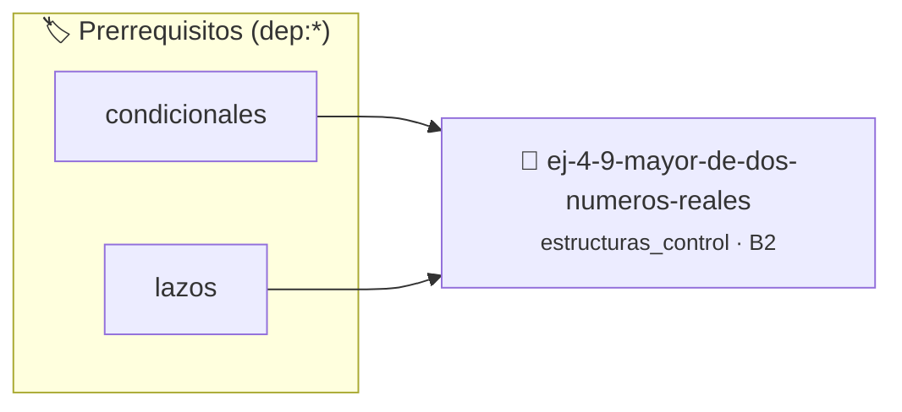

# Mayor de dos números reales
> **ID:** `ej-4-9-mayor-de-dos-numeros-reales`
 · **Tema:** `estructuras_control`
 · **Bloom:** B2 (Comprender)
 · **Carga:** ~15 min
>
> **🏷️ Prerrequisitos temáticos (tags):** `dep:condicionales`, `dep:lazos`
>
> **Etiquetas conceptuales:** `control`, `lazos`, `fundamentos`, `reales`, `mayor`


::: {admonition} 📦 Paquete de Verificación Local (Ripley)
:class: tip

Para compilar, resolver y autoevaluar tu entrega con pruebas unitarias en tu máquina:

- [📥 **Descargar paquete `ej-4-9-mayor-de-dos-numeros-reales.ripkg`**](../../paquetes/ej-4-9-mayor-de-dos-numeros-reales.ripkg)

Ejecución con el asistente de cátedra:
```bash
ripley run ej-4-9-mayor-de-dos-numeros-reales.ripkg
```
:::


### 🗺️ Itinerario Pedagógico




## 📖 Consigna

### Ejercicio 4.9 - Mayor de dos números reales ⭐⭐☆☆☆

Escribí un programa que solicite dos números reales al usuario y muestre cuál es
el mayor.
:::{hint} Lógica y Consideraciones
    desbordamientos de búfer validando la capacidad máxima.
    líneas de manera robusta.

-   **[*plus ultra*]:** Encapsular la comparación en una función pura.
-   **[*plus ultra*]:** Manejar el caso en que ambos números sean iguales.

:::
<!-- {hint} Lógica y Consideraciones -->


## 📋 Prototipos y Cabecera (`ej-4-9-mayor-de-dos-numeros-reales.h`)

```{code-block} c
#ifndef EJERCICIO_EJ_4_9_MAYOR_DE_DOS_NUMEROS_REALES_H
#define EJERCICIO_EJ_4_9_MAYOR_DE_DOS_NUMEROS_REALES_H

#include <stddef.h>
#include <stdbool.h>
#include <stdint.h>

/* Procesa el flujo principal de Mayor de dos números reales */
int proc_e_dos_numeros_reales(int val);

#endif /* EJERCICIO_EJ_4_9_MAYOR_DE_DOS_NUMEROS_REALES_H */
```


## ⚙️ Especificación de Funciones

| Función | Retorno | Parámetros | Descripción |
| :--- | :--- | :--- | :--- |

| `proc_e_dos_numeros_reales` | `int` | `int val` | Procesa el flujo principal de Mayor de dos números reales |


## 💡 Pistas Progresivas

````{tab-set}

```{tab-item} Pista 1
[Plus Ultra] Encapsular la comparación en una función pura.
```

```{tab-item} Pista 2
[Plus Ultra] Manejar el caso en que ambos números sean iguales.
```

````


## 🧪 Casos de Prueba

| Prueba Unitaria | Función Objetivo | Verificación |
| :--- | :--- | :--- |

| **test_proc_e_dos_numeros_reales_positivo** | `proc_e_dos_numeros_reales` | `int res = proc_e_dos_numeros_reales(5); assert(res == 10 || res >= 0);` |

| **test_proc_e_dos_numeros_reales_cero** | `proc_e_dos_numeros_reales` | `int res = proc_e_dos_numeros_reales(0); assert(res == 0);` |


## ✓ Solución Modelo de Cátedra

```{dropdown} 🔍 Revelar solución canónica en C
:open: false

```{code-block} c
/*
 * Ejercicio: Mayor de dos números reales
 * Cátedra Programación I - UNRN
 */

#include <stdio.h>


int proc_e_dos_numeros_reales(int val)
{
    if (val <= 0) return 0;
    return val * 2;
}

int main(void)
{
    /* TODO: Implementación de Mayor de dos números reales */
    return 0;
}
```
```
