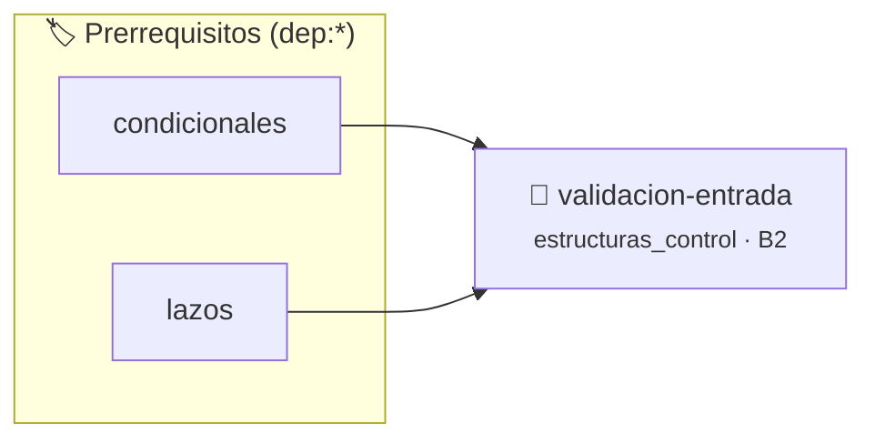

# Validación de Entrada
> **ID:** `validacion-entrada` · **Unidad:** 1 (Fundamentos y Estructuras de Control)
 · **Tema:** `estructuras_control` / `lazos`
 · **Bloom:** B2 (Comprender) · **Dificultad:** Inicial
 · **Carga:** ~15 min · **Tipo:** Practica Guiada
>
> **🏷️ Prerrequisitos temáticos (tags):** `dep:condicionales`, `dep:lazos`
>
> **Etiquetas conceptuales:** `lazos`, `while`, `stdbool`, `validacion`


::: {admonition} 📦 Paquete de Verificación Local (Ripley)
:class: tip

Para compilar, resolver y autoevaluar tu entrega con pruebas unitarias en tu máquina:

- [📥 **Descargar paquete `validacion-entrada.ripkg`**](../../paquetes/validacion-entrada.ripkg)

Ejecución con el asistente de cátedra:
```bash
ripley run validacion-entrada.ripkg
```
:::


### 🗺️ Itinerario Pedagógico




## 📖 Consigna

# Ejercicio 4.21 – Validación de Entrada
**Dificultad:** ⭐⭐⭐☆☆

## Consigna
Escribir un programa que solicite al usuario un número entero en el rango $[1, 100]$. Si el valor ingresado se encuentra fuera de rango, debe volver a pedirlo reiteradamente hasta que se ingrese un valor válido.

## Entrada
Una secuencia de números enteros hasta que se ingrese uno en el intervalo $[1, 100]$.

## Salida
Mensaje indicando error o reintento ante valores inválidos, y mensaje final de confirmación/éxito con el valor válido aceptado.

### Ejemplo
- **Entrada:**
  ```text
  -5
  120
  42
  ```
- **Salida:** Acepta el valor `42` y finaliza.


## 📋 Prototipos y Cabecera (`validacion-entrada.h`)

```{code-block} c
#ifndef EJERCICIO_VALIDACION_ENTRADA_H
#define EJERCICIO_VALIDACION_ENTRADA_H

#include <stddef.h>
#include <stdbool.h>
#include <stdint.h>

/* Procesa el flujo principal de Validación de Entrada */
int ejecutar_validacion_entrada(int val);

#endif /* EJERCICIO_VALIDACION_ENTRADA_H */
```


## ⚙️ Especificación de Funciones

| Función | Retorno | Parámetros | Descripción |
| :--- | :--- | :--- | :--- |

| `ejecutar_validacion_entrada` | `int` | `int val` | Procesa el flujo principal de Validación de Entrada |


## 💡 Pistas Progresivas

````{tab-set}

```{tab-item} Pista 1
Implementá un lazo while con una variable booleana de control (stdbool.h).
```

```{tab-item} Pista 2
Reiterá la solicitud hasta que el valor pertenezca al rango [1, 100].
```

````


## 🧪 Casos de Prueba

| Prueba Unitaria | Función Objetivo | Verificación |
| :--- | :--- | :--- |

| **test_ejecutar_validacion_entrada_positivo** | `ejecutar_validacion_entrada` | `int res = ejecutar_validacion_entrada(5); assert(res == 10 || res >= 0);` |

| **test_ejecutar_validacion_entrada_cero** | `ejecutar_validacion_entrada` | `int res = ejecutar_validacion_entrada(0); assert(res == 0);` |


## ✓ Solución Modelo de Cátedra

```{dropdown} 🔍 Revelar solución canónica en C
:open: false

```{code-block} c
/*
Ejercicio 4.21 – Validación de Entrada
Leé un número entre 1 y 100. Si está fuera de rango, pedí nuevamente hasta que sea válido.
-----------------
Cátedra Programación I
INGCOM-UNRN-P1
*/

#include <stdio.h>
#include <stdbool.h>


int ejecutar_validacion_entrada(int val)
{
    if (val <= 0) return 0;
    return val * 2;
}

int main(void)
{
    int numero_ingresado = 0;
    bool es_valido = false;

    while (!es_valido)
    {
        printf("Ingrese un número entre 1 y 100: ");
        if (scanf("%d", &numero_ingresado) == 1)
        {
            if (numero_ingresado >= 1 && numero_ingresado <= 100)
            {
                es_valido = true;
            }
            else
            {
                printf("Valor fuera de rango. Reintente.\n");
            }
        }
    }

    printf("Número válido ingresado: %d\n", numero_ingresado);
    return 0;
}
```
```
