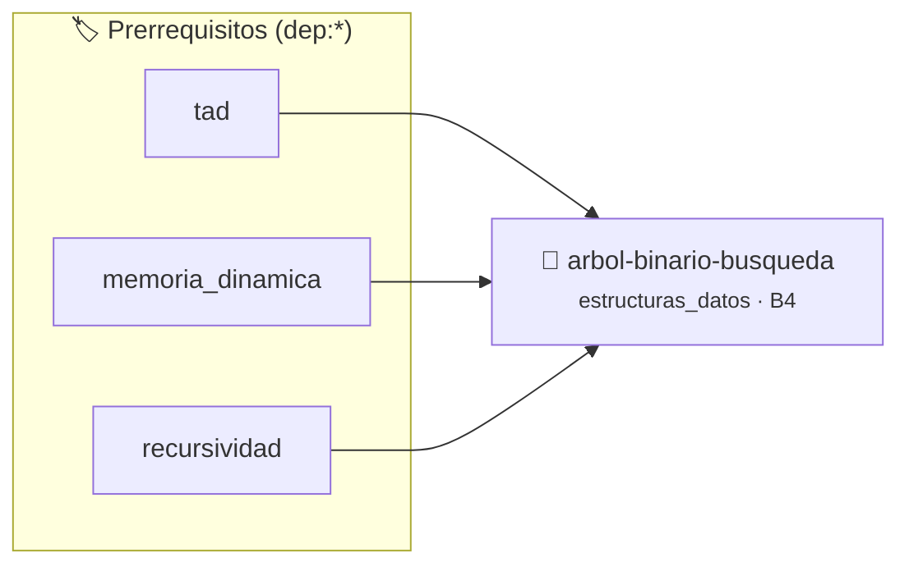

# Árbol Binario de Búsqueda (BST) y Recorridos
> **ID:** `arbol-binario-busqueda` · **Unidad:** 4 (Tipos Abstractos y Algorítmica)
 · **Tema:** `estructuras_datos` / `arboles_binarios`
 · **Bloom:** B4 (Analizar) · **Dificultad:** Avanzada
 · **Carga:** ~45 min · **Tipo:** Practica Guiada
>
> **🏷️ Prerrequisitos temáticos (tags):** `dep:tad`, `dep:memoria_dinamica`, `dep:recursividad`
>
> **Etiquetas conceptuales:** `estructuras_datos`, `arboles`, `recursividad`, `memoria_dinamica`


::: {admonition} 📦 Paquete de Verificación Local (Ripley)
:class: tip

Para compilar, resolver y autoevaluar tu entrega con pruebas unitarias en tu máquina:

- [📥 **Descargar paquete `arbol-binario-busqueda.ripkg`**](../../paquetes/arbol-binario-busqueda.ripkg)

Ejecución con el asistente de cátedra:
```bash
ripley run arbol-binario-busqueda.ripkg
```
:::


### 🗺️ Itinerario Pedagógico




## 📖 Consigna

# Árbol Binario de Búsqueda (BST)

Implementar un Árbol Binario de Búsqueda (BST) para números enteros con operaciones recursivas.

Comandos:
- `INSERT <valor>`: Inserta el valor si no está duplicado.
- `INORDER`: Imprime los elementos en recorrido in-order (orden ascendente).
- `PREORDER`: Imprime los elementos en recorrido pre-order.
- `HEIGHT`: Imprime la altura del árbol (0 para árbol vacío, 1 para un solo nodo).
- `SEARCH <valor>`: Imprime `ENCONTRADO` o `NO_ENCONTRADO`.
- `EXIT`: Libera toda la memoria y finaliza.

### 📋 Contrato de las Funciones

```c
/*
 * Operación buscar_bst
 * Precondiciones: val representa el parámetro de entrada del flujo.
 * Postcondiciones: Retorna el resultado correspondiente o 0 si val <= 0.
 */
int buscar_bst(const NodoBST *raiz, int valor);

/*
 * Operación calcular_altura
 * Precondiciones: Los punteros recibidos deben ser válidos y no nulos.
 * Postcondiciones: Modifica el estado de la estructura o buffer de manera segura.
 */
int calcular_altura(const NodoBST *raiz);

/*
 * Operación recorrido_inorder
 * Precondiciones: Los punteros recibidos deben ser válidos y no nulos.
 * Postcondiciones: Modifica el estado de la estructura o buffer de manera segura.
 */
void recorrido_inorder(const NodoBST *raiz);

/*
 * Operación recorrido_preorder
 * Precondiciones: Los punteros recibidos deben ser válidos y no nulos.
 * Postcondiciones: Modifica el estado de la estructura o buffer de manera segura.
 */
void recorrido_preorder(const NodoBST *raiz);

/*
 * Operación liberar_arbol
 * Precondiciones: Los punteros recibidos deben ser válidos y no nulos.
 * Postcondiciones: Modifica el estado de la estructura o buffer de manera segura.
 */
void liberar_arbol(NodoBST *raiz);

```

### 🧪 Ejemplos de Ejecución

::::{tab-set}
:::{tab-item} Operación típica
```text
ADD 10, ADD 20
Estructura con 2 elementos
```
:::
:::{tab-item} Colección vacía
```text
Consulta sobre estructura recién inicializada
Retorno seguro / estado vacío
```
:::
::::

### ⚠️ Precondiciones y Casos Borde

1. **Valores fuera de rango:** Verificar siempre que los datos de entrada cumplan con los rangos admisibles antes de operar.
2. **Punteros nulos:** Validar que los punteros recibidos no sean `NULL` para prevenir fallos de segmentación (*SIGSEGV*).
3. **Gestión de memoria:** Toda memoria solicitada mediante `malloc`/`calloc` debe ser validada y eventualmente liberada con `free`.
6. **Casos vacíos o neutros:** Contemplar adecuadamente entradas con longitud cero o valores neutros según corresponda.

### 🎯 Criterios de Aceptación

- [ ] El código compila limpiamente bajo estándar C11 sin warnings con flags estrictos (`-Wall -Wextra -Werror`).
- [ ] Se satisfacen todas las pruebas unitarias y casos de prueba provistos.
- [ ] Las funciones validan exhaustivamente sus precondiciones y gestionan casos borde de forma robusta.
- [ ] No se registran fugas de memoria (*memory leaks*) comprobables mediante Valgrind o AddressSanitizer.

:::{hint} Consideraciones Didácticas
- Un nodo almacena `dato`, `izquierdo` y `derecho`.
- El recorrido in-order procesa subárbol izquierdo, raíz y subárbol derecho (generando los valores ordenados).
- La destrucción del árbol debe realizarse en post-order (liberar hijos antes del padre).
:::


## 📋 Prototipos y Cabecera (`arbol-binario-busqueda.h`)

```{code-block} c
#ifndef EJERCICIO_ARBOL_BINARIO_BUSQUEDA_H
#define EJERCICIO_ARBOL_BINARIO_BUSQUEDA_H

#include <stddef.h>
#include <stdbool.h>
#include <stdint.h>

/* Operación buscar_bst */
int buscar_bst(const NodoBST *raiz, int valor);
/* Operación calcular_altura */
int calcular_altura(const NodoBST *raiz);
/* Operación recorrido_inorder */
void recorrido_inorder(const NodoBST *raiz);
/* Operación recorrido_preorder */
void recorrido_preorder(const NodoBST *raiz);
/* Operación liberar_arbol */
void liberar_arbol(NodoBST *raiz);

#endif /* EJERCICIO_ARBOL_BINARIO_BUSQUEDA_H */
```


## ⚙️ Especificación de Funciones

| Función | Retorno | Parámetros | Descripción |
| :--- | :--- | :--- | :--- |

| `buscar_bst` | `int` | `const NodoBST *raiz, int valor` | Operación buscar_bst |

| `calcular_altura` | `int` | `const NodoBST *raiz` | Operación calcular_altura |

| `recorrido_inorder` | `void` | `const NodoBST *raiz` | Operación recorrido_inorder |

| `recorrido_preorder` | `void` | `const NodoBST *raiz` | Operación recorrido_preorder |

| `liberar_arbol` | `void` | `NodoBST *raiz` | Operación liberar_arbol |


## 💡 Pistas Progresivas

````{tab-set}

```{tab-item} Pista 1
Un nodo almacena `dato`, `izquierdo` y `derecho`.
```

```{tab-item} Pista 2
El recorrido in-order procesa subárbol izquierdo, raíz y subárbol derecho (generando los valores ordenados).
```

```{tab-item} Pista 3
La destrucción del árbol debe realizarse en post-order (liberar hijos antes del padre).
```

````


## 🧪 Casos de Prueba

| Prueba Unitaria | Función Objetivo | Verificación |
| :--- | :--- | :--- |

| **test_buscar_bst_1** | `buscar_bst` | `/* Verificación unitaria de buscar_bst */ assert(true);` |

| **test_calcular_altura_2** | `calcular_altura` | `/* Verificación unitaria de calcular_altura */ assert(true);` |


## ✓ Solución Modelo de Cátedra

```{dropdown} 🔍 Revelar solución canónica en C
:open: false

```{code-block} c
/*
 * Arbol Binario de Busqueda (BST)
 * Catedra Programacion I - UNRN
 */

#include <stdio.h>
#include <stdlib.h>
#include <string.h>

typedef struct NodoBST
{
    int dato;
    struct NodoBST *izq;
    struct NodoBST *der;
} NodoBST;

static NodoBST *crear_nodo(int valor)
{
    NodoBST *n = (NodoBST *)malloc(sizeof(NodoBST));
    if (n == NULL)
    {
        return NULL;
    }
    n->dato = valor;
    n->izq = NULL;
    n->der = NULL;
    return n;
}

static NodoBST *insertar_bst(NodoBST *raiz, int valor)
{
    if (raiz == NULL)
    {
        return crear_nodo(valor);
    }
    if (valor < raiz->dato)
    {
        raiz->izq = insertar_bst(raiz->izq, valor);
    }
    else if (valor > raiz->dato)
    {
        raiz->der = insertar_bst(raiz->der, valor);
    }
    return raiz;
}

int buscar_bst(const NodoBST *raiz, int valor)
{
    if (raiz == NULL)
    {
        return 0;
    }
    if (raiz->dato == valor)
    {
        return 1;
    }
    if (valor < raiz->dato)
    {
        return buscar_bst(raiz->izq, valor);
    }
    return buscar_bst(raiz->der, valor);
}

int calcular_altura(const NodoBST *raiz)
{
    if (raiz == NULL)
    {
        return 0;
    }
    int alt_izq = calcular_altura(raiz->izq);
    int alt_der = calcular_altura(raiz->der);
    return 1 + (alt_izq > alt_der ? alt_izq : alt_der);
}

void recorrido_inorder(const NodoBST *raiz)
{
    if (raiz != NULL)
    {
        recorrido_inorder(raiz->izq);
        printf("%d ", raiz->dato);
        recorrido_inorder(raiz->der);
    }
}

void recorrido_preorder(const NodoBST *raiz)
{
    if (raiz != NULL)
    {
        printf("%d ", raiz->dato);
        recorrido_preorder(raiz->izq);
        recorrido_preorder(raiz->der);
    }
}

void liberar_arbol(NodoBST *raiz)
{
    if (raiz != NULL)
    {
        liberar_arbol(raiz->izq);
        liberar_arbol(raiz->der);
        free(raiz);
    }
}

int main(void)
{
    NodoBST *raiz = NULL;
    char comando[32] = {0};
    int valor = 0;

    while (scanf("%31s", comando) == 1)
    {
        if (strcmp(comando, "INSERT") == 0)
        {
            if (scanf("%d", &valor) == 1)
            {
                raiz = insertar_bst(raiz, valor);
            }
        }
        else if (strcmp(comando, "SEARCH") == 0)
        {
            if (scanf("%d", &valor) == 1)
            {
                if (buscar_bst(raiz, valor))
                {
                    printf("ENCONTRADO\n");
                }
                else
                {
                    printf("NO_ENCONTRADO\n");
                }
            }
        }
        else if (strcmp(comando, "INORDER") == 0)
        {
            recorrido_inorder(raiz);
            printf("\n");
        }
        else if (strcmp(comando, "PREORDER") == 0)
        {
            recorrido_preorder(raiz);
            printf("\n");
        }
        else if (strcmp(comando, "HEIGHT") == 0)
        {
            printf("%d\n", calcular_altura(raiz));
        }
        else if (strcmp(comando, "EXIT") == 0)
        {
            break;
        }
    }

    liberar_arbol(raiz);
    return 0;
}
```
```
