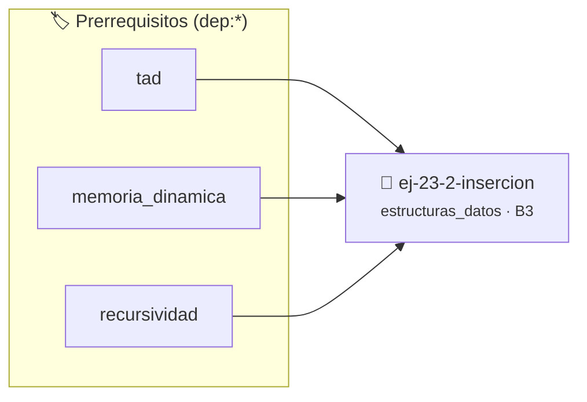

# Inserción
> **ID:** `ej-23-2-insercion`
 · **Tema:** `estructuras_datos`
 · **Bloom:** B3 (Aplicar)
 · **Carga:** ~25 min
>
> **🏷️ Prerrequisitos temáticos (tags):** `dep:tad`, `dep:memoria_dinamica`, `dep:recursividad`
>
> **Etiquetas conceptuales:** `listas`, `algoritmos`, `nodos`, `insercion`


::: {admonition} 📦 Paquete de Verificación Local (Ripley)
:class: tip

Para compilar, resolver y autoevaluar tu entrega con pruebas unitarias en tu máquina:

- [📥 **Descargar paquete `ej-23-2-insercion.ripkg`**](../../paquetes/ej-23-2-insercion.ripkg)

Ejecución con el asistente de cátedra:
```bash
ripley run ej-23-2-insercion.ripkg
```
:::


### 🗺️ Itinerario Pedagógico




## 📖 Consigna

### Ejercicio 23.2 - Inserción ⭐⭐☆☆☆

- **`void insertar_al_principio(nodo_t **cabeza, int dato)`**: Crea un nuevo
  nodo y lo convierte en la nueva cabeza de la lista. Requiere un puntero doble
  para modificar el puntero `cabeza` original.
- **`void insertar_al_final(nodo_t *cabeza, int dato)`**: Recorre la lista hasta
  el último nodo y enlaza el nuevo nodo al final.
:::{hint} Lógica y Consideraciones

-   **[*plus ultra*]:** Validar punteros `NULL` recibidos como parámetro para
    evitar fallos de segmentación.
-   **[*plus ultra*]:** Implementar una versión utilizando aritmética de
    punteros en lugar de indexación directa.

:::
<!-- {hint} Lógica y Consideraciones -->


## 📋 Prototipos y Cabecera (`ej-23-2-insercion.h`)

```{code-block} c
#ifndef EJERCICIO_EJ_23_2_INSERCION_H
#define EJERCICIO_EJ_23_2_INSERCION_H

#include <stddef.h>
#include <stdbool.h>
#include <stdint.h>

/* Procesa el flujo principal de Inserción */
int ejecutar_ej_23_2_insercion(int val);

#endif /* EJERCICIO_EJ_23_2_INSERCION_H */
```


## ⚙️ Especificación de Funciones

| Función | Retorno | Parámetros | Descripción |
| :--- | :--- | :--- | :--- |

| `ejecutar_ej_23_2_insercion` | `int` | `int val` | Procesa el flujo principal de Inserción |


## 💡 Pistas Progresivas

````{tab-set}

```{tab-item} Pista 1
[Plus Ultra] Validar punteros `NULL` recibidos como parámetro para evitar fallos de segmentación.
```

```{tab-item} Pista 2
[Plus Ultra] Implementar una versión utilizando aritmética de punteros en lugar de indexación directa.
```

````


## 🧪 Casos de Prueba

| Prueba Unitaria | Función Objetivo | Verificación |
| :--- | :--- | :--- |

| **test_ejecutar_ej_23_2_insercion_positivo** | `ejecutar_ej_23_2_insercion` | `int res = ejecutar_ej_23_2_insercion(5); assert(res == 10 || res >= 0);` |

| **test_ejecutar_ej_23_2_insercion_cero** | `ejecutar_ej_23_2_insercion` | `int res = ejecutar_ej_23_2_insercion(0); assert(res == 0);` |


## ✓ Solución Modelo de Cátedra

```{dropdown} 🔍 Revelar solución canónica en C
:open: false

```{code-block} c
/*
 * Ejercicio: Inserción
 * Cátedra Programación I - UNRN
 */

#include <stdio.h>


int ejecutar_ej_23_2_insercion(int val)
{
    if (val <= 0) return 0;
    return val * 2;
}

int main(void)
{
    /* TODO: Implementación de Inserción */
    return 0;
}
```
```
