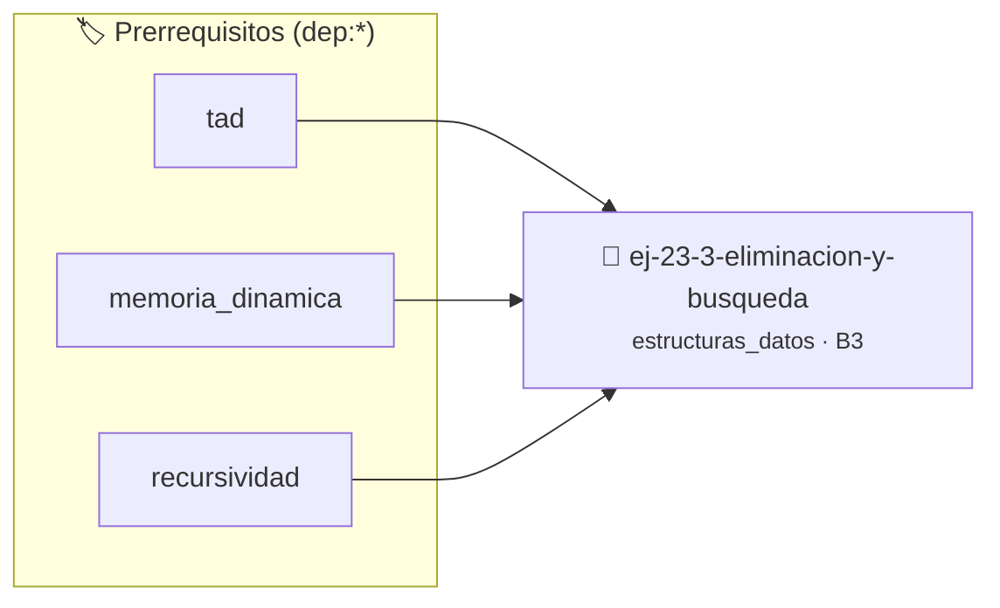

# Eliminación y Búsqueda
> **ID:** `ej-23-3-eliminacion-y-busqueda` · **Unidad:** 4 (Tipos Abstractos y Algorítmica)
 · **Tema:** `estructuras_datos` / `listas_enlazadas`
 · **Bloom:** B3 (Aplicar) · **Dificultad:** Intermedia
 · **Carga:** ~25 min · **Tipo:** Practica Guiada
>
> **🏷️ Prerrequisitos temáticos (tags):** `dep:tad`, `dep:memoria_dinamica`, `dep:recursividad`
>
> **Etiquetas conceptuales:** `listas`, `nodos`, `busqueda`, `eliminacion`, `algoritmos`


::: {admonition} 📦 Paquete de Verificación Local (Ripley)
:class: tip

Para compilar, resolver y autoevaluar tu entrega con pruebas unitarias en tu máquina:

- [📥 **Descargar paquete `ej-23-3-eliminacion-y-busqueda.ripkg`**](../../paquetes/ej-23-3-eliminacion-y-busqueda.ripkg)

Ejecución con el asistente de cátedra:
```bash
ripley run ej-23-3-eliminacion-y-busqueda.ripkg
```
:::


### 🗺️ Itinerario Pedagógico




## 📖 Consigna

### Ejercicio 23.3 - Eliminación y Búsqueda ⭐⭐☆☆☆

- **`nodo_t* buscar_nodo(nodo_t *cabeza, int dato)`**: Recorre la lista y
  devuelve un puntero al primer nodo que contenga el dato, o `NULL` si no se
  encuentra.
- **`void eliminar_por_valor(nodo_t **cabeza, int dato)`**: Busca un nodo con el
  dato especificado y lo elimina de la lista, re-enlazando el nodo anterior con
  el siguiente.


:::{hint} Lógica y Consideraciones

-   **[*plus ultra*]:** Validar punteros `NULL` recibidos como parámetro para
    evitar fallos de segmentación.
-   **[*plus ultra*]:** Implementar una versión utilizando aritmética de
    punteros en lugar de indexación directa.

:::
<!-- {hint} Lógica y Consideraciones -->

---

## Pila (Stack) - LIFO

Una pila sigue el principio LIFO (Last-In, First-Out). Se puede implementar
eficientemente usando una lista enlazada como estructura subyacente.


## 📋 Prototipos y Cabecera (`ej-23-3-eliminacion-y-busqueda.h`)

```{code-block} c
#ifndef EJERCICIO_EJ_23_3_ELIMINACION_Y_BUSQUEDA_H
#define EJERCICIO_EJ_23_3_ELIMINACION_Y_BUSQUEDA_H

#include <stddef.h>
#include <stdbool.h>
#include <stdint.h>

/* Procesa el flujo principal de Eliminación y Búsqueda */
int proc_iminacion_y_busqueda(int val);

#endif /* EJERCICIO_EJ_23_3_ELIMINACION_Y_BUSQUEDA_H */
```


## ⚙️ Especificación de Funciones

| Función | Retorno | Parámetros | Descripción |
| :--- | :--- | :--- | :--- |

| `proc_iminacion_y_busqueda` | `int` | `int val` | Procesa el flujo principal de Eliminación y Búsqueda |


## 💡 Pistas Progresivas

````{tab-set}

```{tab-item} Pista 1
[Plus Ultra] Validar punteros `NULL` recibidos como parámetro para evitar fallos de segmentación.
```

```{tab-item} Pista 2
[Plus Ultra] Implementar una versión utilizando aritmética de punteros en lugar de indexación directa.
```

````


## 🧪 Casos de Prueba

| Prueba Unitaria | Función Objetivo | Verificación |
| :--- | :--- | :--- |

| **test_proc_iminacion_y_busqueda_positivo** | `proc_iminacion_y_busqueda` | `int res = proc_iminacion_y_busqueda(5); assert(res == 10 || res >= 0);` |

| **test_proc_iminacion_y_busqueda_cero** | `proc_iminacion_y_busqueda` | `int res = proc_iminacion_y_busqueda(0); assert(res == 0);` |


## ✓ Solución Modelo de Cátedra

```{dropdown} 🔍 Revelar solución canónica en C
:open: false

```{code-block} c
/*
 * Ejercicio: Eliminación y Búsqueda
 * Cátedra Programación I - UNRN
 */

#include <stdio.h>


int proc_iminacion_y_busqueda(int val)
{
    if (val <= 0) return 0;
    return val * 2;
}

int main(void)
{
    /* TODO: Implementación de Eliminación y Búsqueda */
    return 0;
}
```
```
