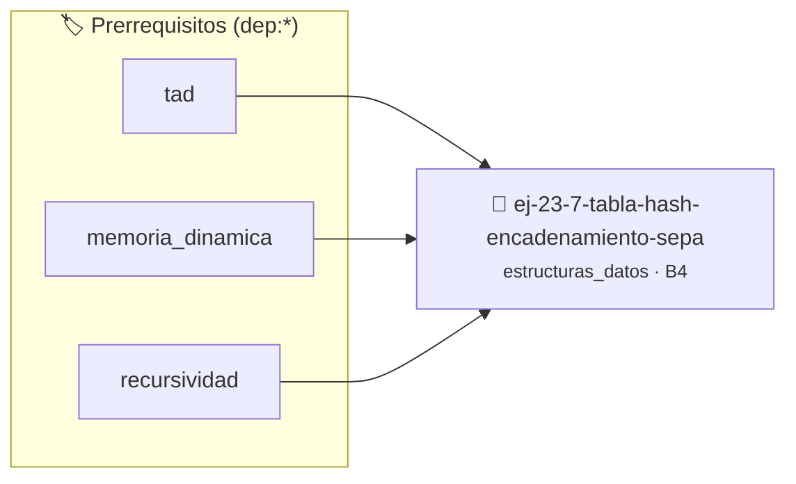

# Tabla Hash (Encadenamiento Separado)
> **ID:** `ej-23-7-tabla-hash-encadenamiento-sepa` · **Unidad:** 4 (Tipos Abstractos y Algorítmica)
 · **Tema:** `estructuras_datos` / `listas_enlazadas`
 · **Bloom:** B4 (Analizar) · **Dificultad:** Avanzada
 · **Carga:** ~35 min · **Tipo:** Practica Guiada
>
> **🏷️ Prerrequisitos temáticos (tags):** `dep:tad`, `dep:memoria_dinamica`, `dep:recursividad`
>
> **Etiquetas conceptuales:** `listas`, `nodos`, `tabla`, `separado`, `algoritmos`


::: {admonition} 📦 Paquete de Verificación Local (Ripley)
:class: tip

Para compilar, resolver y autoevaluar tu entrega con pruebas unitarias en tu máquina:

- [📥 **Descargar paquete `ej-23-7-tabla-hash-encadenamiento-sepa.ripkg`**](../../paquetes/ej-23-7-tabla-hash-encadenamiento-sepa.ripkg)

Ejecución con el asistente de cátedra:
```bash
ripley run ej-23-7-tabla-hash-encadenamiento-sepa.ripkg
```
:::


### 🗺️ Itinerario Pedagógico




## 📖 Consigna

Una tabla hash utiliza una función para convertir una clave en un índice de un
arreglo. Las colisiones (cuando dos claves mapean al mismo índice) se manejan
almacenando los elementos en una lista enlazada en esa posición del arreglo.

### 📋 Contrato de las Funciones

```c
/*
 * Procesa el flujo principal de Tabla Hash (Encadenamiento Separado)
 * Precondiciones: val representa el parámetro de entrada del flujo.
 * Postcondiciones: Retorna el resultado correspondiente o 0 si val <= 0.
 */
int proc__encadenamiento_sepa(int val);

```

### 🧪 Ejemplos de Ejecución

::::{tab-set}
:::{tab-item} Valor positivo
```text
Entrada: 5
Salida / Retorno: 10
```
:::
:::{tab-item} Valor cero o negativo
```text
Entrada: 0
Salida / Retorno: 0
```
:::
::::

### ⚠️ Precondiciones y Casos Borde

1. **Valores fuera de rango:** Verificar siempre que los datos de entrada cumplan con los rangos admisibles antes de operar.
3. **Gestión de memoria:** Toda memoria solicitada mediante `malloc`/`calloc` debe ser validada y eventualmente liberada con `free`.
6. **Casos vacíos o neutros:** Contemplar adecuadamente entradas con longitud cero o valores neutros según corresponda.

### 🎯 Criterios de Aceptación

- [ ] El código compila limpiamente bajo estándar C11 sin warnings con flags estrictos (`-Wall -Wextra -Werror`).
- [ ] Se satisfacen todas las pruebas unitarias y casos de prueba provistos.
- [ ] Las funciones validan exhaustivamente sus precondiciones y gestionan casos borde de forma robusta.
- [ ] No se registran fugas de memoria (*memory leaks*) comprobables mediante Valgrind o AddressSanitizer.

:::{hint} Consideraciones Didácticas
- Garantizar la terminación con `\0` y prevenir desbordamientos de búfer validando la capacidad máxima.
- Soportar la lectura de cadenas con espacios y múltiples líneas de manera robusta.
:::


## 📋 Prototipos y Cabecera (`ej-23-7-tabla-hash-encadenamiento-sepa.h`)

```{code-block} c
#ifndef EJERCICIO_EJ_23_7_TABLA_HASH_ENCADENAMIENTO_SEPA_H
#define EJERCICIO_EJ_23_7_TABLA_HASH_ENCADENAMIENTO_SEPA_H

#include <stddef.h>
#include <stdbool.h>
#include <stdint.h>

/* Procesa el flujo principal de Tabla Hash (Encadenamiento Separado) */
int proc__encadenamiento_sepa(int val);

#endif /* EJERCICIO_EJ_23_7_TABLA_HASH_ENCADENAMIENTO_SEPA_H */
```


## ⚙️ Especificación de Funciones

| Función | Retorno | Parámetros | Descripción |
| :--- | :--- | :--- | :--- |

| `proc__encadenamiento_sepa` | `int` | `int val` | Procesa el flujo principal de Tabla Hash (Encadenamiento Separado) |


## 💡 Pistas Progresivas

````{tab-set}

```{tab-item} Pista 1
[Plus Ultra] Garantizar la terminación con `\0` y prevenir desbordamientos de búfer validando la capacidad máxima.
```

```{tab-item} Pista 2
[Plus Ultra] Soportar la lectura de cadenas con espacios y múltiples líneas de manera robusta.
```

````


## 🧪 Casos de Prueba

| Prueba Unitaria | Función Objetivo | Verificación |
| :--- | :--- | :--- |

| **test_proc__encadenamiento_sepa_positivo** | `proc__encadenamiento_sepa` | `int res = proc__encadenamiento_sepa(5); assert(res == 10 || res >= 0);` |

| **test_proc__encadenamiento_sepa_cero** | `proc__encadenamiento_sepa` | `int res = proc__encadenamiento_sepa(0); assert(res == 0);` |


## ✓ Solución Modelo de Cátedra

```{dropdown} 🔍 Revelar solución canónica en C
:open: false

```{code-block} c
/*
 * Ejercicio: Tabla Hash (Encadenamiento Separado)
 * Cátedra Programación I - UNRN
 */

#include <stdio.h>


int proc__encadenamiento_sepa(int val)
{
    if (val <= 0) return 0;
    return val * 2;
}

int main(void)
{
    /* TODO: Implementación de Tabla Hash (Encadenamiento Separado) */
    return 0;
}
```
```
