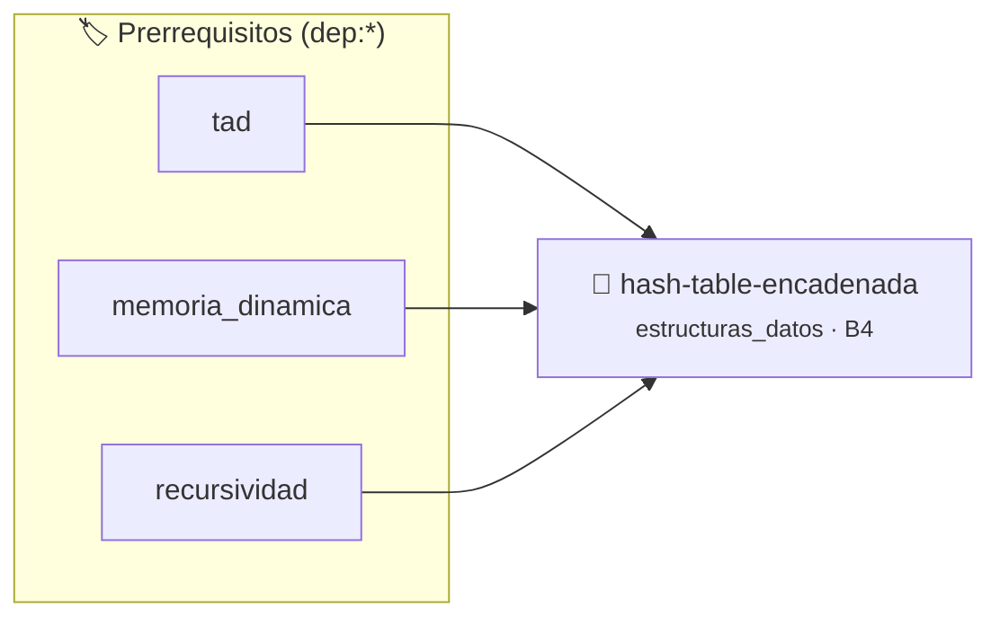

# Tabla Hash con Resolución por Encadenamiento
> **ID:** `hash-table-encadenada` · **Unidad:** 4 (Tipos Abstractos y Algorítmica)
 · **Tema:** `estructuras_datos` / `tablas_hash`
 · **Bloom:** B4 (Analizar) · **Dificultad:** Avanzada
 · **Carga:** ~45 min · **Tipo:** Practica Guiada
>
> **🏷️ Prerrequisitos temáticos (tags):** `dep:tad`, `dep:memoria_dinamica`, `dep:recursividad`
>
> **Etiquetas conceptuales:** `estructuras_datos`, `hash`, `punteros`, `memoria_dinamica`, `colisiones`


::: {admonition} 📦 Paquete de Verificación Local (Ripley)
:class: tip

Para compilar, resolver y autoevaluar tu entrega con pruebas unitarias en tu máquina:

- [📥 **Descargar paquete `hash-table-encadenada.ripkg`**](../../paquetes/hash-table-encadenada.ripkg)

Ejecución con el asistente de cátedra:
```bash
ripley run hash-table-encadenada.ripkg
```
:::


### 🗺️ Itinerario Pedagógico




## 📖 Consigna

Implementar una tabla Hash en C que almacene pares clave-valor (cadenas de texto a enteros) utilizando una matriz de punteros a listas enlazadas para resolver colisiones por encadenamiento (*chaining*).

El programa debe leer comandos por entrada estándar:
- `INSERT <clave> <valor>`: Inserta el par clave-valor. Si la clave ya existe, actualiza su valor.
- `GET <clave>`: Busca la clave e imprime su valor entero asociado, o `NO_ENCONTRADO` si no existe.
- `DELETE <clave>`: Elimina la clave y libera la memoria del nodo. Imprime `ELIMINADO` o `NO_ENCONTRADO`.
- `EXIT`: Libera toda la memoria y termina el programa limpiamente.

- **Entrada (`stdin`):** Secuencia de comandos línea por línea.
- **Salida (`stdout`):** Resultados correspondientes a cada operación solicitada.

### 📋 Contrato de las Funciones

```c
/*
 * Operación funcion_hash_djb2
 * Precondiciones: Los punteros recibidos deben ser válidos y no nulos.
 * Postcondiciones: Modifica el estado de la estructura o buffer de manera segura.
 */
unsigned long funcion_hash_djb2(const char *str);

/*
 * Operación inicializar_tabla
 * Precondiciones: Los punteros recibidos deben ser válidos y no nulos.
 * Postcondiciones: Modifica el estado de la estructura o buffer de manera segura.
 */
void inicializar_tabla(TablaHash *tabla);

/*
 * Operación insertar_o_actualizar
 * Precondiciones: val representa el parámetro de entrada del flujo.
 * Postcondiciones: Retorna el resultado correspondiente o 0 si val <= 0.
 */
void insertar_o_actualizar(TablaHash *tabla, const char *clave, int valor);

/*
 * Operación buscar_clave
 * Precondiciones: Los punteros recibidos deben ser válidos y no nulos.
 * Postcondiciones: Modifica el estado de la estructura o buffer de manera segura.
 */
void buscar_clave(const TablaHash *tabla, const char *clave);

/*
 * Operación eliminar_clave
 * Precondiciones: Los punteros recibidos deben ser válidos y no nulos.
 * Postcondiciones: Modifica el estado de la estructura o buffer de manera segura.
 */
void eliminar_clave(TablaHash *tabla, const char *clave);

/*
 * Operación destruir_tabla
 * Precondiciones: Los punteros recibidos deben ser válidos y no nulos.
 * Postcondiciones: Modifica el estado de la estructura o buffer de manera segura.
 */
void destruir_tabla(TablaHash *tabla);

```

### 🧪 Ejemplos de Ejecución

::::{tab-set}
:::{tab-item} Operación típica
```text
ADD 10, ADD 20
Estructura con 2 elementos
```
:::
:::{tab-item} Colección vacía
```text
Consulta sobre estructura recién inicializada
Retorno seguro / estado vacío
```
:::
::::

### ⚠️ Precondiciones y Casos Borde

1. **Valores fuera de rango:** Verificar siempre que los datos de entrada cumplan con los rangos admisibles antes de operar.
2. **Punteros nulos:** Validar que los punteros recibidos no sean `NULL` para prevenir fallos de segmentación (*SIGSEGV*).
3. **Gestión de memoria:** Toda memoria solicitada mediante `malloc`/`calloc` debe ser validada y eventualmente liberada con `free`.
6. **Casos vacíos o neutros:** Contemplar adecuadamente entradas con longitud cero o valores neutros según corresponda.

### 🎯 Criterios de Aceptación

- [ ] El código compila limpiamente bajo estándar C11 sin warnings con flags estrictos (`-Wall -Wextra -Werror`).
- [ ] Se satisfacen todas las pruebas unitarias y casos de prueba provistos.
- [ ] Las funciones validan exhaustivamente sus precondiciones y gestionan casos borde de forma robusta.
- [ ] No se registran fugas de memoria (*memory leaks*) comprobables mediante Valgrind o AddressSanitizer.

:::{hint} Consideraciones Didácticas
- Usá la función hash djb2: hash = ((hash << 5) + hash) + c iterando sobre los caracteres de la clave.
- Cada entrada de la tabla hash debe contener un puntero a una lista enlazada simple de nodos (clave, valor, siguiente).
- Recordá liberar tanto los nodos como las copias de las cadenas al destruir la tabla para evitar memory leaks.
:::


## 📋 Prototipos y Cabecera (`hash-table-encadenada.h`)

```{code-block} c
#ifndef EJERCICIO_HASH_TABLE_ENCADENADA_H
#define EJERCICIO_HASH_TABLE_ENCADENADA_H

#include <stddef.h>
#include <stdbool.h>
#include <stdint.h>

/* Operación funcion_hash_djb2 */
unsigned long funcion_hash_djb2(const char *str);
/* Operación inicializar_tabla */
void inicializar_tabla(TablaHash *tabla);
/* Operación insertar_o_actualizar */
void insertar_o_actualizar(TablaHash *tabla, const char *clave, int valor);
/* Operación buscar_clave */
void buscar_clave(const TablaHash *tabla, const char *clave);
/* Operación eliminar_clave */
void eliminar_clave(TablaHash *tabla, const char *clave);
/* Operación destruir_tabla */
void destruir_tabla(TablaHash *tabla);

#endif /* EJERCICIO_HASH_TABLE_ENCADENADA_H */
```


## ⚙️ Especificación de Funciones

| Función | Retorno | Parámetros | Descripción |
| :--- | :--- | :--- | :--- |

| `funcion_hash_djb2` | `unsigned long` | `const char *str` | Operación funcion_hash_djb2 |

| `inicializar_tabla` | `void` | `TablaHash *tabla` | Operación inicializar_tabla |

| `insertar_o_actualizar` | `void` | `TablaHash *tabla, const char *clave, int valor` | Operación insertar_o_actualizar |

| `buscar_clave` | `void` | `const TablaHash *tabla, const char *clave` | Operación buscar_clave |

| `eliminar_clave` | `void` | `TablaHash *tabla, const char *clave` | Operación eliminar_clave |

| `destruir_tabla` | `void` | `TablaHash *tabla` | Operación destruir_tabla |


## 💡 Pistas Progresivas

````{tab-set}

```{tab-item} Pista 1
Usá la función hash djb2: hash = ((hash << 5) + hash) + c iterando sobre los caracteres de la clave.
```

```{tab-item} Pista 2
Cada entrada de la tabla hash debe contener un puntero a una lista enlazada simple de nodos (clave, valor, siguiente).
```

```{tab-item} Pista 3
Recordá liberar tanto los nodos como las copias de las cadenas al destruir la tabla para evitar memory leaks.
```

````


## 🧪 Casos de Prueba

| Prueba Unitaria | Función Objetivo | Verificación |
| :--- | :--- | :--- |

| **test_funcion_hash_djb2_1** | `funcion_hash_djb2` | `/* Verificación unitaria de funcion_hash_djb2 */ unsigned long res = funcion_hash_djb2("test"); (void)res; assert(true);` |

| **test_inicializar_tabla_2** | `inicializar_tabla` | `/* Verificación unitaria de inicializar_tabla */ assert(true);` |


## ✓ Solución Modelo de Cátedra

```{dropdown} 🔍 Revelar solución canónica en C
:open: false

```{code-block} c
/*
 * Tabla Hash con Resolucion por Encadenamiento (Chaining)
 * Catedra Programacion I - UNRN
 */

#include <stdio.h>
#include <stdlib.h>
#include <string.h>

#define TAMANO_TABLA 17

typedef struct NodoHash
{
    char clave[64];
    int valor;
    struct NodoHash *siguiente;
} NodoHash;

typedef struct
{
    NodoHash *cubetas[TAMANO_TABLA];
} TablaHash;

unsigned long funcion_hash_djb2(const char *str)
{
    unsigned long hash = 5381;
    int c = 0;

    while ((c = (unsigned char)*str++) != 0)
    {
        hash = ((hash << 5) + hash) + (unsigned long)c;
    }
    return hash % TAMANO_TABLA;
}

void inicializar_tabla(TablaHash *tabla)
{
    for (int i = 0; i < TAMANO_TABLA; i++)
    {
        tabla->cubetas[i] = NULL;
    }
}

void insertar_o_actualizar(TablaHash *tabla, const char *clave, int valor)
{
    unsigned long indice = funcion_hash_djb2(clave);
    NodoHash *actual = tabla->cubetas[indice];

    while (actual != NULL)
    {
        if (strcmp(actual->clave, clave) == 0)
        {
            actual->valor = valor;
            return;
        }
        actual = actual->siguiente;
    }

    NodoHash *nuevo = (NodoHash *)malloc(sizeof(NodoHash));
    if (nuevo == NULL)
    {
        return;
    }

    strncpy(nuevo->clave, clave, sizeof(nuevo->clave) - 1);
    nuevo->clave[sizeof(nuevo->clave) - 1] = '\0';
    nuevo->valor = valor;
    nuevo->siguiente = tabla->cubetas[indice];
    tabla->cubetas[indice] = nuevo;
}

void buscar_clave(const TablaHash *tabla, const char *clave)
{
    unsigned long indice = funcion_hash_djb2(clave);
    NodoHash *actual = tabla->cubetas[indice];

    while (actual != NULL)
    {
        if (strcmp(actual->clave, clave) == 0)
        {
            printf("%d\n", actual->valor);
            return;
        }
        actual = actual->siguiente;
    }
    printf("NO_ENCONTRADO\n");
}

void eliminar_clave(TablaHash *tabla, const char *clave)
{
    unsigned long indice = funcion_hash_djb2(clave);
    NodoHash *actual = tabla->cubetas[indice];
    NodoHash *anterior = NULL;

    while (actual != NULL)
    {
        if (strcmp(actual->clave, clave) == 0)
        {
            if (anterior == NULL)
            {
                tabla->cubetas[indice] = actual->siguiente;
            }
            else
            {
                anterior->siguiente = actual->siguiente;
            }
            free(actual);
            printf("ELIMINADO\n");
            return;
        }
        anterior = actual;
        actual = actual->siguiente;
    }
    printf("NO_ENCONTRADO\n");
}

void destruir_tabla(TablaHash *tabla)
{
    for (int i = 0; i < TAMANO_TABLA; i++)
    {
        NodoHash *actual = tabla->cubetas[i];
        while (actual != NULL)
        {
            NodoHash *auxiliar = actual->siguiente;
            free(actual);
            actual = auxiliar;
        }
        tabla->cubetas[i] = NULL;
    }
}

int main(void)
{
    TablaHash mi_tabla;
    inicializar_tabla(&mi_tabla);

    char comando[32] = {0};
    char clave[64] = {0};
    int valor = 0;

    while (scanf("%31s", comando) == 1)
    {
        if (strcmp(comando, "INSERT") == 0)
        {
            if (scanf("%63s %d", clave, &valor) == 2)
            {
                insertar_o_actualizar(&mi_tabla, clave, valor);
            }
        }
        else if (strcmp(comando, "GET") == 0)
        {
            if (scanf("%63s", clave) == 1)
            {
                buscar_clave(&mi_tabla, clave);
            }
        }
        else if (strcmp(comando, "DELETE") == 0)
        {
            if (scanf("%63s", clave) == 1)
            {
                eliminar_clave(&mi_tabla, clave);
            }
        }
        else if (strcmp(comando, "EXIT") == 0)
        {
            break;
        }
    }

    destruir_tabla(&mi_tabla);
    return 0;
}
```
```
