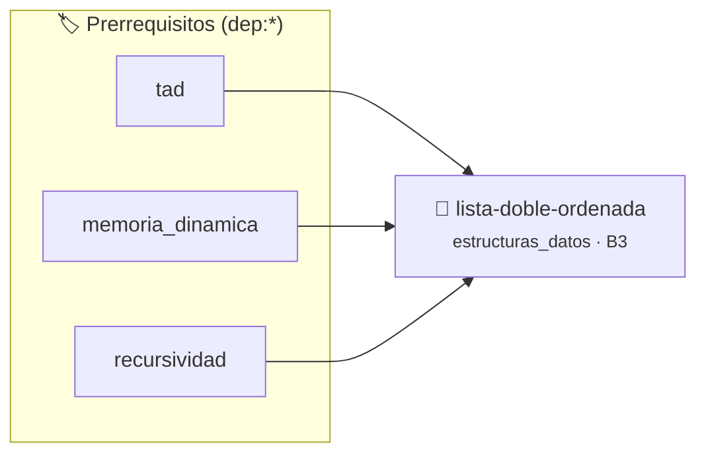

# Lista Doblemente Enlazada con Inserción Ordenada
> **ID:** `lista-doble-ordenada`
 · **Tema:** `estructuras_datos`
 · **Bloom:** B3 (Aplicar)
 · **Carga:** ~25 min
>
> **🏷️ Prerrequisitos temáticos (tags):** `dep:tad`, `dep:memoria_dinamica`, `dep:recursividad`
>
> **Etiquetas conceptuales:** `estructuras_datos`, `listas`, `punteros_dobles`, `memoria_dinamica`


::: {admonition} 📦 Paquete de Verificación Local (Ripley)
:class: tip

Para compilar, resolver y autoevaluar tu entrega con pruebas unitarias en tu máquina:

- [📥 **Descargar paquete `lista-doble-ordenada.ripkg`**](../../paquetes/lista-doble-ordenada.ripkg)

Ejecución con el asistente de cátedra:
```bash
ripley run lista-doble-ordenada.ripkg
```
:::


### 🗺️ Itinerario Pedagógico




## 📖 Consigna

# Lista Doblemente Enlazada con Inserción Ordenada

## 1. Consigna
Implementar un TAD Lista Doblemente Enlazada que mantenga sus elementos enteros ordenados de forma ascendente.

Operaciones a soportar vía comandos:
- `ADD <valor>`: Inserta el entero conservando el orden ascendente.
- `PRINT_ASC`: Muestra todos los elementos desde la cabeza a la cola separados por espacio.
- `PRINT_DESC`: Muestra todos los elementos desde la cola a la cabeza separados por espacio.
- `DEL <valor>`: Elimina la primera ocurrencia del valor.
- `EXIT`: Libera la lista y termina.


## 📋 Prototipos y Cabecera (`lista-doble-ordenada.h`)

```{code-block} c
#ifndef EJERCICIO_LISTA_DOBLE_ORDENADA_H
#define EJERCICIO_LISTA_DOBLE_ORDENADA_H

#include <stddef.h>
#include <stdbool.h>
#include <stdint.h>

/* Operación inicializar_lista */
void inicializar_lista(ListaDoble *lista);
/* Operación insertar_ordenado */
void insertar_ordenado(ListaDoble *lista, int valor);
/* Operación eliminar_valor */
void eliminar_valor(ListaDoble *lista, int valor);
/* Operación imprimir_ascendente */
void imprimir_ascendente(const ListaDoble *lista);
/* Operación imprimir_descendente */
void imprimir_descendente(const ListaDoble *lista);
/* Operación liberar_lista */
void liberar_lista(ListaDoble *lista);

#endif /* EJERCICIO_LISTA_DOBLE_ORDENADA_H */
```


## ⚙️ Especificación de Funciones

| Función | Retorno | Parámetros | Descripción |
| :--- | :--- | :--- | :--- |

| `inicializar_lista` | `void` | `ListaDoble *lista` | Operación inicializar_lista |

| `insertar_ordenado` | `void` | `ListaDoble *lista, int valor` | Operación insertar_ordenado |

| `eliminar_valor` | `void` | `ListaDoble *lista, int valor` | Operación eliminar_valor |

| `imprimir_ascendente` | `void` | `const ListaDoble *lista` | Operación imprimir_ascendente |

| `imprimir_descendente` | `void` | `const ListaDoble *lista` | Operación imprimir_descendente |

| `liberar_lista` | `void` | `ListaDoble *lista` | Operación liberar_lista |


## 💡 Pistas Progresivas

````{tab-set}

```{tab-item} Pista 1
Cada nodo debe tener punteros `siguiente` y `anterior`.
```

```{tab-item} Pista 2
Al insertar un nodo, actualizá los enlaces de los nodos adyacentes manteniendo la cabeza y cola si corresponde.
```

```{tab-item} Pista 3
Recorré en ambos sentidos (ASC y DESC) para verificar la consistencia de los punteros dobles.
```

````


## 🧪 Casos de Prueba

| Prueba Unitaria | Función Objetivo | Verificación |
| :--- | :--- | :--- |

| **test_inicializar_lista_1** | `inicializar_lista` | `/* Verificación unitaria de inicializar_lista */ assert(true);` |

| **test_insertar_ordenado_2** | `insertar_ordenado` | `/* Verificación unitaria de insertar_ordenado */ assert(true);` |


## ✓ Solución Modelo de Cátedra

```{dropdown} 🔍 Revelar solución canónica en C
:open: false

```{code-block} c
/*
 * Lista Doblemente Enlazada Ordenada
 * Catedra Programacion I - UNRN
 */

#include <stdio.h>
#include <stdlib.h>
#include <string.h>

typedef struct NodoDoble
{
    int dato;
    struct NodoDoble *anterior;
    struct NodoDoble *siguiente;
} NodoDoble;

typedef struct
{
    NodoDoble *cabeza;
    NodoDoble *cola;
} ListaDoble;

void inicializar_lista(ListaDoble *lista)
{
    lista->cabeza = NULL;
    lista->cola = NULL;
}

void insertar_ordenado(ListaDoble *lista, int valor)
{
    NodoDoble *nuevo = (NodoDoble *)malloc(sizeof(NodoDoble));
    if (nuevo == NULL)
    {
        return;
    }
    nuevo->dato = valor;
    nuevo->anterior = NULL;
    nuevo->siguiente = NULL;

    if (lista->cabeza == NULL)
    {
        lista->cabeza = nuevo;
        lista->cola = nuevo;
        return;
    }

    if (valor <= lista->cabeza->dato)
    {
        nuevo->siguiente = lista->cabeza;
        lista->cabeza->anterior = nuevo;
        lista->cabeza = nuevo;
        return;
    }

    if (valor >= lista->cola->dato)
    {
        nuevo->anterior = lista->cola;
        lista->cola->siguiente = nuevo;
        lista->cola = nuevo;
        return;
    }

    NodoDoble *actual = lista->cabeza;
    while (actual != NULL && actual->dato < valor)
    {
        actual = actual->siguiente;
    }

    nuevo->siguiente = actual;
    nuevo->anterior = actual->anterior;
    actual->anterior->siguiente = nuevo;
    actual->anterior = nuevo;
}

void eliminar_valor(ListaDoble *lista, int valor)
{
    NodoDoble *actual = lista->cabeza;
    while (actual != NULL && actual->dato != valor)
    {
        actual = actual->siguiente;
    }

    if (actual == NULL)
    {
        return;
    }

    if (actual == lista->cabeza && actual == lista->cola)
    {
        lista->cabeza = NULL;
        lista->cola = NULL;
    }
    else if (actual == lista->cabeza)
    {
        lista->cabeza = actual->siguiente;
        lista->cabeza->anterior = NULL;
    }
    else if (actual == lista->cola)
    {
        lista->cola = actual->anterior;
        lista->cola->siguiente = NULL;
    }
    else
    {
        actual->anterior->siguiente = actual->siguiente;
        actual->siguiente->anterior = actual->anterior;
    }
    free(actual);
}

void imprimir_ascendente(const ListaDoble *lista)
{
    NodoDoble *actual = lista->cabeza;
    while (actual != NULL)
    {
        printf("%d%c", actual->dato, actual->siguiente ? ' ' : '\n');
        actual = actual->siguiente;
    }
    if (lista->cabeza == NULL)
    {
        printf("\n");
    }
}

void imprimir_descendente(const ListaDoble *lista)
{
    NodoDoble *actual = lista->cola;
    while (actual != NULL)
    {
        printf("%d%c", actual->dato, actual->anterior ? ' ' : '\n');
        actual = actual->anterior;
    }
    if (lista->cola == NULL)
    {
        printf("\n");
    }
}

void liberar_lista(ListaDoble *lista)
{
    NodoDoble *actual = lista->cabeza;
    while (actual != NULL)
    {
        NodoDoble *aux = actual->siguiente;
        free(actual);
        actual = aux;
    }
    lista->cabeza = NULL;
    lista->cola = NULL;
}

int main(void)
{
    ListaDoble lista;
    inicializar_lista(&lista);

    char comando[32] = {0};
    int valor = 0;

    while (scanf("%31s", comando) == 1)
    {
        if (strcmp(comando, "ADD") == 0)
        {
            if (scanf("%d", &valor) == 1)
            {
                insertar_ordenado(&lista, valor);
            }
        }
        else if (strcmp(comando, "DEL") == 0)
        {
            if (scanf("%d", &valor) == 1)
            {
                eliminar_valor(&lista, valor);
            }
        }
        else if (strcmp(comando, "PRINT_ASC") == 0)
        {
            imprimir_ascendente(&lista);
        }
        else if (strcmp(comando, "PRINT_DESC") == 0)
        {
            imprimir_descendente(&lista);
        }
        else if (strcmp(comando, "EXIT") == 0)
        {
            break;
        }
    }

    liberar_lista(&lista);
    return 0;
}
```
```
