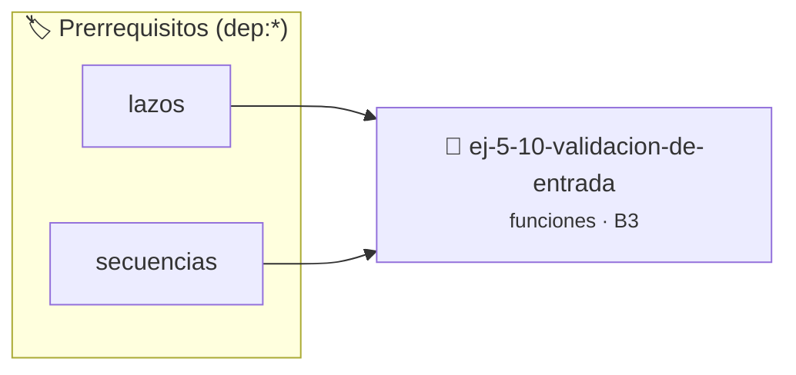

# Validación de Entrada
> **ID:** `ej-5-10-validacion-de-entrada` · **Unidad:** 1 (Fundamentos y Estructuras de Control)
 · **Tema:** `funciones` / `funciones_general`
 · **Bloom:** B3 (Aplicar) · **Dificultad:** Intermedia
 · **Carga:** ~25 min · **Tipo:** Practica Guiada
>
> **🏷️ Prerrequisitos temáticos (tags):** `dep:lazos`, `dep:secuencias`


::: {admonition} 📦 Paquete de Verificación Local (Ripley)
:class: tip

Para compilar, resolver y autoevaluar tu entrega con pruebas unitarias en tu máquina:

- [📥 **Descargar paquete `ej-5-10-validacion-de-entrada.ripkg`**](../../paquetes/ej-5-10-validacion-de-entrada.ripkg)

Ejecución con el asistente de cátedra:
```bash
ripley run ej-5-10-validacion-de-entrada.ripkg
```
:::


### 🗺️ Itinerario Pedagógico




## 📖 Consigna

Implementá funciones modulares y puras de validación que reciban valores por parámetro y retornen un resultado booleano (`true` o `false` según `<stdbool.h>`):

- `bool validar_rango(int valor, int min, int max);` — Valida si `valor` se encuentra dentro del rango `[min, max]` (inclusivo).
- `bool validar_positivo(double valor);` — Valida si `valor` es estrictamente mayor que cero (`valor > 0.0`).

**Orientación:**
- Las funciones deben ser puras (sin llamadas a `printf` ni `scanf`, respetando la Regla 0x2002h).
- Incluí `<stdbool.h>` para utilizar el tipo `bool` y las constantes `true` y `false`.
- Podés probar su funcionamiento desde `main()` mediante aserciones con `assert()`.


---
(ejercicio_5_11)=

### 📋 Contrato de las Funciones

```c
/*
 * Valida si valor esta dentro de min y max
 * Precondiciones: val representa el parámetro de entrada del flujo.
 * Postcondiciones: Retorna el resultado correspondiente o 0 si val <= 0.
 */
bool validar_rango(int valor, int min, int max);

/*
 * Valida si valor es mayor a 0
 * Precondiciones: val representa el parámetro de entrada del flujo.
 * Postcondiciones: Retorna el resultado correspondiente o 0 si val <= 0.
 */
bool validar_positivo(double valor);

```

### 🧪 Ejemplos de Ejecución

::::{tab-set}
:::{tab-item} Caso general
```text
val = 10
Retorno esperado calculado
```
:::
:::{tab-item} Caso límite
```text
val = 0
Retorno 0 o manejo de borde
```
:::
::::

### ⚠️ Precondiciones y Casos Borde

1. **Valores fuera de rango:** Verificar siempre que los datos de entrada cumplan con los rangos admisibles antes de operar.
6. **Casos vacíos o neutros:** Contemplar adecuadamente entradas con longitud cero o valores neutros según corresponda.

### 🎯 Criterios de Aceptación

- [ ] El código compila limpiamente bajo estándar C11 sin warnings con flags estrictos (`-Wall -Wextra -Werror`).
- [ ] Se satisfacen todas las pruebas unitarias y casos de prueba provistos.
- [ ] Las funciones validan exhaustivamente sus precondiciones y gestionan casos borde de forma robusta.


## 📋 Prototipos y Cabecera (`ej-5-10-validacion-de-entrada.h`)

```{code-block} c
#ifndef EJERCICIO_EJ_5_10_VALIDACION_DE_ENTRADA_H
#define EJERCICIO_EJ_5_10_VALIDACION_DE_ENTRADA_H

#include <stddef.h>
#include <stdbool.h>
#include <stdint.h>

/* Valida si valor esta dentro de min y max */
bool validar_rango(int valor, int min, int max);
/* Valida si valor es mayor a 0 */
bool validar_positivo(double valor);

#endif /* EJERCICIO_EJ_5_10_VALIDACION_DE_ENTRADA_H */
```


## ⚙️ Especificación de Funciones

| Función | Retorno | Parámetros | Descripción |
| :--- | :--- | :--- | :--- |

| `validar_rango` | `bool` | `int valor, int min, int max` | Valida si valor esta dentro de min y max |

| `validar_positivo` | `bool` | `double valor` | Valida si valor es mayor a 0 |


## 🧪 Casos de Prueba

| Prueba Unitaria | Función Objetivo | Verificación |
| :--- | :--- | :--- |

| **test_val_rango** | `validar_rango` | `assert(validar_rango(5, 1, 10) == true); assert(validar_rango(15, 1, 10) == false);` |

| **test_val_pos** | `validar_positivo` | `assert(validar_positivo(3.14) == true); assert(validar_positivo(-1.0) == false);` |


## ✓ Solución Modelo de Cátedra

```{dropdown} 🔍 Revelar solución canónica en C
:open: false

```{code-block} c
#include <stdio.h>
#include <stdbool.h>

bool validar_rango(int valor, int min, int max) {
    return (valor >= min && valor <= max);
}

bool validar_positivo(double valor) {
    return (valor > 0.0);
}

int main(void) {
    printf("Valido: %d\n", validar_rango(5, 1, 10));
    return 0;
}
```
```
