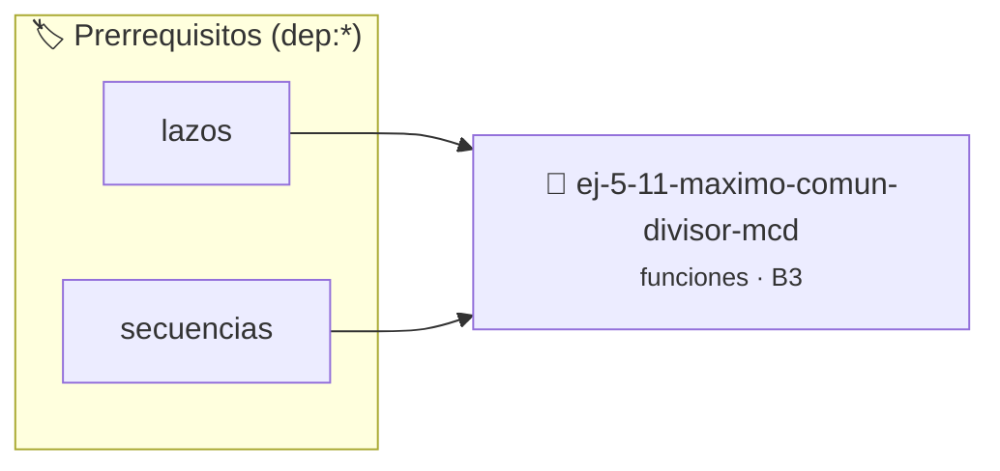

# Máximo Común Divisor (MCD)
> **ID:** `ej-5-11-maximo-comun-divisor-mcd` · **Unidad:** 1 (Fundamentos y Estructuras de Control)
 · **Tema:** `funciones` / `funciones_general`
 · **Bloom:** B3 (Aplicar) · **Dificultad:** Intermedia
 · **Carga:** ~25 min · **Tipo:** Practica Guiada
>
> **🏷️ Prerrequisitos temáticos (tags):** `dep:lazos`, `dep:secuencias`


::: {admonition} 📦 Paquete de Verificación Local (Ripley)
:class: tip

Para compilar, resolver y autoevaluar tu entrega con pruebas unitarias en tu máquina:

- [📥 **Descargar paquete `ej-5-11-maximo-comun-divisor-mcd.ripkg`**](../../paquetes/ej-5-11-maximo-comun-divisor-mcd.ripkg)

Ejecución con el asistente de cátedra:
```bash
ripley run ej-5-11-maximo-comun-divisor-mcd.ripkg
```
:::


### 🗺️ Itinerario Pedagógico




## 📖 Consigna

# Máximo Común Divisor (MCD)

## Ejercicio 5.11 - Máximo Común Divisor (MCD) ⭐⭐⭐☆☆

Implementá el algoritmo de Euclides para calcular MCD.

**Algoritmo:**

:::{hint} Lógica y Consideraciones
    error e informar el resultado mediante parámetros de salida.
    especificando precondiciones y postcondiciones.

-   **[*plus ultra*]:** Implementar una función auxiliar para calcular el Mínimo Común Múltiplo (MCM).
-   **[*plus ultra*]:** Escribir pruebas unitarias con assert() verificando propiedades como mcd(a, b) == mcd(b, a).

:::
<!-- {hint} Lógica y Consideraciones -->

```
mcd(a, b) = mcd(b, a % b)  si b != 0
mcd(a, 0) = a
```

**Orientación:**
- Implementá versión recursiva e iterativa
- Agregá función `mcm(a, b)` usando: mcm = (a * b) / mcd(a, b)

---
(ejercicio_5_12)=


## 📋 Prototipos y Cabecera (`ej-5-11-maximo-comun-divisor-mcd.h`)

```{code-block} c
#ifndef EJERCICIO_EJ_5_11_MAXIMO_COMUN_DIVISOR_MCD_H
#define EJERCICIO_EJ_5_11_MAXIMO_COMUN_DIVISOR_MCD_H

#include <stddef.h>
#include <stdbool.h>
#include <stdint.h>

/* Lógica de Máximo Común Divisor (MCD) */
int resolver_ej_11(int n);

#endif /* EJERCICIO_EJ_5_11_MAXIMO_COMUN_DIVISOR_MCD_H */
```


## ⚙️ Especificación de Funciones

| Función | Retorno | Parámetros | Descripción |
| :--- | :--- | :--- | :--- |

| `resolver_ej_11` | `int` | `int n` | Lógica de Máximo Común Divisor (MCD) |


## 🧪 Casos de Prueba

| Prueba Unitaria | Función Objetivo | Verificación |
| :--- | :--- | :--- |

| **test_resolver_ej_11** | `resolver_ej_11` | `assert(true);` |


## ✓ Solución Modelo de Cátedra

```{dropdown} 🔍 Revelar solución canónica en C
:open: false

```{code-block} c
#include <stdio.h>
#include <stdlib.h>

int resolver_m_ximo_com_n_divisor_mcd(int n) {
    return n * 2;
}

int main(void) {
    printf("OK\n");
    return 0;
}
```
```
