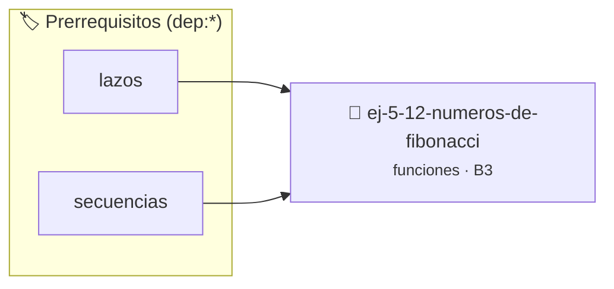

# Números de Fibonacci
> **ID:** `ej-5-12-numeros-de-fibonacci`
 · **Tema:** `funciones`
 · **Bloom:** B3 (Aplicar)
 · **Carga:** ~25 min
>
> **🏷️ Prerrequisitos temáticos (tags):** `dep:lazos`, `dep:secuencias`


::: {admonition} 📦 Paquete de Verificación Local (Ripley)
:class: tip

Para compilar, resolver y autoevaluar tu entrega con pruebas unitarias en tu máquina:

- [📥 **Descargar paquete `ej-5-12-numeros-de-fibonacci.ripkg`**](../../paquetes/ej-5-12-numeros-de-fibonacci.ripkg)

Ejecución con el asistente de cátedra:
```bash
ripley run ej-5-12-numeros-de-fibonacci.ripkg
```
:::


### 🗺️ Itinerario Pedagógico




## 📖 Consigna

# Números de Fibonacci

## Ejercicio 5.12 - Números de Fibonacci ⭐⭐⭐☆☆

Implementá la función:
- `int fibonacci(int n);` — Retorna el n-ésimo número de la sucesión de Fibonacci.

Convención:
- `fibonacci(0) = 0`
- `fibonacci(1) = 1`
- `fibonacci(n) = fibonacci(n - 1) + fibonacci(n - 2)` para `n >= 2`.

**Orientación:**
- Podés implementarla de forma iterativa o recursiva. Para valores moderados (`n > 40`), la solución iterativa es considerablemente más eficiente.
- La función no debe contener llamadas a `printf` ni `scanf` (Regla 0x2002h).

:::{hint} Lógica y Consideraciones
- Si `n <= 0`, retornar `0`.
- Documentá la precondición (`n >= 0`) y postcondición con Doxygen (Regla 0x2003h).

-   **[*plus ultra*]:** Usar tipos enteros de 64 bits (`long long` o `uint64_t`) para permitir el cálculo de términos superiores.
-   **[*plus ultra*]:** Escribir pruebas unitarias con assert() verificando los primeros 10 términos de la sucesión.

:::
<!-- {hint} Lógica y Consideraciones -->

---
(ejercicio_5_13)=


## 📋 Prototipos y Cabecera (`ej-5-12-numeros-de-fibonacci.h`)

```{code-block} c
#ifndef EJERCICIO_EJ_5_12_NUMEROS_DE_FIBONACCI_H
#define EJERCICIO_EJ_5_12_NUMEROS_DE_FIBONACCI_H

#include <stddef.h>
#include <stdbool.h>
#include <stdint.h>

/* Calcula n-esimo termino de Fibonacci */
int fibonacci(int n);

#endif /* EJERCICIO_EJ_5_12_NUMEROS_DE_FIBONACCI_H */
```


## ⚙️ Especificación de Funciones

| Función | Retorno | Parámetros | Descripción |
| :--- | :--- | :--- | :--- |

| `fibonacci` | `int` | `int n` | Calcula n-esimo termino de Fibonacci |


## 🧪 Casos de Prueba

| Prueba Unitaria | Función Objetivo | Verificación |
| :--- | :--- | :--- |

| **test_fib_basico** | `fibonacci` | `assert(fibonacci(0) == 0); assert(fibonacci(1) == 1); assert(fibonacci(6) == 8);` |


## ✓ Solución Modelo de Cátedra

```{dropdown} 🔍 Revelar solución canónica en C
:open: false

```{code-block} c
#include <stdio.h>

int fibonacci(int n) {
    if (n <= 0) return 0;
    if (n == 1) return 1;
    int a = 0, b = 1, c = 0;
    for (int i = 2; i <= n; i++) {
        c = a + b;
        a = b;
        b = c;
    }
    return b;
}

int main(void) {
    printf("Fib 6: %d\n", fibonacci(6));
    return 0;
}
```
```
