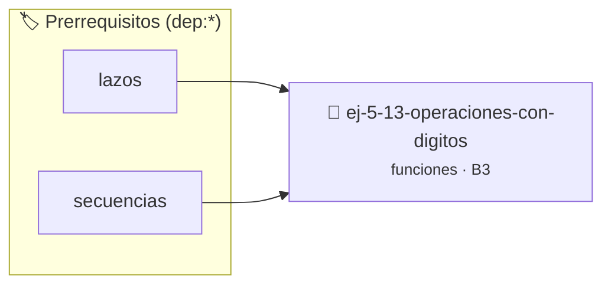

# Operaciones con Dígitos
> **ID:** `ej-5-13-operaciones-con-digitos` · **Unidad:** 1 (Fundamentos y Estructuras de Control)
 · **Tema:** `funciones` / `funciones_general`
 · **Bloom:** B3 (Aplicar) · **Dificultad:** Intermedia
 · **Carga:** ~25 min · **Tipo:** Practica Guiada
>
> **🏷️ Prerrequisitos temáticos (tags):** `dep:lazos`, `dep:secuencias`


::: {admonition} 📦 Paquete de Verificación Local (Ripley)
:class: tip

Para compilar, resolver y autoevaluar tu entrega con pruebas unitarias en tu máquina:

- [📥 **Descargar paquete `ej-5-13-operaciones-con-digitos.ripkg`**](../../paquetes/ej-5-13-operaciones-con-digitos.ripkg)

Ejecución con el asistente de cátedra:
```bash
ripley run ej-5-13-operaciones-con-digitos.ripkg
```
:::


### 🗺️ Itinerario Pedagógico




## 📖 Consigna

# Operaciones con Dígitos

## Ejercicio 5.13 - Operaciones con Dígitos ⭐⭐⭐☆☆

Creá funciones para manipular dígitos de un número:
- `int contar_digitos(int n)`
- `int suma_digitos(int n)`
- `int invertir_numero(int n)`
- `bool es_palindromo(int n)`

**Orientación:**
- Usá división y módulo para extraer dígitos
- `es_palindromo` compara el número con su inverso


:::{hint} Lógica y Consideraciones
    error e informar el resultado mediante parámetros de salida.
    especificando precondiciones y postcondiciones.

-   **[*plus ultra*]:** Modularizar cada operación en una función pura con una única responsabilidad.
-   **[*plus ultra*]:** Documentar con Doxygen las precondiciones sobre números negativos.

:::
<!-- {hint} Lógica y Consideraciones -->

---
(ejercicio_5_14)=


## 📋 Prototipos y Cabecera (`ej-5-13-operaciones-con-digitos.h`)

```{code-block} c
#ifndef EJERCICIO_EJ_5_13_OPERACIONES_CON_DIGITOS_H
#define EJERCICIO_EJ_5_13_OPERACIONES_CON_DIGITOS_H

#include <stddef.h>
#include <stdbool.h>
#include <stdint.h>

/* Lógica de Operaciones con Dígitos */
int resolver_ej_13(int n);

#endif /* EJERCICIO_EJ_5_13_OPERACIONES_CON_DIGITOS_H */
```


## ⚙️ Especificación de Funciones

| Función | Retorno | Parámetros | Descripción |
| :--- | :--- | :--- | :--- |

| `resolver_ej_13` | `int` | `int n` | Lógica de Operaciones con Dígitos |


## 🧪 Casos de Prueba

| Prueba Unitaria | Función Objetivo | Verificación |
| :--- | :--- | :--- |

| **test_resolver_ej_13** | `resolver_ej_13` | `assert(true);` |


## ✓ Solución Modelo de Cátedra

```{dropdown} 🔍 Revelar solución canónica en C
:open: false

```{code-block} c
#include <stdio.h>
#include <stdlib.h>

int resolver_operaciones_con_d_gitos(int n) {
    return n * 2;
}

int main(void) {
    printf("OK\n");
    return 0;
}
```
```
