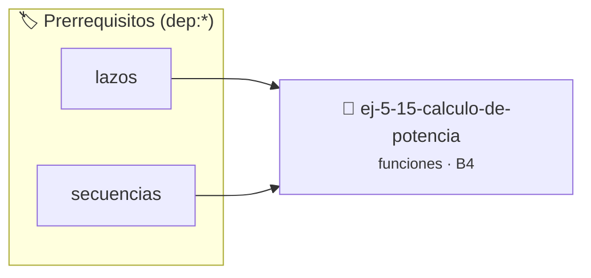

# Cálculo de Potencia
> **ID:** `ej-5-15-calculo-de-potencia`
 · **Tema:** `funciones`
 · **Bloom:** B4 (Analizar)
 · **Carga:** ~35 min
>
> **🏷️ Prerrequisitos temáticos (tags):** `dep:lazos`, `dep:secuencias`


::: {admonition} 📦 Paquete de Verificación Local (Ripley)
:class: tip

Para compilar, resolver y autoevaluar tu entrega con pruebas unitarias en tu máquina:

- [📥 **Descargar paquete `ej-5-15-calculo-de-potencia.ripkg`**](../../paquetes/ej-5-15-calculo-de-potencia.ripkg)

Ejecución con el asistente de cátedra:
```bash
ripley run ej-5-15-calculo-de-potencia.ripkg
```
:::


### 🗺️ Itinerario Pedagógico




## 📖 Consigna

# Cálculo de Potencia

## Ejercicio 5.15 - Cálculo de Potencia ⭐⭐⭐⭐☆

Implementá dos versiones de cálculo de potencia:
- `double potencia_iterativa(double base, int exp)`: calculada mediante multiplicaciones sucesivas.
- `double potencia_rapida(double base, int exp)`: calculada mediante exponenciación binaria (reduciendo a la mitad el exponente en cada paso).
- Manejá exponentes negativos retornando `1.0 / potencia(base, -exp)`.

**Orientación:**
- Simple: multiplica base n veces
- Rápida: si exp es par, `pow(base, exp) = pow(base*base, exp/2)`
- Exponente negativo: `pow(base, -n) = 1 / pow(base, n)`


:::{hint} Lógica y Consideraciones
    valores fuera de rango o tipos inválidos.
    un lazo hasta que el usuario elija finalizar.

-   **[*plus ultra*]:** Verificar que la versión iterativa y la rápida retornen el mismo resultado dentro de una tolerancia con assert.
-   **[*plus ultra*]:** Manejar el caso especial base=0 y exp=0.

:::
<!-- {hint} Lógica y Consideraciones -->

---
(ejercicio_5_16)=


## 📋 Prototipos y Cabecera (`ej-5-15-calculo-de-potencia.h`)

```{code-block} c
#ifndef EJERCICIO_EJ_5_15_CALCULO_DE_POTENCIA_H
#define EJERCICIO_EJ_5_15_CALCULO_DE_POTENCIA_H

#include <stddef.h>
#include <stdbool.h>
#include <stdint.h>

/* Lógica de Cálculo de Potencia */
int resolver_ej_15(int n);

#endif /* EJERCICIO_EJ_5_15_CALCULO_DE_POTENCIA_H */
```


## ⚙️ Especificación de Funciones

| Función | Retorno | Parámetros | Descripción |
| :--- | :--- | :--- | :--- |

| `resolver_ej_15` | `int` | `int n` | Lógica de Cálculo de Potencia |


## 🧪 Casos de Prueba

| Prueba Unitaria | Función Objetivo | Verificación |
| :--- | :--- | :--- |

| **test_resolver_ej_15** | `resolver_ej_15` | `assert(true);` |


## ✓ Solución Modelo de Cátedra

```{dropdown} 🔍 Revelar solución canónica en C
:open: false

```{code-block} c
#include <stdio.h>
#include <stdlib.h>

int resolver_c_lculo_de_potencia(int n) {
    return n * 2;
}

int main(void) {
    printf("OK\n");
    return 0;
}
```
```
