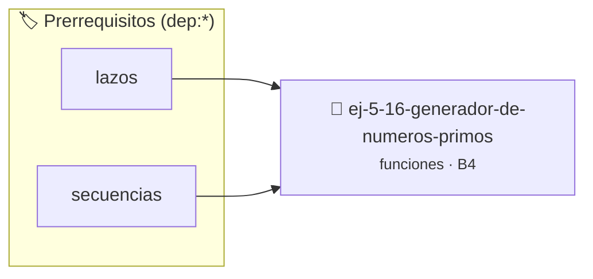

# Generador de Números Primos
> **ID:** `ej-5-16-generador-de-numeros-primos`
 · **Tema:** `funciones`
 · **Bloom:** B4 (Analizar)
 · **Carga:** ~35 min
>
> **🏷️ Prerrequisitos temáticos (tags):** `dep:lazos`, `dep:secuencias`


::: {admonition} 📦 Paquete de Verificación Local (Ripley)
:class: tip

Para compilar, resolver y autoevaluar tu entrega con pruebas unitarias en tu máquina:

- [📥 **Descargar paquete `ej-5-16-generador-de-numeros-primos.ripkg`**](../../paquetes/ej-5-16-generador-de-numeros-primos.ripkg)

Ejecución con el asistente de cátedra:
```bash
ripley run ej-5-16-generador-de-numeros-primos.ripkg
```
:::


### 🗺️ Itinerario Pedagógico




## 📖 Consigna

# Generador de Números Primos

## Ejercicio 5.16 - Generador de Números Primos ⭐⭐⭐⭐☆

Implementá:
- `bool es_primo(int n)`
- `int siguiente_primo(int desde)`
- `void listar_primos(int inicio, int fin)`
- `int contar_primos(int hasta)`

**Orientación:**
- Optimizá `es_primo` probando solo hasta √n
- Reutilizá funciones entre sí
- `siguiente_primo` busca el próximo primo >= desde


:::{hint} Lógica y Consideraciones
    definición interna oculta en el archivo `.c`.
    para copiar la estructura de forma segura.

-   **[*plus ultra*]:** Modularizar la función siguiente_primo reutilizando es_primo.
-   **[*plus ultra*]:** Escribir pruebas con assert() para verificar primos conocidos.

:::
<!-- {hint} Lógica y Consideraciones -->

---
(ejercicio_5_17)=


## 📋 Prototipos y Cabecera (`ej-5-16-generador-de-numeros-primos.h`)

```{code-block} c
#ifndef EJERCICIO_EJ_5_16_GENERADOR_DE_NUMEROS_PRIMOS_H
#define EJERCICIO_EJ_5_16_GENERADOR_DE_NUMEROS_PRIMOS_H

#include <stddef.h>
#include <stdbool.h>
#include <stdint.h>

/* Lógica de Generador de Números Primos */
int resolver_ej_16(int n);

#endif /* EJERCICIO_EJ_5_16_GENERADOR_DE_NUMEROS_PRIMOS_H */
```


## ⚙️ Especificación de Funciones

| Función | Retorno | Parámetros | Descripción |
| :--- | :--- | :--- | :--- |

| `resolver_ej_16` | `int` | `int n` | Lógica de Generador de Números Primos |


## 🧪 Casos de Prueba

| Prueba Unitaria | Función Objetivo | Verificación |
| :--- | :--- | :--- |

| **test_resolver_ej_16** | `resolver_ej_16` | `assert(true);` |


## ✓ Solución Modelo de Cátedra

```{dropdown} 🔍 Revelar solución canónica en C
:open: false

```{code-block} c
#include <stdio.h>
#include <stdlib.h>

int resolver_generador_de_n_meros_primos(int n) {
    return n * 2;
}

int main(void) {
    printf("OK\n");
    return 0;
}
```
```
