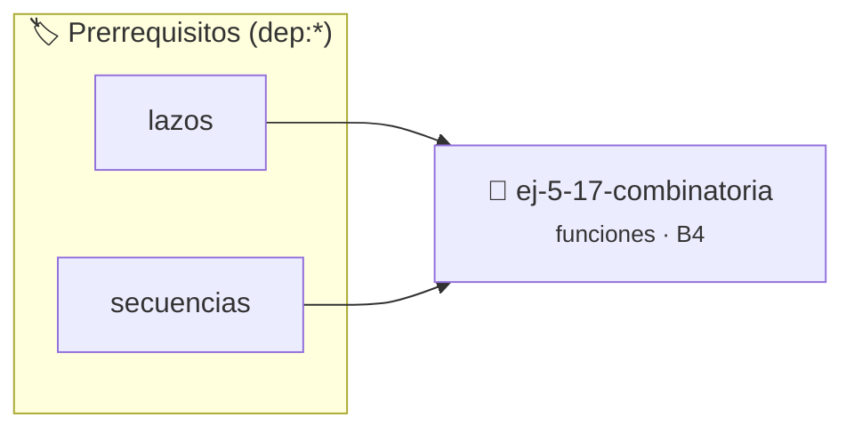

# Combinatoria
> **ID:** `ej-5-17-combinatoria` · **Unidad:** 1 (Fundamentos y Estructuras de Control)
 · **Tema:** `funciones` / `funciones_general`
 · **Bloom:** B4 (Analizar) · **Dificultad:** Avanzada
 · **Carga:** ~35 min · **Tipo:** Practica Guiada
>
> **🏷️ Prerrequisitos temáticos (tags):** `dep:lazos`, `dep:secuencias`


::: {admonition} 📦 Paquete de Verificación Local (Ripley)
:class: tip

Para compilar, resolver y autoevaluar tu entrega con pruebas unitarias en tu máquina:

- [📥 **Descargar paquete `ej-5-17-combinatoria.ripkg`**](../../paquetes/ej-5-17-combinatoria.ripkg)

Ejecución con el asistente de cátedra:
```bash
ripley run ej-5-17-combinatoria.ripkg
```
:::


### 🗺️ Itinerario Pedagógico




## 📖 Consigna

Implementá funciones modulares para el cálculo de combinatoria:
- `long long combinaciones(int n, int k);` — Calcula el número combinatorio $C(n, k) = \frac{n!}{k!(n-k)!}$.
- `long long permutaciones(int n, int k);` — Calcula las permutaciones $P(n, k) = \frac{n!}{(n-k)!}$.

**Orientación:**
- Optimizá el cálculo de $C(n, k)$ simplificando factores para evitar calcular factoriales completos que desborden rápidamente la representación entera.
- Utilizá el tipo `long long` para los resultados (y las operaciones intermedias).
- Si `k < 0` o `k > n`, retornar `0`. Si `k == 0` o `k == n`, $C(n, k) = 1$.
- Las funciones deben ser puras (sin llamadas a `printf` ni `scanf`, Regla 0x2002h).


---
(ejercicio_5_18)=

### 📋 Contrato de las Funciones

```c
/*
 * Calcula combinaciones C(n,k)
 * Precondiciones: Parámetros dentro del dominio válido de la operación.
 * Postcondiciones: Retorna el valor procesado.
 */
long long combinaciones(int n, int k);

/*
 * Calcula permutaciones P(n,k)
 * Precondiciones: Parámetros dentro del dominio válido de la operación.
 * Postcondiciones: Retorna el valor procesado.
 */
long long permutaciones(int n, int k);

```

### 🧪 Ejemplos de Ejecución

::::{tab-set}
:::{tab-item} Caso general
```text
val = 10
Retorno esperado calculado
```
:::
:::{tab-item} Caso límite
```text
val = 0
Retorno 0 o manejo de borde
```
:::
::::

### ⚠️ Precondiciones y Casos Borde

1. **Valores fuera de rango:** Verificar siempre que los datos de entrada cumplan con los rangos admisibles antes de operar.
6. **Casos vacíos o neutros:** Contemplar adecuadamente entradas con longitud cero o valores neutros según corresponda.

### 🎯 Criterios de Aceptación

- [ ] El código compila limpiamente bajo estándar C11 sin warnings con flags estrictos (`-Wall -Wextra -Werror`).
- [ ] Se satisfacen todas las pruebas unitarias y casos de prueba provistos.
- [ ] Las funciones validan exhaustivamente sus precondiciones y gestionan casos borde de forma robusta.


## 📋 Prototipos y Cabecera (`ej-5-17-combinatoria.h`)

```{code-block} c
#ifndef EJERCICIO_EJ_5_17_COMBINATORIA_H
#define EJERCICIO_EJ_5_17_COMBINATORIA_H

#include <stddef.h>
#include <stdbool.h>
#include <stdint.h>

/* Calcula combinaciones C(n,k) */
long long combinaciones(int n, int k);
/* Calcula permutaciones P(n,k) */
long long permutaciones(int n, int k);

#endif /* EJERCICIO_EJ_5_17_COMBINATORIA_H */
```


## ⚙️ Especificación de Funciones

| Función | Retorno | Parámetros | Descripción |
| :--- | :--- | :--- | :--- |

| `combinaciones` | `long long` | `int n, int k` | Calcula combinaciones C(n,k) |

| `permutaciones` | `long long` | `int n, int k` | Calcula permutaciones P(n,k) |


## 🧪 Casos de Prueba

| Prueba Unitaria | Función Objetivo | Verificación |
| :--- | :--- | :--- |

| **test_comb** | `combinaciones` | `assert(combinaciones(5, 2) == 10); assert(combinaciones(5, 0) == 1);` |

| **test_perm** | `permutaciones` | `assert(permutaciones(5, 2) == 20);` |


## ✓ Solución Modelo de Cátedra

```{dropdown} 🔍 Revelar solución canónica en C
:open: false

```{code-block} c
#include <stdio.h>

long long combinaciones(int n, int k) {
    if (k < 0 || k > n) return 0;
    if (k == 0 || k == n) return 1;
    if (k > n / 2) k = n - k;
    long long res = 1;
    for (int i = 1; i <= k; i++) {
        res = res * (n - i + 1) / i;
    }
    return res;
}

long long permutaciones(int n, int k) {
    if (k < 0 || k > n) return 0;
    long long res = 1;
    for (int i = 0; i < k; i++) {
        res *= (n - i);
    }
    return res;
}

int main(void) {
    printf("C(5, 2): %lld\n", combinaciones(5, 2));
    return 0;
}
```
```
