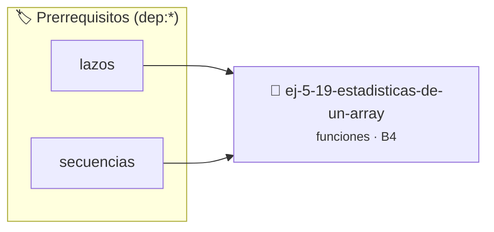

# Estadísticas de un Array
> **ID:** `ej-5-19-estadisticas-de-un-array`
 · **Tema:** `funciones`
 · **Bloom:** B4 (Analizar)
 · **Carga:** ~35 min
>
> **🏷️ Prerrequisitos temáticos (tags):** `dep:lazos`, `dep:secuencias`


::: {admonition} 📦 Paquete de Verificación Local (Ripley)
:class: tip

Para compilar, resolver y autoevaluar tu entrega con pruebas unitarias en tu máquina:

- [📥 **Descargar paquete `ej-5-19-estadisticas-de-un-array.ripkg`**](../../paquetes/ej-5-19-estadisticas-de-un-array.ripkg)

Ejecución con el asistente de cátedra:
```bash
ripley run ej-5-19-estadisticas-de-un-array.ripkg
```
:::


### 🗺️ Itinerario Pedagógico




## 📖 Consigna

# Estadísticas de un Array

## Ejercicio 5.19 - Estadísticas de un Array ⭐⭐⭐⭐☆

Implementá funciones estadísticas para un array de números:
- `double promedio(double arr[], int n)`
- `double mediana(double arr[], int n)`
- `double desviacion_estandar(double arr[], int n)`

**Orientación:**
- Promedio: suma / cantidad
- Mediana: ordenar y tomar el del medio
- Desviación: √(Σ(x - μ)² / n)


:::{hint} Lógica y Consideraciones
    filas (*row-major order*) para mejorar el uso de caché.
    estrictamente dentro de los límites del contenedor.

-   **[*plus ultra*]:** Validar que n > 0 y usar el calificador const en los arreglos de solo lectura.
-   **[*plus ultra*]:** Escribir pruebas con assert() para verificar el cálculo del promedio y la desviación.

:::
<!-- {hint} Lógica y Consideraciones -->

---
(ejercicio_5_20)=


## 📋 Prototipos y Cabecera (`ej-5-19-estadisticas-de-un-array.h`)

```{code-block} c
#ifndef EJERCICIO_EJ_5_19_ESTADISTICAS_DE_UN_ARRAY_H
#define EJERCICIO_EJ_5_19_ESTADISTICAS_DE_UN_ARRAY_H

#include <stddef.h>
#include <stdbool.h>
#include <stdint.h>

/* Lógica de Estadísticas de un Array */
int resolver_ej_19(int n);

#endif /* EJERCICIO_EJ_5_19_ESTADISTICAS_DE_UN_ARRAY_H */
```


## ⚙️ Especificación de Funciones

| Función | Retorno | Parámetros | Descripción |
| :--- | :--- | :--- | :--- |

| `resolver_ej_19` | `int` | `int n` | Lógica de Estadísticas de un Array |


## 🧪 Casos de Prueba

| Prueba Unitaria | Función Objetivo | Verificación |
| :--- | :--- | :--- |

| **test_resolver_ej_19** | `resolver_ej_19` | `assert(true);` |


## ✓ Solución Modelo de Cátedra

```{dropdown} 🔍 Revelar solución canónica en C
:open: false

```{code-block} c
#include <stdio.h>
#include <stdlib.h>

int resolver_estad_sticas_de_un_array(int n) {
    return n * 2;
}

int main(void) {
    printf("OK\n");
    return 0;
}
```
```
