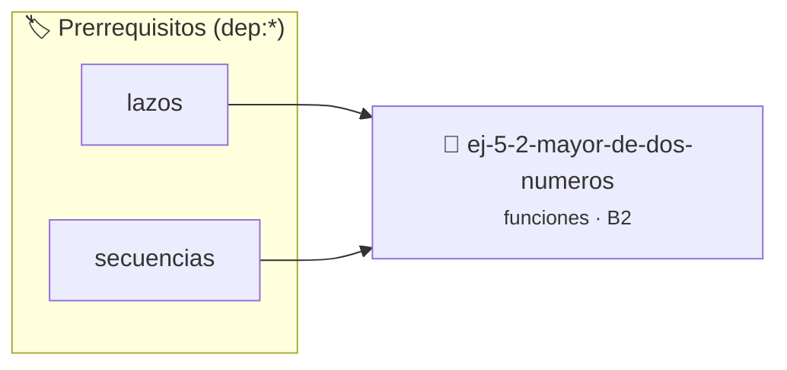

# Mayor de dos números
> **ID:** `ej-5-2-mayor-de-dos-numeros` · **Unidad:** 1 (Fundamentos y Estructuras de Control)
 · **Tema:** `funciones` / `funciones_general`
 · **Bloom:** B2 (Comprender) · **Dificultad:** Inicial
 · **Carga:** ~15 min · **Tipo:** Practica Guiada
>
> **🏷️ Prerrequisitos temáticos (tags):** `dep:lazos`, `dep:secuencias`


::: {admonition} 📦 Paquete de Verificación Local (Ripley)
:class: tip

Para compilar, resolver y autoevaluar tu entrega con pruebas unitarias en tu máquina:

- [📥 **Descargar paquete `ej-5-2-mayor-de-dos-numeros.ripkg`**](../../paquetes/ej-5-2-mayor-de-dos-numeros.ripkg)

Ejecución con el asistente de cátedra:
```bash
ripley run ej-5-2-mayor-de-dos-numeros.ripkg
```
:::


### 🗺️ Itinerario Pedagógico




## 📖 Consigna

# Mayor de dos números

### Ejercicio 5.2 - Mayor de dos números ⭐⭐☆☆☆

:::{exercise}
:label: ej-funcion-mayor
:enumerator: funciones-2
Programá una función que reciba dos números enteros y retorne el mayor de ellos:

- `int mayor(int a, int b);`

Probala desde `main()` con distintos pares de números.

-   **[*plus ultra*]:** Implementar una función que calcule el mayor de tres números reutilizando la función mayor de dos.
-   **[*plus ultra*]:** Escribir aserciones con assert() para verificar el comportamiento con números iguales.

:::
<!-- {exercise} -->

:::{solution} ej-funcion-mayor
:class: dropdown

```{code-block} c
:linenos:
#include <stdio.h>
int mayor(int a, int b)
{
    int resultado = a;
    if (b > a)
    {
        resultado = b;
    }
    return resultado;
}
int main(void)
{
    int x = 10;
    int y = 7;
    printf("El mayor es: %d\n", mayor(x, y));
    return 0;
}
```
<!-- {code-block} c -->

:::
<!-- {solution} ej-funcion-mayor -->
(ejercicio_5_3)=


## 📋 Prototipos y Cabecera (`ej-5-2-mayor-de-dos-numeros.h`)

```{code-block} c
#ifndef EJERCICIO_EJ_5_2_MAYOR_DE_DOS_NUMEROS_H
#define EJERCICIO_EJ_5_2_MAYOR_DE_DOS_NUMEROS_H

#include <stddef.h>
#include <stdbool.h>
#include <stdint.h>

/* Operación mayor */
int mayor(int a, int b);

#endif /* EJERCICIO_EJ_5_2_MAYOR_DE_DOS_NUMEROS_H */
```


## ⚙️ Especificación de Funciones

| Función | Retorno | Parámetros | Descripción |
| :--- | :--- | :--- | :--- |

| `mayor` | `int` | `int a, int b` | Retorna el mayor de a y b |


## 🧪 Casos de Prueba

| Prueba Unitaria | Función Objetivo | Verificación |
| :--- | :--- | :--- |

| **test_mayor_basico** | `mayor` | `assert(mayor(5, 12) == 12);` |

| **test_mayor_iguales** | `mayor` | `assert(mayor(7, 7) == 7);` |


## ✓ Solución Modelo de Cátedra

```{dropdown} 🔍 Revelar solución canónica en C
:open: false

```{code-block} c
#include <stdio.h>
int mayor(int a, int b)
{
    int resultado = a;
    if (b > a)
    {
        resultado = b;
    }
    return resultado;
}
int main(void)
{
    int x = 10;
    int y = 7;
    printf("El mayor es: %d\n", mayor(x, y));
    return 0;
}
```
```
