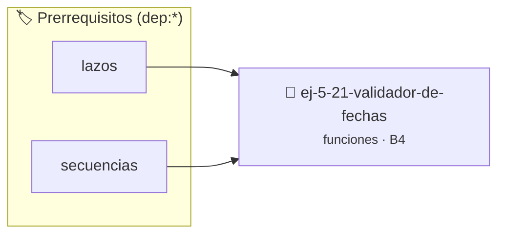

# Validador de Fechas
> **ID:** `ej-5-21-validador-de-fechas`
 · **Tema:** `funciones`
 · **Bloom:** B4 (Analizar)
 · **Carga:** ~35 min
>
> **🏷️ Prerrequisitos temáticos (tags):** `dep:lazos`, `dep:secuencias`


::: {admonition} 📦 Paquete de Verificación Local (Ripley)
:class: tip

Para compilar, resolver y autoevaluar tu entrega con pruebas unitarias en tu máquina:

- [📥 **Descargar paquete `ej-5-21-validador-de-fechas.ripkg`**](../../paquetes/ej-5-21-validador-de-fechas.ripkg)

Ejecución con el asistente de cátedra:
```bash
ripley run ej-5-21-validador-de-fechas.ripkg
```
:::


### 🗺️ Itinerario Pedagógico




## 📖 Consigna

# Validador de Fechas

## Ejercicio 5.21 - Validador de Fechas ⭐⭐⭐⭐☆

Implementá funciones para trabajar con fechas:
- `bool es_fecha_valida(int dia, int mes, int anio)`
- `int dias_del_mes(int mes, int anio)`
- `bool es_bisiesto(int anio)`
- `int dia_del_anio(int dia, int mes, int anio)`

**Orientación:**
- Reutilizá funciones entre sí
- Validá rangos apropiados
- `dia_del_anio` suma días desde inicio del año


:::{hint} Lógica y Consideraciones
    error e informar el resultado mediante parámetros de salida.
    especificando precondiciones y postcondiciones.

-   **[*plus ultra*]:** Modularizar la función reutilizando es_bisiesto y dias_del_mes.
-   **[*plus ultra*]:** Escribir pruebas unitarias exhaustivas para fechas límites (ej. 29 de febrero en años bisiestos y no bisiestos).

:::
<!-- {hint} Lógica y Consideraciones -->

---
(ejercicio_5_22)=


## 📋 Prototipos y Cabecera (`ej-5-21-validador-de-fechas.h`)

```{code-block} c
#ifndef EJERCICIO_EJ_5_21_VALIDADOR_DE_FECHAS_H
#define EJERCICIO_EJ_5_21_VALIDADOR_DE_FECHAS_H

#include <stddef.h>
#include <stdbool.h>
#include <stdint.h>

/* Lógica de Validador de Fechas */
int resolver_ej_21(int n);

#endif /* EJERCICIO_EJ_5_21_VALIDADOR_DE_FECHAS_H */
```


## ⚙️ Especificación de Funciones

| Función | Retorno | Parámetros | Descripción |
| :--- | :--- | :--- | :--- |

| `resolver_ej_21` | `int` | `int n` | Lógica de Validador de Fechas |


## 🧪 Casos de Prueba

| Prueba Unitaria | Función Objetivo | Verificación |
| :--- | :--- | :--- |

| **test_resolver_ej_21** | `resolver_ej_21` | `assert(true);` |


## ✓ Solución Modelo de Cátedra

```{dropdown} 🔍 Revelar solución canónica en C
:open: false

```{code-block} c
#include <stdio.h>
#include <stdlib.h>

int resolver_validador_de_fechas(int n) {
    return n * 2;
}

int main(void) {
    printf("OK\n");
    return 0;
}
```
```
