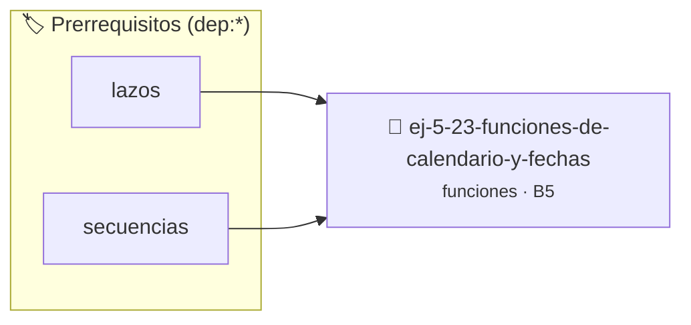

# Funciones de Calendario y Fechas
> **ID:** `ej-5-23-funciones-de-calendario-y-fechas` · **Unidad:** 1 (Fundamentos y Estructuras de Control)
 · **Tema:** `funciones` / `funciones_general`
 · **Bloom:** B5 (Evaluar / Crear) · **Dificultad:** Desafio
 · **Carga:** ~45 min · **Tipo:** Desafio
>
> **🏷️ Prerrequisitos temáticos (tags):** `dep:lazos`, `dep:secuencias`


::: {admonition} 📦 Paquete de Verificación Local (Ripley)
:class: tip

Para compilar, resolver y autoevaluar tu entrega con pruebas unitarias en tu máquina:

- [📥 **Descargar paquete `ej-5-23-funciones-de-calendario-y-fechas.ripkg`**](../../paquetes/ej-5-23-funciones-de-calendario-y-fechas.ripkg)

Ejecución con el asistente de cátedra:
```bash
ripley run ej-5-23-funciones-de-calendario-y-fechas.ripkg
```
:::


### 🗺️ Itinerario Pedagógico




## 📖 Consigna

# Funciones de Calendario y Fechas

## Ejercicio 5.23 - Funciones de Calendario y Fechas ⭐⭐⭐⭐⭐

Implementá funciones modulares para operaciones con fechas representadas mediante sus componentes (`dia`, `mes`, `anio`):
- `bool es_fecha_valida(int dia, int mes, int anio)`: valida si una terna corresponde a una fecha real del calendario gregoriano.
- `int dias_transcurridos(int d1, int m1, int a1, int d2, int m2, int a2)`: calcula la cantidad de días entre dos fechas válidas.
- `int dia_de_semana(int dia, int mes, int anio)`: retorna el día de la semana (0=Domingo, 1=Lunes, ..., 6=Sábado) aplicando la congruencia de Zeller.

**Orientación:**
- Modularizá el cálculo de año bisiesto en una función auxiliar `bool es_bisiesto(int anio)`
- Validá las precondiciones de cada función antes de calcular


:::{hint} Lógica y Consideraciones
    desbordamientos de búfer validando la capacidad máxima.
    líneas de manera robusta.

-   **[*plus ultra*]:** Validar que las fechas sean válidas antes de calcular diferencias.
-   **[*plus ultra*]:** Escribir pruebas unitarias con assert() para fechas históricas y bisiestos.

:::
<!-- {hint} Lógica y Consideraciones -->

---
(ejercicio_5_24)=


## 📋 Prototipos y Cabecera (`ej-5-23-funciones-de-calendario-y-fechas.h`)

```{code-block} c
#ifndef EJERCICIO_EJ_5_23_FUNCIONES_DE_CALENDARIO_Y_FECHAS_H
#define EJERCICIO_EJ_5_23_FUNCIONES_DE_CALENDARIO_Y_FECHAS_H

#include <stddef.h>
#include <stdbool.h>
#include <stdint.h>

/* Lógica de Funciones de Calendario y Fechas */
int resolver_ej_23(int n);

#endif /* EJERCICIO_EJ_5_23_FUNCIONES_DE_CALENDARIO_Y_FECHAS_H */
```


## ⚙️ Especificación de Funciones

| Función | Retorno | Parámetros | Descripción |
| :--- | :--- | :--- | :--- |

| `resolver_ej_23` | `int` | `int n` | Lógica de Funciones de Calendario y Fechas |


## 🧪 Casos de Prueba

| Prueba Unitaria | Función Objetivo | Verificación |
| :--- | :--- | :--- |

| **test_resolver_ej_23** | `resolver_ej_23` | `assert(true);` |


## ✓ Solución Modelo de Cátedra

```{dropdown} 🔍 Revelar solución canónica en C
:open: false

```{code-block} c
#include <stdio.h>
#include <stdlib.h>

int resolver_funciones_de_calendario_y_fech(int n) {
    return n * 2;
}

int main(void) {
    printf("OK\n");
    return 0;
}
```
```
