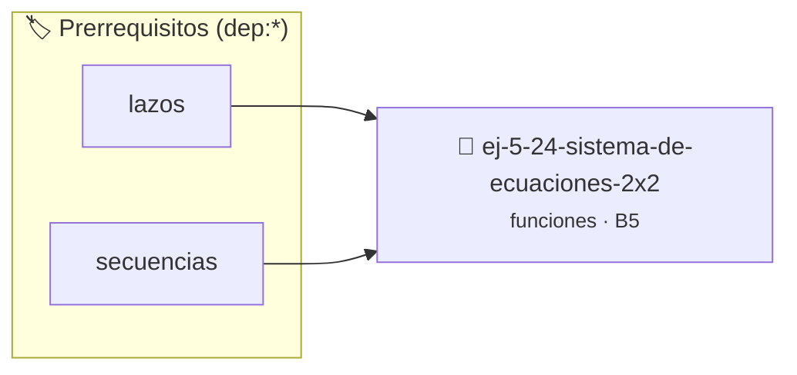

# Sistema de Ecuaciones 2x2
> **ID:** `ej-5-24-sistema-de-ecuaciones-2x2` · **Unidad:** 1 (Fundamentos y Estructuras de Control)
 · **Tema:** `funciones` / `funciones_general`
 · **Bloom:** B5 (Evaluar / Crear) · **Dificultad:** Desafio
 · **Carga:** ~45 min · **Tipo:** Desafio
>
> **🏷️ Prerrequisitos temáticos (tags):** `dep:lazos`, `dep:secuencias`


::: {admonition} 📦 Paquete de Verificación Local (Ripley)
:class: tip

Para compilar, resolver y autoevaluar tu entrega con pruebas unitarias en tu máquina:

- [📥 **Descargar paquete `ej-5-24-sistema-de-ecuaciones-2x2.ripkg`**](../../paquetes/ej-5-24-sistema-de-ecuaciones-2x2.ripkg)

Ejecución con el asistente de cátedra:
```bash
ripley run ej-5-24-sistema-de-ecuaciones-2x2.ripkg
```
:::


### 🗺️ Itinerario Pedagógico




## 📖 Consigna

Implementá funciones modulares para resolver y verificar sistemas de ecuaciones lineales 2×2 mediante la regla de Cramer:


```
a₁x + b₁y = c₁
a₂x + b₂y = c₂
```

Implementá:
- `bool resolver_sistema(double a1, double b1, double c1, 
                          double a2, double b2, double c2,
                          double *x, double *y)`

**Orientación:**
- Usá método de Cramer
- Calculá determinante: det = a1×b2 - a2×b1
- Si det = 0, sistema sin solución única
- x = (c1×b2 - c2×b1) / det
- y = (a1×c2 - a2×c1) / det
- Retorná un código booleano indicando si el determinante es no nulo y el sistema tiene solución única

---

## Notas Finales

:::{tip} Diseño de Funciones

- **Una responsabilidad:** Cada función debe hacer una sola cosa bien
- **Nombres descriptivos:** `calcular_promedio` en lugar de `calc`
- **Parámetros mínimos:** No más de 3-4 parámetros si es posible
- **Retorno significativo:** `bool` para éxito/fallo, valores cuando calculás
  algo
- **Sin efectos laterales:** Evitá modificar variables globales

:::

:::{note} Documentación

Cada función debe tener:
- Descripción de qué hace
- Descripción de parámetros
- Descripción del valor de retorno
- Precondiciones (qué debe ser cierto antes de llamarla)
- Postcondiciones (qué garantiza después de ejecutarse)

:::

Estas consignas practican modularización, reutilización, paso de parámetros y
diseño de interfaces de funciones.

### 📋 Contrato de las Funciones

```c
/*
 * Lógica de Sistema de Ecuaciones 2x2
 * Precondiciones: Parámetros dentro del dominio válido de la operación.
 * Postcondiciones: Retorna el valor procesado.
 */
int resolver_ej_24(int n);

```

### 🧪 Ejemplos de Ejecución

::::{tab-set}
:::{tab-item} Caso general
```text
val = 10
Retorno esperado calculado
```
:::
:::{tab-item} Caso límite
```text
val = 0
Retorno 0 o manejo de borde
```
:::
::::

### ⚠️ Precondiciones y Casos Borde

1. **Valores fuera de rango:** Verificar siempre que los datos de entrada cumplan con los rangos admisibles antes de operar.
6. **Casos vacíos o neutros:** Contemplar adecuadamente entradas con longitud cero o valores neutros según corresponda.

### 🎯 Criterios de Aceptación

- [ ] El código compila limpiamente bajo estándar C11 sin warnings con flags estrictos (`-Wall -Wextra -Werror`).
- [ ] Se satisfacen todas las pruebas unitarias y casos de prueba provistos.
- [ ] Las funciones validan exhaustivamente sus precondiciones y gestionan casos borde de forma robusta.


## 📋 Prototipos y Cabecera (`ej-5-24-sistema-de-ecuaciones-2x2.h`)

```{code-block} c
#ifndef EJERCICIO_EJ_5_24_SISTEMA_DE_ECUACIONES_2X2_H
#define EJERCICIO_EJ_5_24_SISTEMA_DE_ECUACIONES_2X2_H

#include <stddef.h>
#include <stdbool.h>
#include <stdint.h>

/* Lógica de Sistema de Ecuaciones 2x2 */
int resolver_ej_24(int n);

#endif /* EJERCICIO_EJ_5_24_SISTEMA_DE_ECUACIONES_2X2_H */
```


## ⚙️ Especificación de Funciones

| Función | Retorno | Parámetros | Descripción |
| :--- | :--- | :--- | :--- |

| `resolver_ej_24` | `int` | `int n` | Lógica de Sistema de Ecuaciones 2x2 |


## 🧪 Casos de Prueba

| Prueba Unitaria | Función Objetivo | Verificación |
| :--- | :--- | :--- |

| **test_resolver_ej_24** | `resolver_ej_24` | `assert(true);` |


## ✓ Solución Modelo de Cátedra

```{dropdown} 🔍 Revelar solución canónica en C
:open: false

```{code-block} c
#include <stdio.h>
#include <stdlib.h>

int resolver_sistema_de_ecuaciones_2x2(int n) {
    return n * 2;
}

int main(void) {
    printf("OK\n");
    return 0;
}
```
```
