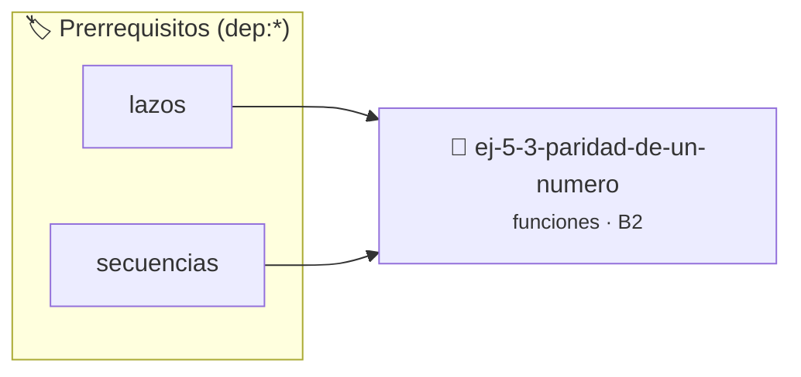

# Paridad de un número
> **ID:** `ej-5-3-paridad-de-un-numero` · **Unidad:** 1 (Fundamentos y Estructuras de Control)
 · **Tema:** `funciones` / `funciones_general`
 · **Bloom:** B2 (Comprender) · **Dificultad:** Inicial
 · **Carga:** ~15 min · **Tipo:** Practica Guiada
>
> **🏷️ Prerrequisitos temáticos (tags):** `dep:lazos`, `dep:secuencias`


::: {admonition} 📦 Paquete de Verificación Local (Ripley)
:class: tip

Para compilar, resolver y autoevaluar tu entrega con pruebas unitarias en tu máquina:

- [📥 **Descargar paquete `ej-5-3-paridad-de-un-numero.ripkg`**](../../paquetes/ej-5-3-paridad-de-un-numero.ripkg)

Ejecución con el asistente de cátedra:
```bash
ripley run ej-5-3-paridad-de-un-numero.ripkg
```
:::


### 🗺️ Itinerario Pedagógico




## 📖 Consigna

:::{exercise}
:label: ej-funcion-par-impar
Definí una función que indique si un número es par o impar. Mostrá el resultado
llamando a la función desde `main()`.
    desbordamientos de búfer validando la capacidad máxima.
    líneas de manera robusta.

-   **[*plus ultra*]:** Hacer que la función retorne un bool en lugar de imprimir directamente en consola.
-   **[*plus ultra*]:** Escribir pruebas unitarias que verifiquen paridad en números pares, impares y negativos.

:::

:::{solution} ej-funcion-par-impar
:class: dropdown

```{code-block} c
:linenos:
#include <stdio.h>
void par_impar(int n)
{
    if (n % 2 == 0)
    {
        printf("%d es par\n", n);
    }
    else
    {
        printf("%d es impar\n", n);
    }
}
int main(void)
{
    par_impar(7);
    par_impar(12);
    return 0;
}
```

:::
(ejercicio_5_4)=

### 📋 Contrato de las Funciones

```c
/*
 * Lógica de Paridad de un número
 * Precondiciones: Parámetros dentro del dominio válido de la operación.
 * Postcondiciones: Retorna el valor procesado.
 */
int resolver_ej_3(int n);

```

### 🧪 Ejemplos de Ejecución

::::{tab-set}
:::{tab-item} Caso general
```text
val = 10
Retorno esperado calculado
```
:::
:::{tab-item} Caso límite
```text
val = 0
Retorno 0 o manejo de borde
```
:::
::::

### ⚠️ Precondiciones y Casos Borde

1. **Valores fuera de rango:** Verificar siempre que los datos de entrada cumplan con los rangos admisibles antes de operar.
6. **Casos vacíos o neutros:** Contemplar adecuadamente entradas con longitud cero o valores neutros según corresponda.

### 🎯 Criterios de Aceptación

- [ ] El código compila limpiamente bajo estándar C11 sin warnings con flags estrictos (`-Wall -Wextra -Werror`).
- [ ] Se satisfacen todas las pruebas unitarias y casos de prueba provistos.
- [ ] Las funciones validan exhaustivamente sus precondiciones y gestionan casos borde de forma robusta.


## 📋 Prototipos y Cabecera (`ej-5-3-paridad-de-un-numero.h`)

```{code-block} c
#ifndef EJERCICIO_EJ_5_3_PARIDAD_DE_UN_NUMERO_H
#define EJERCICIO_EJ_5_3_PARIDAD_DE_UN_NUMERO_H

#include <stddef.h>
#include <stdbool.h>
#include <stdint.h>

/* Operación par_impar */
void par_impar(int n);

#endif /* EJERCICIO_EJ_5_3_PARIDAD_DE_UN_NUMERO_H */
```


## ⚙️ Especificación de Funciones

| Función | Retorno | Parámetros | Descripción |
| :--- | :--- | :--- | :--- |

| `resolver_ej_3` | `int` | `int n` | Lógica de Paridad de un número |


## 🧪 Casos de Prueba

| Prueba Unitaria | Función Objetivo | Verificación |
| :--- | :--- | :--- |

| **test_resolver_ej_3** | `resolver_ej_3` | `assert(true);` |


## ✓ Solución Modelo de Cátedra

```{dropdown} 🔍 Revelar solución canónica en C
:open: false

```{code-block} c
#include <stdio.h>
void par_impar(int n)
{
    if (n % 2 == 0)
    {
        printf("%d es par\n", n);
    }
    else
    {
        printf("%d es impar\n", n);
    }
}
int main(void)
{
    par_impar(7);
    par_impar(12);
    return 0;
}
```
```
