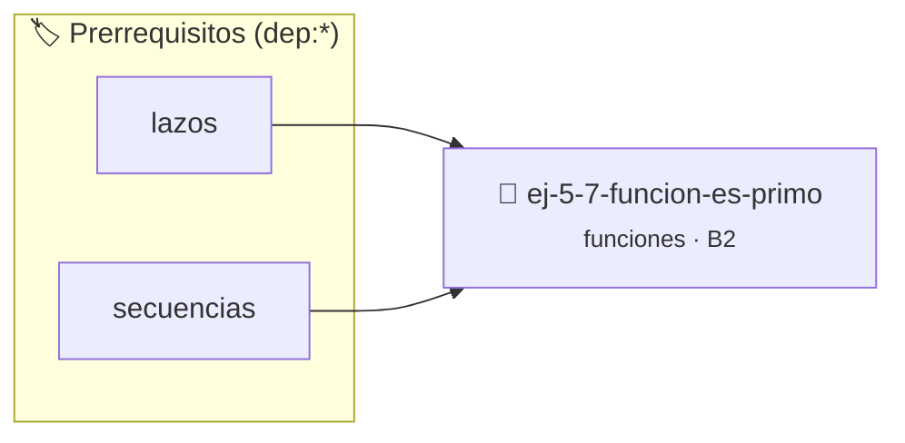

# Función Es Primo
> **ID:** `ej-5-7-funcion-es-primo`
 · **Tema:** `funciones`
 · **Bloom:** B2 (Comprender)
 · **Carga:** ~15 min
>
> **🏷️ Prerrequisitos temáticos (tags):** `dep:lazos`, `dep:secuencias`


::: {admonition} 📦 Paquete de Verificación Local (Ripley)
:class: tip

Para compilar, resolver y autoevaluar tu entrega con pruebas unitarias en tu máquina:

- [📥 **Descargar paquete `ej-5-7-funcion-es-primo.ripkg`**](../../paquetes/ej-5-7-funcion-es-primo.ripkg)

Ejecución con el asistente de cátedra:
```bash
ripley run ej-5-7-funcion-es-primo.ripkg
```
:::


### 🗺️ Itinerario Pedagógico




## 📖 Consigna

# Función Es Primo

## Ejercicio 5.7 - Función Es Primo ⭐⭐☆☆☆

Implementá `bool es_primo(int n)` que determine si un número es primo.

**Orientación:**
- Probá divisibilidad desde 2 hasta √n
- Optimización: solo verificar impares después del 2
- En `main`, mostrá primos en un rango


:::{hint} Lógica y Consideraciones
    desbordamientos de búfer validando la capacidad máxima.
    líneas de manera robusta.

-   **[*plus ultra*]:** Optimizar la función probando divisores únicamente hasta sqrt(n).
-   **[*plus ultra*]:** Documentar las precondiciones (`@pre n >= 1`) y postcondiciones con Doxygen.

:::
<!-- {hint} Lógica y Consideraciones -->

---
(ejercicio_5_8)=


## 📋 Prototipos y Cabecera (`ej-5-7-funcion-es-primo.h`)

```{code-block} c
#ifndef EJERCICIO_EJ_5_7_FUNCION_ES_PRIMO_H
#define EJERCICIO_EJ_5_7_FUNCION_ES_PRIMO_H

#include <stddef.h>
#include <stdbool.h>
#include <stdint.h>

/* Lógica de Función Es Primo */
int resolver_ej_7(int n);

#endif /* EJERCICIO_EJ_5_7_FUNCION_ES_PRIMO_H */
```


## ⚙️ Especificación de Funciones

| Función | Retorno | Parámetros | Descripción |
| :--- | :--- | :--- | :--- |

| `resolver_ej_7` | `int` | `int n` | Lógica de Función Es Primo |


## 🧪 Casos de Prueba

| Prueba Unitaria | Función Objetivo | Verificación |
| :--- | :--- | :--- |

| **test_resolver_ej_7** | `resolver_ej_7` | `assert(true);` |


## ✓ Solución Modelo de Cátedra

```{dropdown} 🔍 Revelar solución canónica en C
:open: false

```{code-block} c
#include <stdio.h>
#include <stdlib.h>

int resolver_funci_n_es_primo(int n) {
    return n * 2;
}

int main(void) {
    printf("OK\n");
    return 0;
}
```
```
