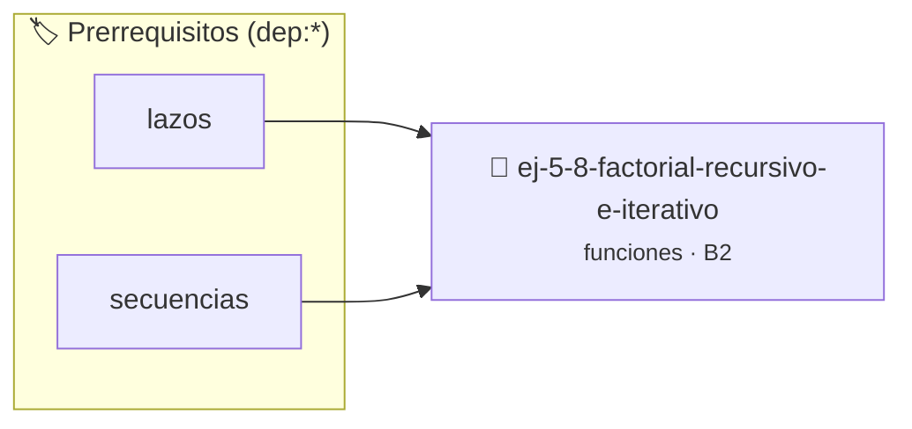

# Factorial Recursivo e Iterativo
> **ID:** `ej-5-8-factorial-recursivo-e-iterativo` · **Unidad:** 1 (Fundamentos y Estructuras de Control)
 · **Tema:** `funciones` / `funciones_general`
 · **Bloom:** B2 (Comprender) · **Dificultad:** Inicial
 · **Carga:** ~15 min · **Tipo:** Practica Guiada
>
> **🏷️ Prerrequisitos temáticos (tags):** `dep:lazos`, `dep:secuencias`


::: {admonition} 📦 Paquete de Verificación Local (Ripley)
:class: tip

Para compilar, resolver y autoevaluar tu entrega con pruebas unitarias en tu máquina:

- [📥 **Descargar paquete `ej-5-8-factorial-recursivo-e-iterativo.ripkg`**](../../paquetes/ej-5-8-factorial-recursivo-e-iterativo.ripkg)

Ejecución con el asistente de cátedra:
```bash
ripley run ej-5-8-factorial-recursivo-e-iterativo.ripkg
```
:::


### 🗺️ Itinerario Pedagógico




## 📖 Consigna

Implementá dos versiones de la función factorial:
- `int factorial_iterativo(int n);`
- `int factorial_recursivo(int n);`

**Orientación:**
- Iterativo: usá un lazo `for` o `while` acumulando el producto.
- Recursivo: `n * factorial_recursivo(n - 1)`, con caso base `n <= 1` retornando `1`.
- Si `n < 0`, retornar `-1` como código de error.


---
(ejercicio_5_9)=

### 📋 Contrato de las Funciones

```c
/*
 * Factorial iterativo
 * Precondiciones: Parámetros dentro del dominio válido de la operación.
 * Postcondiciones: Retorna el valor procesado.
 */
int factorial_iterativo(int n);

/*
 * Factorial recursivo
 * Precondiciones: Parámetros dentro del dominio válido de la operación.
 * Postcondiciones: Retorna el valor procesado.
 */
int factorial_recursivo(int n);

```

### 🧪 Ejemplos de Ejecución

::::{tab-set}
:::{tab-item} Valor positivo
```text
Entrada: 5
Salida / Retorno: 120
```
:::
:::{tab-item} Valor positivo
```text
Entrada: 5
Salida / Retorno: 120
```
:::
::::

### ⚠️ Precondiciones y Casos Borde

1. **Valores fuera de rango:** Verificar siempre que los datos de entrada cumplan con los rangos admisibles antes de operar.
6. **Casos vacíos o neutros:** Contemplar adecuadamente entradas con longitud cero o valores neutros según corresponda.

### 🎯 Criterios de Aceptación

- [ ] El código compila limpiamente bajo estándar C11 sin warnings con flags estrictos (`-Wall -Wextra -Werror`).
- [ ] Se satisfacen todas las pruebas unitarias y casos de prueba provistos.
- [ ] Las funciones validan exhaustivamente sus precondiciones y gestionan casos borde de forma robusta.


## 📋 Prototipos y Cabecera (`ej-5-8-factorial-recursivo-e-iterativo.h`)

```{code-block} c
#ifndef EJERCICIO_EJ_5_8_FACTORIAL_RECURSIVO_E_ITERATIVO_H
#define EJERCICIO_EJ_5_8_FACTORIAL_RECURSIVO_E_ITERATIVO_H

#include <stddef.h>
#include <stdbool.h>
#include <stdint.h>

/* Factorial iterativo */
int factorial_iterativo(int n);
/* Factorial recursivo */
int factorial_recursivo(int n);

#endif /* EJERCICIO_EJ_5_8_FACTORIAL_RECURSIVO_E_ITERATIVO_H */
```


## ⚙️ Especificación de Funciones

| Función | Retorno | Parámetros | Descripción |
| :--- | :--- | :--- | :--- |

| `factorial_iterativo` | `int` | `int n` | Factorial iterativo |

| `factorial_recursivo` | `int` | `int n` | Factorial recursivo |


## 🧪 Casos de Prueba

| Prueba Unitaria | Función Objetivo | Verificación |
| :--- | :--- | :--- |

| **test_factorial_it** | `factorial_iterativo` | `assert(factorial_iterativo(5) == 120); assert(factorial_iterativo(0) == 1);` |

| **test_factorial_rec** | `factorial_recursivo` | `assert(factorial_recursivo(5) == 120); assert(factorial_recursivo(0) == 1);` |


## ✓ Solución Modelo de Cátedra

```{dropdown} 🔍 Revelar solución canónica en C
:open: false

```{code-block} c
#include <stdio.h>
#include <assert.h>

int factorial_iterativo(int n) {
    if (n < 0) return -1;
    int res = 1;
    for (int i = 2; i <= n; i++) res *= i;
    return res;
}

int factorial_recursivo(int n) {
    if (n < 0) return -1;
    if (n <= 1) return 1;
    return n * factorial_recursivo(n - 1);
}

int main(void) {
    printf("Fact 5: %d\n", factorial_iterativo(5));
    return 0;
}
```
```
