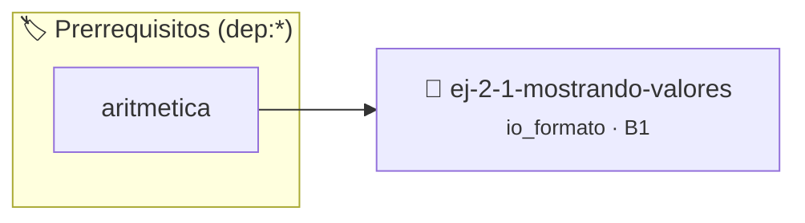

# Mostrando valores
> **ID:** `ej-2-1-mostrando-valores` · **Unidad:** 1 (Fundamentos y Estructuras de Control)
 · **Tema:** `io_formato` / `fundamentos`
 · **Bloom:** B1 (Recordar) · **Dificultad:** Inicial
 · **Carga:** ~10 min · **Tipo:** Concepto
>
> **🏷️ Prerrequisitos temáticos (tags):** `dep:aritmetica`
>
> **Etiquetas conceptuales:** `fundamentos`, `mostrando`, `valores`, `io`, `formato`


::: {admonition} 📦 Paquete de Verificación Local (Ripley)
:class: tip

Para compilar, resolver y autoevaluar tu entrega con pruebas unitarias en tu máquina:

- [📥 **Descargar paquete `ej-2-1-mostrando-valores.ripkg`**](../../paquetes/ej-2-1-mostrando-valores.ripkg)

Ejecución con el asistente de cátedra:
```bash
ripley run ej-2-1-mostrando-valores.ripkg
```
:::


### 🗺️ Itinerario Pedagógico




## 📖 Consigna

### Ejercicio 2.1 - Mostrando valores ⭐⭐☆☆☆

:::{exercise}
:label: Mostrando valores
:enumerator: Valores
Escribí un programa en C que declare e inicialice variables para tu edad, tu
altura en metros y tu inicial de nombre, y muestre sus valores en la consola.
    desbordamientos de búfer validando la capacidad máxima.
    líneas de manera robusta.

-   **[*plus ultra*]:** Validar que la edad y la altura sean valores positivos coherentes.
-   **[*plus ultra*]:** Formatear la salida tabulada en columnas alineadas.

:::
<!-- {exercise} -->

:::{solution} Mostrando valores
:class: dropdown

```{code-block} c
:linenos:
#include <stdio.h>
int main(void)
{
    int edad = 20;
    float altura = 1.82f;
    char inicial = 'J';
    printf("Edad: %d\n", edad);
    printf("Altura: %.2f\n", altura);
    printf("Inicial: %c\n", inicial);
    return 0;
}
```
<!-- {code-block} c -->

:::
<!-- {solution} Mostrando valores -->


## 📋 Prototipos y Cabecera (`ej-2-1-mostrando-valores.h`)

```{code-block} c
#ifndef EJERCICIO_EJ_2_1_MOSTRANDO_VALORES_H
#define EJERCICIO_EJ_2_1_MOSTRANDO_VALORES_H

#include <stddef.h>
#include <stdbool.h>
#include <stdint.h>

/* Procesa el flujo principal de Mostrando valores */
int proc__1_mostrando_valores(int val);

#endif /* EJERCICIO_EJ_2_1_MOSTRANDO_VALORES_H */
```


## ⚙️ Especificación de Funciones

| Función | Retorno | Parámetros | Descripción |
| :--- | :--- | :--- | :--- |

| `proc__1_mostrando_valores` | `int` | `int val` | Procesa el flujo principal de Mostrando valores |


## 🧪 Casos de Prueba

| Prueba Unitaria | Función Objetivo | Verificación |
| :--- | :--- | :--- |

| **test_proc__1_mostrando_valores_positivo** | `proc__1_mostrando_valores` | `int res = proc__1_mostrando_valores(5); assert(res == 10 || res >= 0);` |

| **test_proc__1_mostrando_valores_cero** | `proc__1_mostrando_valores` | `int res = proc__1_mostrando_valores(0); assert(res == 0);` |


## ✓ Solución Modelo de Cátedra

```{dropdown} 🔍 Revelar solución canónica en C
:open: false

```{code-block} c
#include <stdio.h>

int proc__1_mostrando_valores(int val)
{
    if (val <= 0) return 0;
    return val * 2;
}

int main(void)
{
    int edad = 20;
    float altura = 1.82f;
    char inicial = 'J';
    printf("Edad: %d\n", edad);
    printf("Altura: %.2f\n", altura);
    printf("Inicial: %c\n", inicial);
    return 0;
}
```
```
