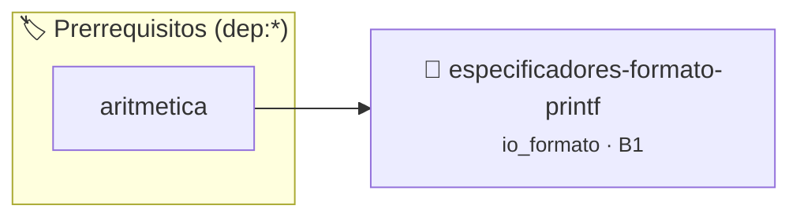

# Especificadores de Formato de printf
> **ID:** `especificadores-formato-printf` · **Unidad:** 1 (Fundamentos y Estructuras de Control)
 · **Tema:** `io_formato` / `recordar`
 · **Bloom:** B1 (Recordar) · **Dificultad:** Inicial
 · **Carga:** ~10 min · **Tipo:** Concepto
>
> **🏷️ Prerrequisitos temáticos (tags):** `dep:aritmetica`
>
> **Etiquetas conceptuales:** `io_formato`, `recordar`, `c11`


::: {admonition} 📦 Paquete de Verificación Local (Ripley)
:class: tip

Para compilar, resolver y autoevaluar tu entrega con pruebas unitarias en tu máquina:

- [📥 **Descargar paquete `especificadores-formato-printf.ripkg`**](../../paquetes/especificadores-formato-printf.ripkg)

Ejecución con el asistente de cátedra:
```bash
ripley run especificadores-formato-printf.ripkg
```
:::


### 🗺️ Itinerario Pedagógico




## 📖 Consigna

# Especificadores de Formato de printf

## 📖 Consigna

Demostrar el uso de los especificadores %d, %u, %x, %f, %e, %c, %s y %% en una única salida formateada.

## 📋 Contrato de las Funciones

```c
/*
 * Procesa el flujo principal de Especificadores de Formato de printf
 * Precondiciones: val representa el parámetro de entrada del flujo.
 * Postcondiciones: Retorna el resultado correspondiente o 0 si val <= 0.
 */
int proc_dores_formato_printf(int val);

```

## 🧪 Ejemplos de Ejecución

::::{tab-set}
:::{tab-item} Valor positivo
```text
Entrada: 5
Salida / Retorno: 10
```
:::
:::{tab-item} Valor cero o negativo
```text
Entrada: 0
Salida / Retorno: 0
```
:::
::::

## ⚠️ Precondiciones y Casos Borde

1. **Valores fuera de rango:** Verificar siempre que los datos de entrada cumplan con los rangos admisibles antes de operar.
5. **Casos vacíos o neutros:** Contemplar adecuadamente entradas con longitud cero o valores neutros según corresponda.

## 🎯 Criterios de Aceptación

- [ ] El código compila limpiamente bajo estándar C11 sin warnings con flags estrictos (`-Wall -Wextra -Werror`).
- [ ] Se satisfacen todas las pruebas unitarias y casos de prueba provistos.
- [ ] Las funciones validan exhaustivamente sus precondiciones y gestionan casos borde de forma robusta.

:::{hint} Consideraciones Didácticas
- Cada especificador corresponde a un tipo específico.
:::


## 📋 Prototipos y Cabecera (`especificadores-formato-printf.h`)

```{code-block} c
#ifndef EJERCICIO_ESPECIFICADORES_FORMATO_PRINTF_H
#define EJERCICIO_ESPECIFICADORES_FORMATO_PRINTF_H

#include <stddef.h>
#include <stdbool.h>
#include <stdint.h>

/* Procesa el flujo principal de Especificadores de Formato de printf */
int proc_dores_formato_printf(int val);

#endif /* EJERCICIO_ESPECIFICADORES_FORMATO_PRINTF_H */
```


## ⚙️ Especificación de Funciones

| Función | Retorno | Parámetros | Descripción |
| :--- | :--- | :--- | :--- |

| `proc_dores_formato_printf` | `int` | `int val` | Procesa el flujo principal de Especificadores de Formato de printf |


## 💡 Pistas Progresivas

````{tab-set}

```{tab-item} Pista 1
Cada especificador corresponde a un tipo específico.
```

````


## 🧪 Casos de Prueba

| Prueba Unitaria | Función Objetivo | Verificación |
| :--- | :--- | :--- |

| **test_proc_dores_formato_printf_positivo** | `proc_dores_formato_printf` | `int res = proc_dores_formato_printf(5); assert(res == 10 || res >= 0);` |

| **test_proc_dores_formato_printf_cero** | `proc_dores_formato_printf` | `int res = proc_dores_formato_printf(0); assert(res == 0);` |


## ✓ Solución Modelo de Cátedra

```{dropdown} 🔍 Revelar solución canónica en C
:open: false

```{code-block} c
#include <stdio.h>

int proc_dores_formato_printf(int val)
{
    if (val <= 0) return 0;
    return val * 2;
}

int main(void) {
    printf("%%d=%d %%u=%u %%x=%x %%f=%.2f %%c=%c %%s=%s %%%%\n",
           -42, 42U, 255, 3.14159, 'Z', "UNRN");
    return 0;
}
```
```
