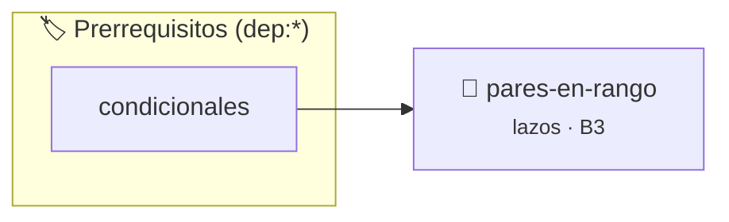

# Números Pares en Rango
> **ID:** `pares-en-rango` · **Unidad:** 1 (Fundamentos y Estructuras de Control)
 · **Tema:** `lazos` / `for`
 · **Bloom:** B3 (Aplicar) · **Dificultad:** Intermedia
 · **Carga:** ~25 min · **Tipo:** Practica Guiada
>
> **🏷️ Prerrequisitos temáticos (tags):** `dep:condicionales`
>
> **Etiquetas conceptuales:** `lazos`, `for`, `condicionales`, `intervalos`


::: {admonition} 📦 Paquete de Verificación Local (Ripley)
:class: tip

Para compilar, resolver y autoevaluar tu entrega con pruebas unitarias en tu máquina:

- [📥 **Descargar paquete `pares-en-rango.ripkg`**](../../paquetes/pares-en-rango.ripkg)

Ejecución con el asistente de cátedra:
```bash
ripley run pares-en-rango.ripkg
```
:::


### 🗺️ Itinerario Pedagógico




## 📖 Consigna

**Dificultad:** ⭐⭐☆☆☆

Escribir un programa que lea dos valores enteros que definen un rango $[A, B]$ y muestre por pantalla todos los números pares comprendidos entre ambos valores (inclusive).

## Entrada
Dos números enteros $A$ y $B$.

## Salida
Todos los números pares dentro del intervalo $[A, B]$ separados por espacio o línea.

### Ejemplo
- **Entrada:**
  ```text
  1
  10
  ```
- **Salida:** `2 4 6 8 10`

### 📋 Contrato de las Funciones

```c
/*
 * Procesa el flujo principal de Números Pares en Rango
 * Precondiciones: val representa el parámetro de entrada del flujo.
 * Postcondiciones: Retorna el resultado correspondiente o 0 si val <= 0.
 */
int ejecutar_pares_en_rango(int val);

```

### 🧪 Ejemplos de Ejecución

::::{tab-set}
:::{tab-item} Valor positivo
```text
Entrada: 5
Salida / Retorno: 10
```
:::
:::{tab-item} Valor cero o negativo
```text
Entrada: 0
Salida / Retorno: 0
```
:::
::::

### ⚠️ Precondiciones y Casos Borde

1. **Valores fuera de rango:** Verificar siempre que los datos de entrada cumplan con los rangos admisibles antes de operar.
6. **Casos vacíos o neutros:** Contemplar adecuadamente entradas con longitud cero o valores neutros según corresponda.

### 🎯 Criterios de Aceptación

- [ ] El código compila limpiamente bajo estándar C11 sin warnings con flags estrictos (`-Wall -Wextra -Werror`).
- [ ] Se satisfacen todas las pruebas unitarias y casos de prueba provistos.
- [ ] Las funciones validan exhaustivamente sus precondiciones y gestionan casos borde de forma robusta.

:::{hint} Consideraciones Didácticas
- Si A > B, intercambiá los extremos para recorrer el intervalo en orden creciente.
- Imprimí los valores donde valor % 2 == 0.
:::


## 📋 Prototipos y Cabecera (`pares-en-rango.h`)

```{code-block} c
#ifndef EJERCICIO_PARES_EN_RANGO_H
#define EJERCICIO_PARES_EN_RANGO_H

#include <stddef.h>
#include <stdbool.h>
#include <stdint.h>

/* Procesa el flujo principal de Números Pares en Rango */
int ejecutar_pares_en_rango(int val);

#endif /* EJERCICIO_PARES_EN_RANGO_H */
```


## ⚙️ Especificación de Funciones

| Función | Retorno | Parámetros | Descripción |
| :--- | :--- | :--- | :--- |

| `ejecutar_pares_en_rango` | `int` | `int val` | Procesa el flujo principal de Números Pares en Rango |


## 💡 Pistas Progresivas

````{tab-set}

```{tab-item} Pista 1
Si A > B, intercambiá los extremos para recorrer el intervalo en orden creciente.
```

```{tab-item} Pista 2
Imprimí los valores donde valor % 2 == 0.
```

````


## 🧪 Casos de Prueba

| Prueba Unitaria | Función Objetivo | Verificación |
| :--- | :--- | :--- |

| **test_ejecutar_pares_en_rango_positivo** | `ejecutar_pares_en_rango` | `int res = ejecutar_pares_en_rango(5); assert(res == 10 || res >= 0);` |

| **test_ejecutar_pares_en_rango_cero** | `ejecutar_pares_en_rango` | `int res = ejecutar_pares_en_rango(0); assert(res == 0);` |


## ✓ Solución Modelo de Cátedra

```{dropdown} 🔍 Revelar solución canónica en C
:open: false

```{code-block} c
/*
Ejercicio 4.19 – Números Pares en Rango
Mostrá todos los números pares entre dos valores ingresados.
-----------------
Cátedra Programación I
INGCOM-UNRN-P1
*/

#include <stdio.h>


int ejecutar_pares_en_rango(int val)
{
    if (val <= 0) return 0;
    return val * 2;
}

int main(void)
{
    int rango_inicio = 0;
    int rango_final = 0;

    printf("Ingrese el valor inicial (A): ");
    if (scanf("%d", &rango_inicio) != 1)
    {
        return 1;
    }

    printf("Ingrese el valor final (B): ");
    if (scanf("%d", &rango_final) != 1)
    {
        return 1;
    }

    if (rango_inicio > rango_final)
    {
        int auxiliar = rango_inicio;
        rango_inicio = rango_final;
        rango_final = auxiliar;
    }

    printf("Números pares en el rango [%d, %d]:\n", rango_inicio, rango_final);
    for (int actual = rango_inicio; actual <= rango_final; actual++)
    {
        if (actual % 2 == 0)
        {
            printf("%d ", actual);
        }
    }
    printf("\n");

    return 0;
}
```
```
