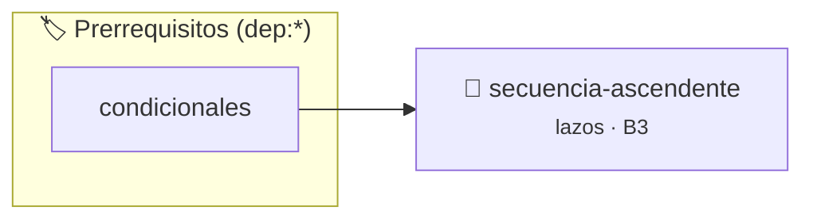

# Secuencia Ascendente
> **ID:** `secuencia-ascendente` · **Unidad:** 1 (Fundamentos y Estructuras de Control)
 · **Tema:** `lazos` / `for`
 · **Bloom:** B3 (Aplicar) · **Dificultad:** Intermedia
 · **Carga:** ~25 min · **Tipo:** Practica Guiada
>
> **🏷️ Prerrequisitos temáticos (tags):** `dep:condicionales`
>
> **Etiquetas conceptuales:** `lazos`, `for`, `secuencias`


::: {admonition} 📦 Paquete de Verificación Local (Ripley)
:class: tip

Para compilar, resolver y autoevaluar tu entrega con pruebas unitarias en tu máquina:

- [📥 **Descargar paquete `secuencia-ascendente.ripkg`**](../../paquetes/secuencia-ascendente.ripkg)

Ejecución con el asistente de cátedra:
```bash
ripley run secuencia-ascendente.ripkg
```
:::


### 🗺️ Itinerario Pedagógico




## 📖 Consigna

**Identificador:** `ejercicio2` | **Módulo:** Práctica 1

---

El objetivo es mostrar una secuencia de números enteros que comienza en un número $n$ y termina justo antes de un número $m$. Esto corresponde al intervalo matemático $[n, m)$.

---

- **Entrada (`stdin`):** Dos números enteros $n$ y $m$ separados por espacio o salto de línea.
- **Salida (`stdout`):** La secuencia de números enteros en el intervalo $[n, m)$, imprimiendo un número por línea. Si $n \ge m$, no se imprime ningún número.

---

```text
Entrada:
3 7

Salida:
3
4
5
6
```

### 📋 Contrato de las Funciones

```c
/*
 * Procesa el flujo principal de Secuencia Ascendente
 * Precondiciones: val representa el parámetro de entrada del flujo.
 * Postcondiciones: Retorna el resultado correspondiente o 0 si val <= 0.
 */
int ejecutar_secuencia_ascendente(int val);

```

### 🧪 Ejemplos de Ejecución

::::{tab-set}
:::{tab-item} Valor positivo
```text
Entrada: 5
Salida / Retorno: 10
```
:::
:::{tab-item} Valor cero o negativo
```text
Entrada: 0
Salida / Retorno: 0
```
:::
::::

### ⚠️ Precondiciones y Casos Borde

1. **Valores fuera de rango:** Verificar siempre que los datos de entrada cumplan con los rangos admisibles antes de operar.
6. **Casos vacíos o neutros:** Contemplar adecuadamente entradas con longitud cero o valores neutros según corresponda.

### 🎯 Criterios de Aceptación

- [ ] El código compila limpiamente bajo estándar C11 sin warnings con flags estrictos (`-Wall -Wextra -Werror`).
- [ ] Se satisfacen todas las pruebas unitarias y casos de prueba provistos.
- [ ] Las funciones validan exhaustivamente sus precondiciones y gestionan casos borde de forma robusta.

:::{hint} Consideraciones Didácticas
- El intervalo [n, m) es semiabierto: incluye n y excluye m.
- Si la condición inicial n < m no se cumple, el bucle no debe iterar.
:::


## 📋 Prototipos y Cabecera (`secuencia-ascendente.h`)

```{code-block} c
#ifndef EJERCICIO_SECUENCIA_ASCENDENTE_H
#define EJERCICIO_SECUENCIA_ASCENDENTE_H

#include <stddef.h>
#include <stdbool.h>
#include <stdint.h>

/* Procesa el flujo principal de Secuencia Ascendente */
int ejecutar_secuencia_ascendente(int val);

#endif /* EJERCICIO_SECUENCIA_ASCENDENTE_H */
```


## ⚙️ Especificación de Funciones

| Función | Retorno | Parámetros | Descripción |
| :--- | :--- | :--- | :--- |

| `ejecutar_secuencia_ascendente` | `int` | `int val` | Procesa el flujo principal de Secuencia Ascendente |


## 💡 Pistas Progresivas

````{tab-set}

```{tab-item} Pista 1
El intervalo [n, m) es semiabierto: incluye n y excluye m.
```

```{tab-item} Pista 2
Si la condición inicial n < m no se cumple, el bucle no debe iterar.
```

````


## 🧪 Casos de Prueba

| Prueba Unitaria | Función Objetivo | Verificación |
| :--- | :--- | :--- |

| **test_ejecutar_secuencia_ascendente_positivo** | `ejecutar_secuencia_ascendente` | `int res = ejecutar_secuencia_ascendente(5); assert(res == 10 || res >= 0);` |

| **test_ejecutar_secuencia_ascendente_cero** | `ejecutar_secuencia_ascendente` | `int res = ejecutar_secuencia_ascendente(0); assert(res == 0);` |


## ✓ Solución Modelo de Cátedra

```{dropdown} 🔍 Revelar solución canónica en C
:open: false

```{code-block} c
/*
Ejercicio 1.2 – Secuencia Ascendente
Mostrar una secuencia de números enteros desde n hasta antes de m.
-----------------
Docente Cátedra
catedra_p1
*/

#include <stdio.h>


int ejecutar_secuencia_ascendente(int val)
{
    if (val <= 0) return 0;
    return val * 2;
}

int main(void)
{
    int n = 0;
    int m = 0;

    if (scanf("%d %d", &n, &m) == 2)
    {
        for (int i = n; i < m; i++)
        {
            printf("%d\n", i);
        }
    }

    return 0;
}
```
```
