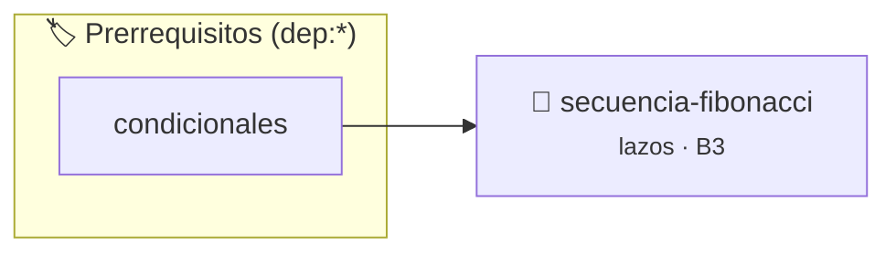

# Secuencia de Fibonacci
> **ID:** `secuencia-fibonacci`
 · **Tema:** `lazos`
 · **Bloom:** B3 (Aplicar)
 · **Carga:** ~25 min
>
> **🏷️ Prerrequisitos temáticos (tags):** `dep:condicionales`
>
> **Etiquetas conceptuales:** `lazos`, `for`, `secuencias`, `fibonacci`


::: {admonition} 📦 Paquete de Verificación Local (Ripley)
:class: tip

Para compilar, resolver y autoevaluar tu entrega con pruebas unitarias en tu máquina:

- [📥 **Descargar paquete `secuencia-fibonacci.ripkg`**](../../paquetes/secuencia-fibonacci.ripkg)

Ejecución con el asistente de cátedra:
```bash
ripley run secuencia-fibonacci.ripkg
```
:::


### 🗺️ Itinerario Pedagógico




## 📖 Consigna

# Ejercicio 4.24 – Secuencia de Fibonacci
**Dificultad:** ⭐⭐⭐☆☆

## Consigna
Escribir un programa que genere y muestre los primeros $N$ términos de la secuencia de Fibonacci de forma iterativa.
La secuencia comienza en $t_0 = 0$ y $t_1 = 1$, y los términos siguientes son la suma de los dos anteriores: $t_n = t_{n-1} + t_{n-2}$.

## Entrada
Un número entero positivo $N$ (cantidad de términos a generar).

## Salida
Los primeros $N$ términos de la serie separados por espacios o saltos de línea.

### Ejemplo
- **Entrada:** `6`
- **Salida:** `0 1 1 2 3 5`


## 📋 Prototipos y Cabecera (`secuencia-fibonacci.h`)

```{code-block} c
#ifndef EJERCICIO_SECUENCIA_FIBONACCI_H
#define EJERCICIO_SECUENCIA_FIBONACCI_H

#include <stddef.h>
#include <stdbool.h>
#include <stdint.h>

/* Procesa el flujo principal de Secuencia de Fibonacci */
int ejecutar_secuencia_fibonacci(int val);

#endif /* EJERCICIO_SECUENCIA_FIBONACCI_H */
```


## ⚙️ Especificación de Funciones

| Función | Retorno | Parámetros | Descripción |
| :--- | :--- | :--- | :--- |

| `ejecutar_secuencia_fibonacci` | `int` | `int val` | Procesa el flujo principal de Secuencia de Fibonacci |


## 💡 Pistas Progresivas

````{tab-set}

```{tab-item} Pista 1
Inicializá los primeros dos términos: t0 = 0 y t1 = 1.
```

```{tab-item} Pista 2
En cada paso, calculá el siguiente término t0 + t1, imprimilo y desplazá las variables.
```

````


## 🧪 Casos de Prueba

| Prueba Unitaria | Función Objetivo | Verificación |
| :--- | :--- | :--- |

| **test_ejecutar_secuencia_fibonacci_positivo** | `ejecutar_secuencia_fibonacci` | `int res = ejecutar_secuencia_fibonacci(5); assert(res == 10 || res >= 0);` |

| **test_ejecutar_secuencia_fibonacci_cero** | `ejecutar_secuencia_fibonacci` | `int res = ejecutar_secuencia_fibonacci(0); assert(res == 0);` |


## ✓ Solución Modelo de Cátedra

```{dropdown} 🔍 Revelar solución canónica en C
:open: false

```{code-block} c
/*
Ejercicio 4.24 – Secuencia de Fibonacci
Generá los primeros N números de Fibonacci de forma iterativa.
-----------------
Cátedra Programación I
INGCOM-UNRN-P1
*/

#include <stdio.h>


int ejecutar_secuencia_fibonacci(int val)
{
    if (val <= 0) return 0;
    return val * 2;
}

int main(void)
{
    int cantidad_terminos = 0;
    long termino_anterior = 0;
    long termino_actual = 1;
    long termino_siguiente = 0;

    printf("Ingrese la cantidad de términos N: ");
    if (scanf("%d", &cantidad_terminos) != 1 || cantidad_terminos <= 0)
    {
        return 1;
    }

    printf("Secuencia de Fibonacci (%d términos):\n", cantidad_terminos);
    for (int indice = 0; indice < cantidad_terminos; indice++)
    {
        printf("%ld ", termino_anterior);
        termino_siguiente = termino_anterior + termino_actual;
        termino_anterior = termino_actual;
        termino_actual = termino_siguiente;
    }
    printf("\n");

    return 0;
}
```
```
