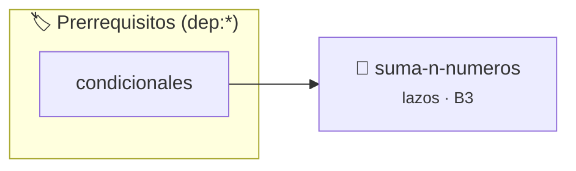

# Suma de N Números
> **ID:** `suma-n-numeros` · **Unidad:** 1 (Fundamentos y Estructuras de Control)
 · **Tema:** `lazos` / `for`
 · **Bloom:** B3 (Aplicar) · **Dificultad:** Intermedia
 · **Carga:** ~25 min · **Tipo:** Practica Guiada
>
> **🏷️ Prerrequisitos temáticos (tags):** `dep:condicionales`
>
> **Etiquetas conceptuales:** `lazos`, `for`, `acumulador`


::: {admonition} 📦 Paquete de Verificación Local (Ripley)
:class: tip

Para compilar, resolver y autoevaluar tu entrega con pruebas unitarias en tu máquina:

- [📥 **Descargar paquete `suma-n-numeros.ripkg`**](../../paquetes/suma-n-numeros.ripkg)

Ejecución con el asistente de cátedra:
```bash
ripley run suma-n-numeros.ripkg
```
:::


### 🗺️ Itinerario Pedagógico




## 📖 Consigna

# Ejercicio 4.16 – Suma de N Números
**Dificultad:** ⭐☆☆☆☆

## Consigna
Escribir un programa que lea un número natural $N$ por entrada estándar y calcule la suma de los primeros $N$ números naturales ($1 + 2 + \dots + N$).

## Entrada
Un número entero positivo $N$.

## Salida
El resultado de la suma acumulada de los primeros $N$ números naturales.

### Ejemplo
- **Entrada:** `5`
- **Salida:** `15`


## 📋 Prototipos y Cabecera (`suma-n-numeros.h`)

```{code-block} c
#ifndef EJERCICIO_SUMA_N_NUMEROS_H
#define EJERCICIO_SUMA_N_NUMEROS_H

#include <stddef.h>
#include <stdbool.h>
#include <stdint.h>

/* Procesa el flujo principal de Suma de N Números */
int ejecutar_suma_n_numeros(int val);

#endif /* EJERCICIO_SUMA_N_NUMEROS_H */
```


## ⚙️ Especificación de Funciones

| Función | Retorno | Parámetros | Descripción |
| :--- | :--- | :--- | :--- |

| `ejecutar_suma_n_numeros` | `int` | `int val` | Procesa el flujo principal de Suma de N Números |


## 💡 Pistas Progresivas

````{tab-set}

```{tab-item} Pista 1
Verificá que N sea un número positivo (N > 0).
```

```{tab-item} Pista 2
Acumulá la suma de 1 hasta N mediante un lazo for.
```

````


## 🧪 Casos de Prueba

| Prueba Unitaria | Función Objetivo | Verificación |
| :--- | :--- | :--- |

| **test_ejecutar_suma_n_numeros_positivo** | `ejecutar_suma_n_numeros` | `int res = ejecutar_suma_n_numeros(5); assert(res == 10 || res >= 0);` |

| **test_ejecutar_suma_n_numeros_cero** | `ejecutar_suma_n_numeros` | `int res = ejecutar_suma_n_numeros(0); assert(res == 0);` |


## ✓ Solución Modelo de Cátedra

```{dropdown} 🔍 Revelar solución canónica en C
:open: false

```{code-block} c
/*
Ejercicio 4.16 – Suma de N Números
Leé un número N y calculá la suma de los primeros N números naturales.
-----------------
Cátedra Programación I
INGCOM-UNRN-P1
*/

#include <stdio.h>


int ejecutar_suma_n_numeros(int val)
{
    if (val <= 0) return 0;
    return val * 2;
}

int main(void)
{
    int numero_limite = 0;
    int suma_acumulada = 0;

    printf("Ingrese un número natural N: ");
    if (scanf("%d", &numero_limite) != 1 || numero_limite <= 0)
    {
        printf("Número inválido.\n");
        return 1;
    }

    for (int i = 1; i <= numero_limite; i++)
    {
        suma_acumulada += i;
    }

    printf("La suma de los primeros %d números naturales es: %d\n", numero_limite, suma_acumulada);
    return 0;
}
```
```
