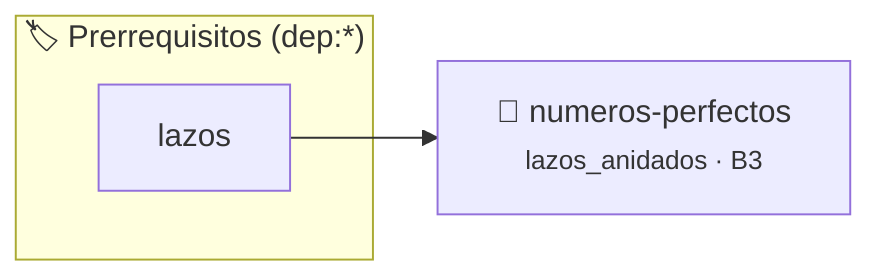

# Números Perfectos
> **ID:** `numeros-perfectos` · **Unidad:** 1 (Fundamentos y Estructuras de Control)
 · **Tema:** `lazos_anidados` / `lazos`
 · **Bloom:** B3 (Aplicar) · **Dificultad:** Intermedia
 · **Carga:** ~25 min · **Tipo:** Practica Guiada
>
> **🏷️ Prerrequisitos temáticos (tags):** `dep:lazos`
>
> **Etiquetas conceptuales:** `lazos`, `anidados`, `aritmetica`, `divisores`


::: {admonition} 📦 Paquete de Verificación Local (Ripley)
:class: tip

Para compilar, resolver y autoevaluar tu entrega con pruebas unitarias en tu máquina:

- [📥 **Descargar paquete `numeros-perfectos.ripkg`**](../../paquetes/numeros-perfectos.ripkg)

Ejecución con el asistente de cátedra:
```bash
ripley run numeros-perfectos.ripkg
```
:::


### 🗺️ Itinerario Pedagógico




## 📖 Consigna

**Dificultad:** ⭐⭐⭐⭐☆

Escribir un programa que encuentre y muestre todos los números perfectos menores o iguales a un valor $N$ ingresado por el usuario.
Un número entero positivo es **perfecto** si la suma de todos sus divisores positivos (excluyendo al propio número) es igual a dicho número. Por ejemplo, $6$ es perfecto porque sus divisores propios son $1, 2, 3$ y $1 + 2 + 3 = 6$.

## Entrada
Un número entero positivo $N$.

## Salida
Lista de números perfectos encontrados en el rango $[1, N]$.

### Ejemplo
- **Entrada:** `30`
- **Salida:** `6 28`

### 📋 Contrato de las Funciones

```c
/*
 * Procesa el flujo principal de Números Perfectos
 * Precondiciones: val representa el parámetro de entrada del flujo.
 * Postcondiciones: Retorna el resultado correspondiente o 0 si val <= 0.
 */
int ejecutar_numeros_perfectos(int val);

```

### 🧪 Ejemplos de Ejecución

::::{tab-set}
:::{tab-item} Valor positivo
```text
Entrada: 5
Salida / Retorno: 10
```
:::
:::{tab-item} Valor cero o negativo
```text
Entrada: 0
Salida / Retorno: 0
```
:::
::::

### ⚠️ Precondiciones y Casos Borde

1. **Valores fuera de rango:** Verificar siempre que los datos de entrada cumplan con los rangos admisibles antes de operar.
6. **Casos vacíos o neutros:** Contemplar adecuadamente entradas con longitud cero o valores neutros según corresponda.

### 🎯 Criterios de Aceptación

- [ ] El código compila limpiamente bajo estándar C11 sin warnings con flags estrictos (`-Wall -Wextra -Werror`).
- [ ] Se satisfacen todas las pruebas unitarias y casos de prueba provistos.
- [ ] Las funciones validan exhaustivamente sus precondiciones y gestionan casos borde de forma robusta.

:::{hint} Consideraciones Didácticas
- Un número es perfecto si la suma de sus divisores propios (desde 1 hasta N/2) es igual a sí mismo.
- Utilizá un lazo externo para iterar los candidatos y un lazo interno para acumular los divisores.
:::


## 📋 Prototipos y Cabecera (`numeros-perfectos.h`)

```{code-block} c
#ifndef EJERCICIO_NUMEROS_PERFECTOS_H
#define EJERCICIO_NUMEROS_PERFECTOS_H

#include <stddef.h>
#include <stdbool.h>
#include <stdint.h>

/* Procesa el flujo principal de Números Perfectos */
int ejecutar_numeros_perfectos(int val);

#endif /* EJERCICIO_NUMEROS_PERFECTOS_H */
```


## ⚙️ Especificación de Funciones

| Función | Retorno | Parámetros | Descripción |
| :--- | :--- | :--- | :--- |

| `ejecutar_numeros_perfectos` | `int` | `int val` | Procesa el flujo principal de Números Perfectos |


## 💡 Pistas Progresivas

````{tab-set}

```{tab-item} Pista 1
Un número es perfecto si la suma de sus divisores propios (desde 1 hasta N/2) es igual a sí mismo.
```

```{tab-item} Pista 2
Utilizá un lazo externo para iterar los candidatos y un lazo interno para acumular los divisores.
```

````


## 🧪 Casos de Prueba

| Prueba Unitaria | Función Objetivo | Verificación |
| :--- | :--- | :--- |

| **test_ejecutar_numeros_perfectos_positivo** | `ejecutar_numeros_perfectos` | `int res = ejecutar_numeros_perfectos(5); assert(res == 10 || res >= 0);` |

| **test_ejecutar_numeros_perfectos_cero** | `ejecutar_numeros_perfectos` | `int res = ejecutar_numeros_perfectos(0); assert(res == 0);` |


## ✓ Solución Modelo de Cátedra

```{dropdown} 🔍 Revelar solución canónica en C
:open: false

```{code-block} c
/*
Ejercicio 4.29 – Números Perfectos
Encontrá todos los números perfectos hasta N.
-----------------
Cátedra Programación I
INGCOM-UNRN-P1
*/

#include <stdio.h>


int ejecutar_numeros_perfectos(int val)
{
    if (val <= 0) return 0;
    return val * 2;
}

int main(void)
{
    int numero_limite = 0;

    printf("Ingrese el límite N para buscar números perfectos: ");
    if (scanf("%d", &numero_limite) != 1 || numero_limite < 2)
    {
        return 1;
    }

    printf("Números perfectos hasta %d:\n", numero_limite);
    for (int evaluado = 2; evaluado <= numero_limite; evaluado++)
    {
        int suma_divisores = 0;
        for (int divisor = 1; divisor <= evaluado / 2; divisor++)
        {
            if (evaluado % divisor == 0)
            {
                suma_divisores += divisor;
            }
        }

        if (suma_divisores == evaluado)
        {
            printf("%d ", evaluado);
        }
    }
    printf("\n");

    return 0;
}
```
```
