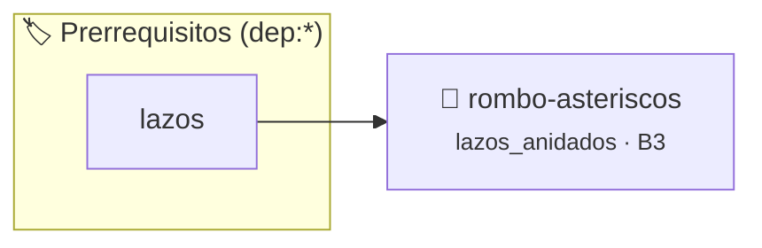

# Rombo de Asteriscos
> **ID:** `rombo-asteriscos`
 · **Tema:** `lazos_anidados`
 · **Bloom:** B3 (Aplicar)
 · **Carga:** ~25 min
>
> **🏷️ Prerrequisitos temáticos (tags):** `dep:lazos`
>
> **Etiquetas conceptuales:** `lazos`, `anidados`, `patrones`, `geometria`


::: {admonition} 📦 Paquete de Verificación Local (Ripley)
:class: tip

Para compilar, resolver y autoevaluar tu entrega con pruebas unitarias en tu máquina:

- [📥 **Descargar paquete `rombo-asteriscos.ripkg`**](../../paquetes/rombo-asteriscos.ripkg)

Ejecución con el asistente de cátedra:
```bash
ripley run rombo-asteriscos.ripkg
```
:::


### 🗺️ Itinerario Pedagógico




## 📖 Consigna

# Ejercicio 4.37 – Rombo
**Dificultad:** ⭐⭐⭐⭐⭐

## Consigna
Escribir un programa que dibuje por consola un rombo formado por caracteres asterisco (`*`) a partir de una dimensión o ancho máximo ingresado por el usuario.

## Entrada
Un número entero impar $N$ que representa el ancho máximo (o número de filas/columnas centrales del rombo).

## Salida
El patrón geométrico del rombo dibujado con espacios y asteriscos.

### Ejemplo
- **Entrada:** `5`
- **Salida:**
  ```text
    *
   ***
  *****
   ***
    *
  ```


## 📋 Prototipos y Cabecera (`rombo-asteriscos.h`)

```{code-block} c
#ifndef EJERCICIO_ROMBO_ASTERISCOS_H
#define EJERCICIO_ROMBO_ASTERISCOS_H

#include <stddef.h>
#include <stdbool.h>
#include <stdint.h>

/* Procesa el flujo principal de Rombo de Asteriscos */
int ejecutar_rombo_asteriscos(int val);

#endif /* EJERCICIO_ROMBO_ASTERISCOS_H */
```


## ⚙️ Especificación de Funciones

| Función | Retorno | Parámetros | Descripción |
| :--- | :--- | :--- | :--- |

| `ejecutar_rombo_asteriscos` | `int` | `int val` | Procesa el flujo principal de Rombo de Asteriscos |


## 💡 Pistas Progresivas

````{tab-set}

```{tab-item} Pista 1
Dividí la figura en triángulo superior creciente y triángulo inferior decreciente.
```

```{tab-item} Pista 2
Para cada fila, calculá la cantidad de espacios (ancho - fila) / 2 y la cantidad de asteriscos.
```

````


## 🧪 Casos de Prueba

| Prueba Unitaria | Función Objetivo | Verificación |
| :--- | :--- | :--- |

| **test_ejecutar_rombo_asteriscos_positivo** | `ejecutar_rombo_asteriscos` | `int res = ejecutar_rombo_asteriscos(5); assert(res == 10 || res >= 0);` |

| **test_ejecutar_rombo_asteriscos_cero** | `ejecutar_rombo_asteriscos` | `int res = ejecutar_rombo_asteriscos(0); assert(res == 0);` |


## ✓ Solución Modelo de Cátedra

```{dropdown} 🔍 Revelar solución canónica en C
:open: false

```{code-block} c
/*
Ejercicio 4.37 – Rombo
Dibujá un rombo de asteriscos
-----------------
Cátedra Programación I
INGCOM-UNRN-P1
*/

#include <stdio.h>


int ejecutar_rombo_asteriscos(int val)
{
    if (val <= 0) return 0;
    return val * 2;
}

int main(void)
{
    int ancho_maximo = 0;

    printf("Ingrese el ancho máximo del rombo (número impar): ");
    if (scanf("%d", &ancho_maximo) != 1 || ancho_maximo <= 0)
    {
        return 1;
    }

    if (ancho_maximo % 2 == 0)
    {
        ancho_maximo += 1;
    }

    // Parte superior
    for (int fila = 1; fila <= ancho_maximo; fila += 2)
    {
        for (int espacios = 0; espacios < (ancho_maximo - fila) / 2; espacios++)
        {
            printf(" ");
        }
        for (int asteriscos = 0; asteriscos < fila; asteriscos++)
        {
            printf("*");
        }
        printf("\n");
    }

    // Parte inferior
    for (int fila = ancho_maximo - 2; fila >= 1; fila -= 2)
    {
        for (int espacios = 0; espacios < (ancho_maximo - fila) / 2; espacios++)
        {
            printf(" ");
        }
        for (int asteriscos = 0; asteriscos < fila; asteriscos++)
        {
            printf("*");
        }
        printf("\n");
    }

    return 0;
}
```
```
