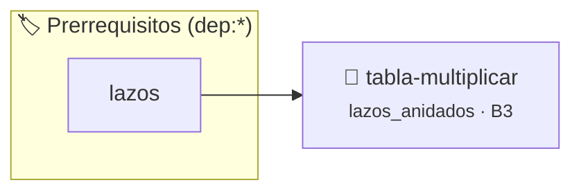

# Tabla de Multiplicar Completa
> **ID:** `tabla-multiplicar` · **Unidad:** 1 (Fundamentos y Estructuras de Control)
 · **Tema:** `lazos_anidados` / `lazos`
 · **Bloom:** B3 (Aplicar) · **Dificultad:** Intermedia
 · **Carga:** ~25 min · **Tipo:** Practica Guiada
>
> **🏷️ Prerrequisitos temáticos (tags):** `dep:lazos`
>
> **Etiquetas conceptuales:** `lazos`, `anidados`, `tablas`, `formato`


::: {admonition} 📦 Paquete de Verificación Local (Ripley)
:class: tip

Para compilar, resolver y autoevaluar tu entrega con pruebas unitarias en tu máquina:

- [📥 **Descargar paquete `tabla-multiplicar.ripkg`**](../../paquetes/tabla-multiplicar.ripkg)

Ejecución con el asistente de cátedra:
```bash
ripley run tabla-multiplicar.ripkg
```
:::


### 🗺️ Itinerario Pedagógico




## 📖 Consigna

**Dificultad:** ⭐⭐⭐⭐☆

Escribir un programa que muestre por pantalla la tabla de multiplicar pitagórica completa del 1 al 10 (las 10 tablas organizadas en filas y columnas).

## Entrada
No requiere entrada por teclado.

## Salida
Tabla de multiplicar estructurada del $1 \times 1$ al $10 \times 10$.

### Ejemplo
- **Salida:** Matriz de productos con valores del 1 al 100.

### 📋 Contrato de las Funciones

```c
/*
 * Procesa el flujo principal de Tabla de Multiplicar Completa
 * Precondiciones: val representa el parámetro de entrada del flujo.
 * Postcondiciones: Retorna el resultado correspondiente o 0 si val <= 0.
 */
int ejecutar_tabla_multiplicar(int val);

```

### 🧪 Ejemplos de Ejecución

::::{tab-set}
:::{tab-item} Valor positivo
```text
Entrada: 5
Salida / Retorno: 10
```
:::
:::{tab-item} Valor cero o negativo
```text
Entrada: 0
Salida / Retorno: 0
```
:::
::::

### ⚠️ Precondiciones y Casos Borde

1. **Valores fuera de rango:** Verificar siempre que los datos de entrada cumplan con los rangos admisibles antes de operar.
6. **Casos vacíos o neutros:** Contemplar adecuadamente entradas con longitud cero o valores neutros según corresponda.

### 🎯 Criterios de Aceptación

- [ ] El código compila limpiamente bajo estándar C11 sin warnings con flags estrictos (`-Wall -Wextra -Werror`).
- [ ] Se satisfacen todas las pruebas unitarias y casos de prueba provistos.
- [ ] Las funciones validan exhaustivamente sus precondiciones y gestionan casos borde de forma robusta.

:::{hint} Consideraciones Didácticas
- Usá dos lazos for anidados para iterar filas (1..10) y columnas (1..10).
- Alineá las columnas usando el especificador de formato %4d en printf.
:::


## 📋 Prototipos y Cabecera (`tabla-multiplicar.h`)

```{code-block} c
#ifndef EJERCICIO_TABLA_MULTIPLICAR_H
#define EJERCICIO_TABLA_MULTIPLICAR_H

#include <stddef.h>
#include <stdbool.h>
#include <stdint.h>

/* Procesa el flujo principal de Tabla de Multiplicar Completa */
int ejecutar_tabla_multiplicar(int val);

#endif /* EJERCICIO_TABLA_MULTIPLICAR_H */
```


## ⚙️ Especificación de Funciones

| Función | Retorno | Parámetros | Descripción |
| :--- | :--- | :--- | :--- |

| `ejecutar_tabla_multiplicar` | `int` | `int val` | Procesa el flujo principal de Tabla de Multiplicar Completa |


## 💡 Pistas Progresivas

````{tab-set}

```{tab-item} Pista 1
Usá dos lazos for anidados para iterar filas (1..10) y columnas (1..10).
```

```{tab-item} Pista 2
Alineá las columnas usando el especificador de formato %4d en printf.
```

````


## 🧪 Casos de Prueba

| Prueba Unitaria | Función Objetivo | Verificación |
| :--- | :--- | :--- |

| **test_ejecutar_tabla_multiplicar_positivo** | `ejecutar_tabla_multiplicar` | `int res = ejecutar_tabla_multiplicar(5); assert(res == 10 || res >= 0);` |

| **test_ejecutar_tabla_multiplicar_cero** | `ejecutar_tabla_multiplicar` | `int res = ejecutar_tabla_multiplicar(0); assert(res == 0);` |


## ✓ Solución Modelo de Cátedra

```{dropdown} 🔍 Revelar solución canónica en C
:open: false

```{code-block} c
/*
Ejercicio 4.38 – Tabla de Multiplicar Completa
Mostrá tabla de multiplicar del 1 al 10 (todas las tablas).
-----------------
Cátedra Programación I
INGCOM-UNRN-P1
*/

#include <stdio.h>


int ejecutar_tabla_multiplicar(int val)
{
    if (val <= 0) return 0;
    return val * 2;
}

int main(void)
{
    printf("Tabla de Multiplicar del 1 al 10:\n");
    for (int fila = 1; fila <= 10; fila++)
    {
        for (int columna = 1; columna <= 10; columna++)
        {
            printf("%4d", fila * columna);
        }
        printf("\n");
    }

    return 0;
}
```
```
