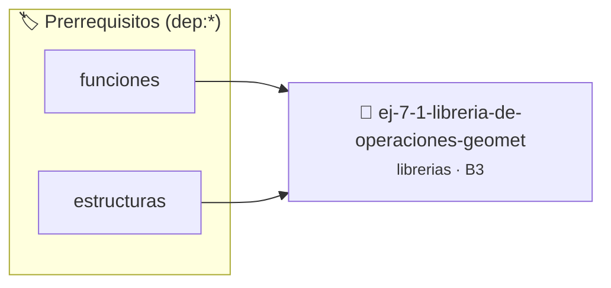

# Librería de Operaciones Geométricas 2D
> **ID:** `ej-7-1-libreria-de-operaciones-geomet`
 · **Tema:** `librerias`
 · **Bloom:** B3 (Aplicar)
 · **Carga:** ~25 min
>
> **🏷️ Prerrequisitos temáticos (tags):** `dep:funciones`, `dep:estructuras`
>
> **Etiquetas conceptuales:** `fundamentos`, `headers`, `operaciones`, `libreria`, `geometricas`


::: {admonition} 📦 Paquete de Verificación Local (Ripley)
:class: tip

Para compilar, resolver y autoevaluar tu entrega con pruebas unitarias en tu máquina:

- [📥 **Descargar paquete `ej-7-1-libreria-de-operaciones-geomet.ripkg`**](../../paquetes/ej-7-1-libreria-de-operaciones-geomet.ripkg)

Ejecución con el asistente de cátedra:
```bash
ripley run ej-7-1-libreria-de-operaciones-geomet.ripkg
```
:::


### 🗺️ Itinerario Pedagógico




## 📖 Consigna

### Ejercicio 7.1 - Librería de Operaciones Geométricas 2D ⭐⭐☆☆☆

Diseñá e implementá la librería `geometria2d.h` y `geometria2d.c` para cálculos en el plano 2D:
- `double geo_distancia(double x1, double y1, double x2, double y2)`: distancia euclídea.
- `double geo_area_rectangulo(double ancho, double alto)`: área de un rectángulo.
- `double geo_perimetro_rectangulo(double ancho, double alto)`: perímetro de un rectángulo.
- `double geo_area_circulo(double radio)`: área de un círculo.
- `double geo_perimetro_circulo(double radio)`: perímetro de un círculo.

:::{hint} Lógica y Consideraciones
- **[*plus ultra*]:** Validar que dimensiones como radio, ancho y alto no sean negativas (retornar `-1.0` en caso de error).
- Usá la constante `M_PI` definida en `<math.h>`.
:::
<!-- {hint} Lógica y Consideraciones -->

---


## 📋 Prototipos y Cabecera (`ej-7-1-libreria-de-operaciones-geomet.h`)

```{code-block} c
#ifndef EJERCICIO_EJ_7_1_LIBRERIA_DE_OPERACIONES_GEOMET_H
#define EJERCICIO_EJ_7_1_LIBRERIA_DE_OPERACIONES_GEOMET_H

#include <stddef.h>
#include <stdbool.h>
#include <stdint.h>

/* Procesa el flujo principal de Librería de Operaciones Geométricas 2D */
int proc_e_operaciones_geomet(int val);

#endif /* EJERCICIO_EJ_7_1_LIBRERIA_DE_OPERACIONES_GEOMET_H */
```


## ⚙️ Especificación de Funciones

| Función | Retorno | Parámetros | Descripción |
| :--- | :--- | :--- | :--- |

| `proc_e_operaciones_geomet` | `int` | `int val` | Procesa el flujo principal de Librería de Operaciones Geométricas 2D |


## 💡 Pistas Progresivas

````{tab-set}

```{tab-item} Pista 1
[Plus Ultra] Validar que dimensiones como radio, ancho y alto no sean negativas (retornar `-1.0` en caso de error).
```

```{tab-item} Pista 2
Usá la constante `M_PI` definida en `<math.h>`.
```

````


## 🧪 Casos de Prueba

| Prueba Unitaria | Función Objetivo | Verificación |
| :--- | :--- | :--- |

| **test_proc_e_operaciones_geomet_positivo** | `proc_e_operaciones_geomet` | `int res = proc_e_operaciones_geomet(5); assert(res == 10 || res >= 0);` |

| **test_proc_e_operaciones_geomet_cero** | `proc_e_operaciones_geomet` | `int res = proc_e_operaciones_geomet(0); assert(res == 0);` |


## ✓ Solución Modelo de Cátedra

```{dropdown} 🔍 Revelar solución canónica en C
:open: false

```{code-block} c
/*
 * Ejercicio: Librería de Operaciones Geométricas 2D
 * Cátedra Programación I - UNRN
 */

#include <stdio.h>


int proc_e_operaciones_geomet(int val)
{
    if (val <= 0) return 0;
    return val * 2;
}

int main(void)
{
    /* TODO: Implementación de Librería de Operaciones Geométricas 2D */
    return 0;
}
```
```
