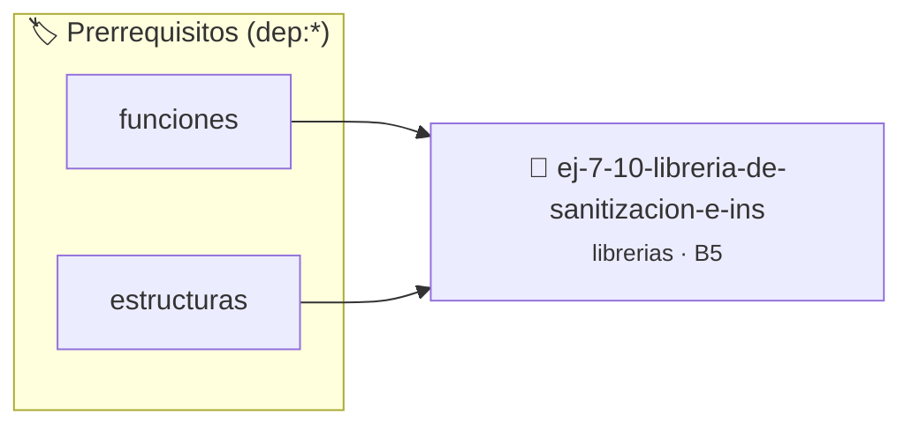

# Librería de Sanitización e Inspección de Entradas
> **ID:** `ej-7-10-libreria-de-sanitizacion-e-ins` · **Unidad:** 5 (Ingeniería de Software y Calidad en C)
 · **Tema:** `librerias` / `sanitizacion`
 · **Bloom:** B5 (Evaluar / Crear) · **Dificultad:** Desafio
 · **Carga:** ~45 min · **Tipo:** Desafio
>
> **🏷️ Prerrequisitos temáticos (tags):** `dep:funciones`, `dep:estructuras`
>
> **Etiquetas conceptuales:** `sanitizacion`, `entradas`, `inspeccion`, `fundamentos`, `headers`


::: {admonition} 📦 Paquete de Verificación Local (Ripley)
:class: tip

Para compilar, resolver y autoevaluar tu entrega con pruebas unitarias en tu máquina:

- [📥 **Descargar paquete `ej-7-10-libreria-de-sanitizacion-e-ins.ripkg`**](../../paquetes/ej-7-10-libreria-de-sanitizacion-e-ins.ripkg)

Ejecución con el asistente de cátedra:
```bash
ripley run ej-7-10-libreria-de-sanitizacion-e-ins.ripkg
```
:::


### 🗺️ Itinerario Pedagógico




## 📖 Consigna

### Ejercicio 7.10 - Librería de Sanitización e Inspección de Entradas ⭐⭐⭐☆☆

Creá `sanitizer.h` y `sanitizer.c`:
- `bool san_es_entero_valido(const char *str, size_t len_str)`
- `bool san_es_decimal_valido(const char *str, size_t len_str)`
- `bool san_es_email_basico(const char *str, size_t len_str)` (presencia de `@` y al menos un `.`)
- `void san_reemplazar_caracter(char *str, size_t len_str, char viejo, char nuevo)`

:::{hint} Lógica y Consideraciones
- Utilizá esta librería para validar la entrada ingresada por el usuario antes de convertirla a tipos numéricos.
:::
<!-- {hint} Lógica y Consideraciones -->

---

## 3. Librerías de Manejo de Arreglos y Matrices


## 📋 Prototipos y Cabecera (`ej-7-10-libreria-de-sanitizacion-e-ins.h`)

```{code-block} c
#ifndef EJERCICIO_EJ_7_10_LIBRERIA_DE_SANITIZACION_E_INS_H
#define EJERCICIO_EJ_7_10_LIBRERIA_DE_SANITIZACION_E_INS_H

#include <stddef.h>
#include <stdbool.h>
#include <stdint.h>

/* Procesa el flujo principal de Librería de Sanitización e Inspección de Entradas */
int proc_e_sanitizacion_e_ins(int val);

#endif /* EJERCICIO_EJ_7_10_LIBRERIA_DE_SANITIZACION_E_INS_H */
```


## ⚙️ Especificación de Funciones

| Función | Retorno | Parámetros | Descripción |
| :--- | :--- | :--- | :--- |

| `proc_e_sanitizacion_e_ins` | `int` | `int val` | Procesa el flujo principal de Librería de Sanitización e Inspección de Entradas |


## 💡 Pistas Progresivas

````{tab-set}

```{tab-item} Pista 1
Utilizá esta librería para validar la entrada ingresada por el usuario antes de convertirla a tipos numéricos.
```

````


## 🧪 Casos de Prueba

| Prueba Unitaria | Función Objetivo | Verificación |
| :--- | :--- | :--- |

| **test_proc_e_sanitizacion_e_ins_positivo** | `proc_e_sanitizacion_e_ins` | `int res = proc_e_sanitizacion_e_ins(5); assert(res == 10 || res >= 0);` |

| **test_proc_e_sanitizacion_e_ins_cero** | `proc_e_sanitizacion_e_ins` | `int res = proc_e_sanitizacion_e_ins(0); assert(res == 0);` |


## ✓ Solución Modelo de Cátedra

```{dropdown} 🔍 Revelar solución canónica en C
:open: false

```{code-block} c
/*
 * Ejercicio: Librería de Sanitización e Inspección de Entradas
 * Cátedra Programación I - UNRN
 */

#include <stdio.h>


int proc_e_sanitizacion_e_ins(int val)
{
    if (val <= 0) return 0;
    return val * 2;
}

int main(void)
{
    /* TODO: Implementación de Librería de Sanitización e Inspección de Entradas */
    return 0;
}
```
```
