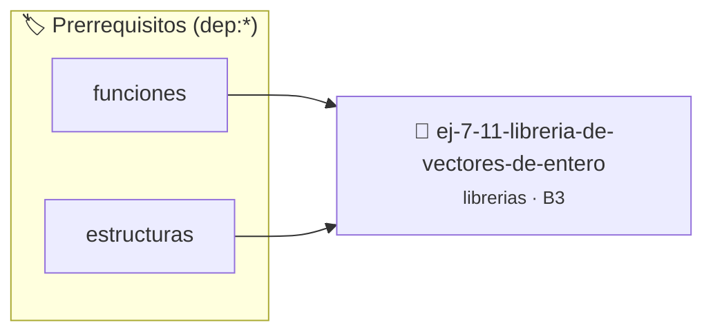

# Librería de Vectores de Enteros
> **ID:** `ej-7-11-libreria-de-vectores-de-entero` · **Unidad:** 5 (Ingeniería de Software y Calidad en C)
 · **Tema:** `librerias` / `fundamentos`
 · **Bloom:** B3 (Aplicar) · **Dificultad:** Intermedia
 · **Carga:** ~25 min · **Tipo:** Practica Guiada
>
> **🏷️ Prerrequisitos temáticos (tags):** `dep:funciones`, `dep:estructuras`
>
> **Etiquetas conceptuales:** `fundamentos`, `headers`, `libreria`, `enteros`, `vectores`


::: {admonition} 📦 Paquete de Verificación Local (Ripley)
:class: tip

Para compilar, resolver y autoevaluar tu entrega con pruebas unitarias en tu máquina:

- [📥 **Descargar paquete `ej-7-11-libreria-de-vectores-de-entero.ripkg`**](../../paquetes/ej-7-11-libreria-de-vectores-de-entero.ripkg)

Ejecución con el asistente de cátedra:
```bash
ripley run ej-7-11-libreria-de-vectores-de-entero.ripkg
```
:::


### 🗺️ Itinerario Pedagógico




## 📖 Consigna

### Ejercicio 7.11 - Librería de Vectores de Enteros ⭐⭐⭐☆☆

Diseñá la librería `vec_int.h` y `vec_int.c` para operar sobre arreglos estáticos de enteros:
- `void vec_int_imprimir(const int *v, size_t n)`
- `int vec_int_suma(const int *v, size_t n)`
- `double vec_int_promedio(const int *v, size_t n)`
- `ssize_t vec_int_buscar_primero(const int *v, size_t n, int elem)`
- `size_t vec_int_contar_ocurrencias(const int *v, size_t n, int elem)`

:::{hint} Lógica y Consideraciones
- Usá `ssize_t` para devolver `-1` cuando el elemento buscado no se encuentre.
:::
<!-- {hint} Lógica y Consideraciones -->

---


## 📋 Prototipos y Cabecera (`ej-7-11-libreria-de-vectores-de-entero.h`)

```{code-block} c
#ifndef EJERCICIO_EJ_7_11_LIBRERIA_DE_VECTORES_DE_ENTERO_H
#define EJERCICIO_EJ_7_11_LIBRERIA_DE_VECTORES_DE_ENTERO_H

#include <stddef.h>
#include <stdbool.h>
#include <stdint.h>

/* Procesa el flujo principal de Librería de Vectores de Enteros */
int proc_e_vectores_de_entero(int val);

#endif /* EJERCICIO_EJ_7_11_LIBRERIA_DE_VECTORES_DE_ENTERO_H */
```


## ⚙️ Especificación de Funciones

| Función | Retorno | Parámetros | Descripción |
| :--- | :--- | :--- | :--- |

| `proc_e_vectores_de_entero` | `int` | `int val` | Procesa el flujo principal de Librería de Vectores de Enteros |


## 💡 Pistas Progresivas

````{tab-set}

```{tab-item} Pista 1
Usá `ssize_t` para devolver `-1` cuando el elemento buscado no se encuentre.
```

````


## 🧪 Casos de Prueba

| Prueba Unitaria | Función Objetivo | Verificación |
| :--- | :--- | :--- |

| **test_proc_e_vectores_de_entero_positivo** | `proc_e_vectores_de_entero` | `int res = proc_e_vectores_de_entero(5); assert(res == 10 || res >= 0);` |

| **test_proc_e_vectores_de_entero_cero** | `proc_e_vectores_de_entero` | `int res = proc_e_vectores_de_entero(0); assert(res == 0);` |


## ✓ Solución Modelo de Cátedra

```{dropdown} 🔍 Revelar solución canónica en C
:open: false

```{code-block} c
/*
 * Ejercicio: Librería de Vectores de Enteros
 * Cátedra Programación I - UNRN
 */

#include <stdio.h>


int proc_e_vectores_de_entero(int val)
{
    if (val <= 0) return 0;
    return val * 2;
}

int main(void)
{
    /* TODO: Implementación de Librería de Vectores de Enteros */
    return 0;
}
```
```
