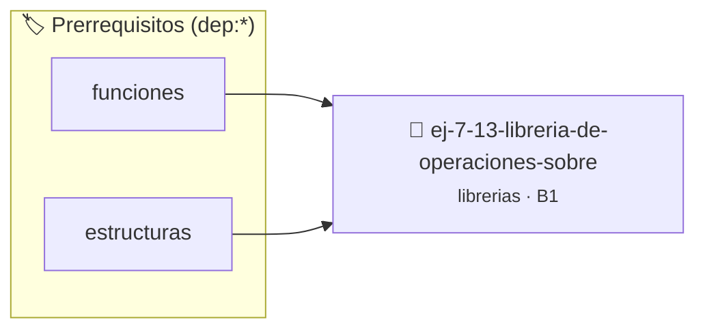

# Librería de Operaciones sobre Matrices 2D
> **ID:** `ej-7-13-libreria-de-operaciones-sobre` · **Unidad:** 5 (Ingeniería de Software y Calidad en C)
 · **Tema:** `librerias` / `sobre`
 · **Bloom:** B1 (Recordar) · **Dificultad:** Inicial
 · **Carga:** ~10 min · **Tipo:** Concepto
>
> **🏷️ Prerrequisitos temáticos (tags):** `dep:funciones`, `dep:estructuras`
>
> **Etiquetas conceptuales:** `sobre`, `matrices`, `fundamentos`, `headers`, `operaciones`


::: {admonition} 📦 Paquete de Verificación Local (Ripley)
:class: tip

Para compilar, resolver y autoevaluar tu entrega con pruebas unitarias en tu máquina:

- [📥 **Descargar paquete `ej-7-13-libreria-de-operaciones-sobre.ripkg`**](../../paquetes/ej-7-13-libreria-de-operaciones-sobre.ripkg)

Ejecución con el asistente de cátedra:
```bash
ripley run ej-7-13-libreria-de-operaciones-sobre.ripkg
```
:::


### 🗺️ Itinerario Pedagógico




## 📖 Consigna

Diseñá `matriz2d.h` y `matriz2d.c` para matrices con dimensiones fijas o pasadas linealmente:
- `void mat_sumar(size_t filas, size_t cols, const double A[filas][cols], const double B[filas][cols], double C[filas][cols])`
- `void mat_multiplicar_escalar(size_t filas, size_t cols, double M[filas][cols], double escalar)`
- `void mat_transponer(size_t filas, size_t cols, const double A[filas][cols], double T[cols][filas])`
- `double mat_traza(size_t n, const double A[n][n])`


---

### 📋 Contrato de las Funciones

```c
/*
 * Procesa el flujo principal de Librería de Operaciones sobre Matrices 2D
 * Precondiciones: val representa el parámetro de entrada del flujo.
 * Postcondiciones: Retorna el resultado correspondiente o 0 si val <= 0.
 */
int proc_de_operaciones_sobre(int val);

```

### 🧪 Ejemplos de Ejecución

::::{tab-set}
:::{tab-item} Valor positivo
```text
Entrada: 5
Salida / Retorno: 10
```
:::
:::{tab-item} Valor cero o negativo
```text
Entrada: 0
Salida / Retorno: 0
```
:::
::::

### ⚠️ Precondiciones y Casos Borde

1. **Valores fuera de rango:** Verificar siempre que los datos de entrada cumplan con los rangos admisibles antes de operar.
6. **Casos vacíos o neutros:** Contemplar adecuadamente entradas con longitud cero o valores neutros según corresponda.

### 🎯 Criterios de Aceptación

- [ ] El código compila limpiamente bajo estándar C11 sin warnings con flags estrictos (`-Wall -Wextra -Werror`).
- [ ] Se satisfacen todas las pruebas unitarias y casos de prueba provistos.
- [ ] Las funciones validan exhaustivamente sus precondiciones y gestionan casos borde de forma robusta.

:::{hint} Consideraciones Didácticas
- Usá VLA (Variable Length Arrays) en los parámetros para permitir sintaxis limpia de matrices 2D en C99+.
:::


## 📋 Prototipos y Cabecera (`ej-7-13-libreria-de-operaciones-sobre.h`)

```{code-block} c
#ifndef EJERCICIO_EJ_7_13_LIBRERIA_DE_OPERACIONES_SOBRE_H
#define EJERCICIO_EJ_7_13_LIBRERIA_DE_OPERACIONES_SOBRE_H

#include <stddef.h>
#include <stdbool.h>
#include <stdint.h>

/* Procesa el flujo principal de Librería de Operaciones sobre Matrices 2D */
int proc_de_operaciones_sobre(int val);

#endif /* EJERCICIO_EJ_7_13_LIBRERIA_DE_OPERACIONES_SOBRE_H */
```


## ⚙️ Especificación de Funciones

| Función | Retorno | Parámetros | Descripción |
| :--- | :--- | :--- | :--- |

| `proc_de_operaciones_sobre` | `int` | `int val` | Procesa el flujo principal de Librería de Operaciones sobre Matrices 2D |


## 💡 Pistas Progresivas

````{tab-set}

```{tab-item} Pista 1
Usá VLA (Variable Length Arrays) en los parámetros para permitir sintaxis limpia de matrices 2D en C99+.
```

````


## 🧪 Casos de Prueba

| Prueba Unitaria | Función Objetivo | Verificación |
| :--- | :--- | :--- |

| **test_proc_de_operaciones_sobre_positivo** | `proc_de_operaciones_sobre` | `int res = proc_de_operaciones_sobre(5); assert(res == 10 || res >= 0);` |

| **test_proc_de_operaciones_sobre_cero** | `proc_de_operaciones_sobre` | `int res = proc_de_operaciones_sobre(0); assert(res == 0);` |


## ✓ Solución Modelo de Cátedra

```{dropdown} 🔍 Revelar solución canónica en C
:open: false

```{code-block} c
/*
 * Ejercicio: Librería de Operaciones sobre Matrices 2D
 * Cátedra Programación I - UNRN
 */

#include <stdio.h>


int proc_de_operaciones_sobre(int val)
{
    if (val <= 0) return 0;
    return val * 2;
}

int main(void)
{
    /* TODO: Implementación de Librería de Operaciones sobre Matrices 2D */
    return 0;
}
```
```
