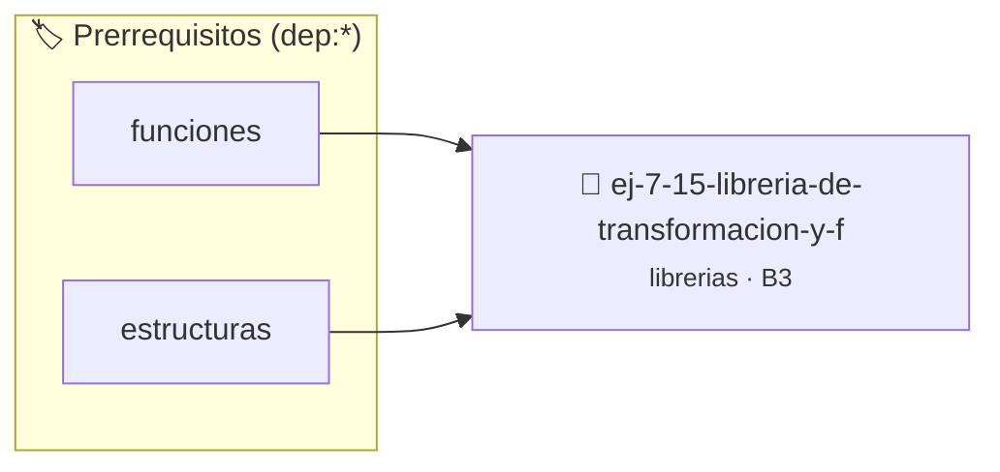

# Librería de Transformación y Filtrado de Arreglos
> **ID:** `ej-7-15-libreria-de-transformacion-y-f`
 · **Tema:** `librerias`
 · **Bloom:** B3 (Aplicar)
 · **Carga:** ~25 min
>
> **🏷️ Prerrequisitos temáticos (tags):** `dep:funciones`, `dep:estructuras`
>
> **Etiquetas conceptuales:** `filtrado`, `fundamentos`, `headers`, `libreria`, `arreglos`


::: {admonition} 📦 Paquete de Verificación Local (Ripley)
:class: tip

Para compilar, resolver y autoevaluar tu entrega con pruebas unitarias en tu máquina:

- [📥 **Descargar paquete `ej-7-15-libreria-de-transformacion-y-f.ripkg`**](../../paquetes/ej-7-15-libreria-de-transformacion-y-f.ripkg)

Ejecución con el asistente de cátedra:
```bash
ripley run ej-7-15-libreria-de-transformacion-y-f.ripkg
```
:::


### 🗺️ Itinerario Pedagógico




## 📖 Consigna

### Ejercicio 7.15 - Librería de Transformación y Filtrado de Arreglos ⭐⭐⭐⭐☆

Diseñá `array_utils.h` y `array_utils.c` para procesar secuencias numéricas mediante funciones modulares:
- `size_t arr_filtrar_pares(const int *src, size_t n, int *dest)`: copia solo los valores pares a `dest` y retorna la cantidad colocada.
- `size_t arr_filtrar_mayores_que(const int *src, size_t n, int umbral, int *dest)`: copia solo los valores mayores que `umbral`.
- `void arr_escalar(int *v, size_t n, int factor)`: multiplica cada elemento del arreglo por un factor escalar.
- `long long arr_sumatoria(const int *v, size_t n)`: calcula la suma total de los elementos.

:::{hint} Lógica y Consideraciones
- Utilizá el calificador `const` en los arreglos de solo lectura y documentá precondiciones claras para cada función.
- **[*plus ultra*]:** Escribir pruebas unitarias con `assert()` en `tests/` para verificar arreglos vacíos y con valores negativos.
:::
<!-- {hint} Lógica y Consideraciones -->

---

## 4. Librerías de Utilidades del Sistema y E/S


## 📋 Prototipos y Cabecera (`ej-7-15-libreria-de-transformacion-y-f.h`)

```{code-block} c
#ifndef EJERCICIO_EJ_7_15_LIBRERIA_DE_TRANSFORMACION_Y_F_H
#define EJERCICIO_EJ_7_15_LIBRERIA_DE_TRANSFORMACION_Y_F_H

#include <stddef.h>
#include <stdbool.h>
#include <stdint.h>

/* Procesa el flujo principal de Librería de Transformación y Filtrado de Arreglos */
int proc_e_transformacion_y_f(int val);

#endif /* EJERCICIO_EJ_7_15_LIBRERIA_DE_TRANSFORMACION_Y_F_H */
```


## ⚙️ Especificación de Funciones

| Función | Retorno | Parámetros | Descripción |
| :--- | :--- | :--- | :--- |

| `proc_e_transformacion_y_f` | `int` | `int val` | Procesa el flujo principal de Librería de Transformación y Filtrado de Arreglos |


## 💡 Pistas Progresivas

````{tab-set}

```{tab-item} Pista 1
Utilizá el calificador `const` en los arreglos de solo lectura y documentá precondiciones claras para cada función.
```

```{tab-item} Pista 2
[Plus Ultra] Escribir pruebas unitarias con `assert()` en `tests/` para verificar arreglos vacíos y con valores negativos.
```

````


## 🧪 Casos de Prueba

| Prueba Unitaria | Función Objetivo | Verificación |
| :--- | :--- | :--- |

| **test_proc_e_transformacion_y_f_positivo** | `proc_e_transformacion_y_f` | `int res = proc_e_transformacion_y_f(5); assert(res == 10 || res >= 0);` |

| **test_proc_e_transformacion_y_f_cero** | `proc_e_transformacion_y_f` | `int res = proc_e_transformacion_y_f(0); assert(res == 0);` |


## ✓ Solución Modelo de Cátedra

```{dropdown} 🔍 Revelar solución canónica en C
:open: false

```{code-block} c
/*
 * Ejercicio: Librería de Transformación y Filtrado de Arreglos
 * Cátedra Programación I - UNRN
 */

#include <stdio.h>


int proc_e_transformacion_y_f(int val)
{
    if (val <= 0) return 0;
    return val * 2;
}

int main(void)
{
    /* TODO: Implementación de Librería de Transformación y Filtrado de Arreglos */
    return 0;
}
```
```
