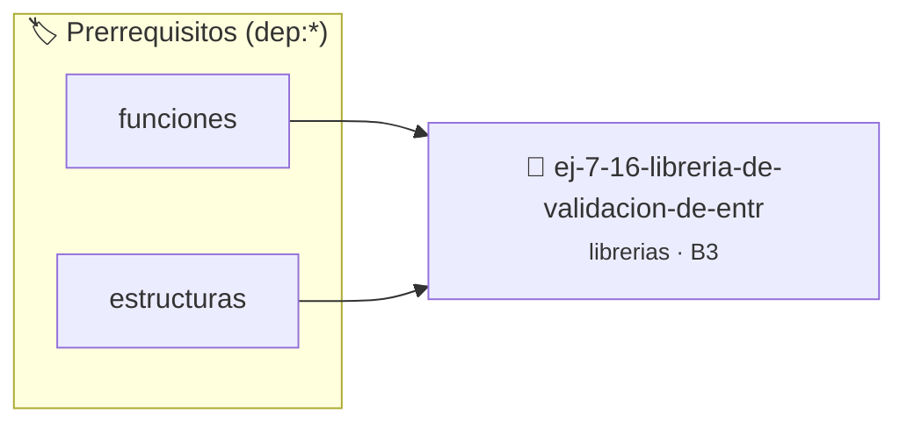

# Librería de Validación de Entradas de Usuario
> **ID:** `ej-7-16-libreria-de-validacion-de-entr`
 · **Tema:** `librerias`
 · **Bloom:** B3 (Aplicar)
 · **Carga:** ~25 min
>
> **🏷️ Prerrequisitos temáticos (tags):** `dep:funciones`, `dep:estructuras`
>
> **Etiquetas conceptuales:** `entradas`, `fundamentos`, `headers`, `libreria`, `validacion`


::: {admonition} 📦 Paquete de Verificación Local (Ripley)
:class: tip

Para compilar, resolver y autoevaluar tu entrega con pruebas unitarias en tu máquina:

- [📥 **Descargar paquete `ej-7-16-libreria-de-validacion-de-entr.ripkg`**](../../paquetes/ej-7-16-libreria-de-validacion-de-entr.ripkg)

Ejecución con el asistente de cátedra:
```bash
ripley run ej-7-16-libreria-de-validacion-de-entr.ripkg
```
:::


### 🗺️ Itinerario Pedagógico




## 📖 Consigna

### Ejercicio 7.16 - Librería de Validación de Entradas de Usuario ⭐⭐☆☆☆

Diseñá `input_val.h` y `input_val.c` para simplificar la lectura segura desde `stdin`:
- `int leer_entero_rango(const char *mensaje, size_t len_msg, int min, int max)`
- `double leer_double_positivo(const char *mensaje, size_t len_msg)`
- `bool leer_confirmacion_s_n(const char *mensaje, size_t len_msg)`
- `void leer_cadena_segura(const char *mensaje, size_t len_msg, char *buffer, size_t tam)`

:::{hint} Lógica y Consideraciones
- Limpiá el búfer de entrada `stdin` ante errores de formato para evitar lazos infinitos.
:::
<!-- {hint} Lógica y Consideraciones -->

---


## 📋 Prototipos y Cabecera (`ej-7-16-libreria-de-validacion-de-entr.h`)

```{code-block} c
#ifndef EJERCICIO_EJ_7_16_LIBRERIA_DE_VALIDACION_DE_ENTR_H
#define EJERCICIO_EJ_7_16_LIBRERIA_DE_VALIDACION_DE_ENTR_H

#include <stddef.h>
#include <stdbool.h>
#include <stdint.h>

/* Procesa el flujo principal de Librería de Validación de Entradas de Usuario */
int proc_e_validacion_de_entr(int val);

#endif /* EJERCICIO_EJ_7_16_LIBRERIA_DE_VALIDACION_DE_ENTR_H */
```


## ⚙️ Especificación de Funciones

| Función | Retorno | Parámetros | Descripción |
| :--- | :--- | :--- | :--- |

| `proc_e_validacion_de_entr` | `int` | `int val` | Procesa el flujo principal de Librería de Validación de Entradas de Usuario |


## 💡 Pistas Progresivas

````{tab-set}

```{tab-item} Pista 1
Limpiá el búfer de entrada `stdin` ante errores de formato para evitar lazos infinitos.
```

````


## 🧪 Casos de Prueba

| Prueba Unitaria | Función Objetivo | Verificación |
| :--- | :--- | :--- |

| **test_proc_e_validacion_de_entr_positivo** | `proc_e_validacion_de_entr` | `int res = proc_e_validacion_de_entr(5); assert(res == 10 || res >= 0);` |

| **test_proc_e_validacion_de_entr_cero** | `proc_e_validacion_de_entr` | `int res = proc_e_validacion_de_entr(0); assert(res == 0);` |


## ✓ Solución Modelo de Cátedra

```{dropdown} 🔍 Revelar solución canónica en C
:open: false

```{code-block} c
/*
 * Ejercicio: Librería de Validación de Entradas de Usuario
 * Cátedra Programación I - UNRN
 */

#include <stdio.h>


int proc_e_validacion_de_entr(int val)
{
    if (val <= 0) return 0;
    return val * 2;
}

int main(void)
{
    /* TODO: Implementación de Librería de Validación de Entradas de Usuario */
    return 0;
}
```
```
