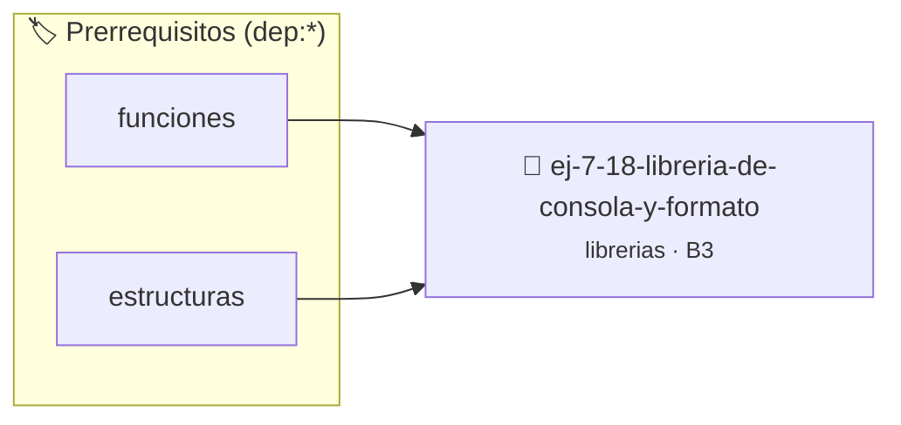

# Librería de Consola y Formato de Salida
> **ID:** `ej-7-18-libreria-de-consola-y-formato`
 · **Tema:** `librerias`
 · **Bloom:** B3 (Aplicar)
 · **Carga:** ~25 min
>
> **🏷️ Prerrequisitos temáticos (tags):** `dep:funciones`, `dep:estructuras`
>
> **Etiquetas conceptuales:** `fundamentos`, `headers`, `libreria`, `consola`, `formato`


::: {admonition} 📦 Paquete de Verificación Local (Ripley)
:class: tip

Para compilar, resolver y autoevaluar tu entrega con pruebas unitarias en tu máquina:

- [📥 **Descargar paquete `ej-7-18-libreria-de-consola-y-formato.ripkg`**](../../paquetes/ej-7-18-libreria-de-consola-y-formato.ripkg)

Ejecución con el asistente de cátedra:
```bash
ripley run ej-7-18-libreria-de-consola-y-formato.ripkg
```
:::


### 🗺️ Itinerario Pedagógico




## 📖 Consigna

### Ejercicio 7.18 - Librería de Consola y Formato de Salida ⭐⭐☆☆☆

Diseñá `console_ui.h` y `console_ui.c`:
- `void ui_limpiar_pantalla(void)`
- `void ui_imprimir_titulo(const char *titulo, size_t len_titulo, char adorno)`
- `void ui_imprimir_barra_progreso(size_t actual, size_t total, int ancho)`
- `void ui_esperar_tecla(void)`

:::{hint} Lógica y Consideraciones
- Empleá secuencias de escape ANSI cuando sea posible para el control del terminal de forma portable.
:::
<!-- {hint} Lógica y Consideraciones -->

---


## 📋 Prototipos y Cabecera (`ej-7-18-libreria-de-consola-y-formato.h`)

```{code-block} c
#ifndef EJERCICIO_EJ_7_18_LIBRERIA_DE_CONSOLA_Y_FORMATO_H
#define EJERCICIO_EJ_7_18_LIBRERIA_DE_CONSOLA_Y_FORMATO_H

#include <stddef.h>
#include <stdbool.h>
#include <stdint.h>

/* Procesa el flujo principal de Librería de Consola y Formato de Salida */
int proc_de_consola_y_formato(int val);

#endif /* EJERCICIO_EJ_7_18_LIBRERIA_DE_CONSOLA_Y_FORMATO_H */
```


## ⚙️ Especificación de Funciones

| Función | Retorno | Parámetros | Descripción |
| :--- | :--- | :--- | :--- |

| `proc_de_consola_y_formato` | `int` | `int val` | Procesa el flujo principal de Librería de Consola y Formato de Salida |


## 💡 Pistas Progresivas

````{tab-set}

```{tab-item} Pista 1
Empleá secuencias de escape ANSI cuando sea posible para el control del terminal de forma portable.
```

````


## 🧪 Casos de Prueba

| Prueba Unitaria | Función Objetivo | Verificación |
| :--- | :--- | :--- |

| **test_proc_de_consola_y_formato_positivo** | `proc_de_consola_y_formato` | `int res = proc_de_consola_y_formato(5); assert(res == 10 || res >= 0);` |

| **test_proc_de_consola_y_formato_cero** | `proc_de_consola_y_formato` | `int res = proc_de_consola_y_formato(0); assert(res == 0);` |


## ✓ Solución Modelo de Cátedra

```{dropdown} 🔍 Revelar solución canónica en C
:open: false

```{code-block} c
/*
 * Ejercicio: Librería de Consola y Formato de Salida
 * Cátedra Programación I - UNRN
 */

#include <stdio.h>


int proc_de_consola_y_formato(int val)
{
    if (val <= 0) return 0;
    return val * 2;
}

int main(void)
{
    /* TODO: Implementación de Librería de Consola y Formato de Salida */
    return 0;
}
```
```
