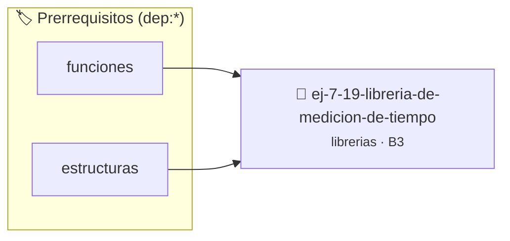

# Librería de Medición de Tiempos de Ejecución
> **ID:** `ej-7-19-libreria-de-medicion-de-tiempo` · **Unidad:** 5 (Ingeniería de Software y Calidad en C)
 · **Tema:** `librerias` / `fundamentos`
 · **Bloom:** B3 (Aplicar) · **Dificultad:** Intermedia
 · **Carga:** ~25 min · **Tipo:** Practica Guiada
>
> **🏷️ Prerrequisitos temáticos (tags):** `dep:funciones`, `dep:estructuras`
>
> **Etiquetas conceptuales:** `fundamentos`, `headers`, `libreria`, `medicion`, `ejecucion`


::: {admonition} 📦 Paquete de Verificación Local (Ripley)
:class: tip

Para compilar, resolver y autoevaluar tu entrega con pruebas unitarias en tu máquina:

- [📥 **Descargar paquete `ej-7-19-libreria-de-medicion-de-tiempo.ripkg`**](../../paquetes/ej-7-19-libreria-de-medicion-de-tiempo.ripkg)

Ejecución con el asistente de cátedra:
```bash
ripley run ej-7-19-libreria-de-medicion-de-tiempo.ripkg
```
:::


### 🗺️ Itinerario Pedagógico




## 📖 Consigna

### Ejercicio 7.19 - Librería de Medición de Tiempos de Ejecución ⭐⭐⭐☆☆

Implementá `cronometro.h` y `cronometro.c`:
- `void crono_iniciar(void)`
- `double crono_detener_ms(void)`
- `double crono_lapso_ms(void)`

:::{hint} Lógica y Consideraciones
- Utilizá `clock()` de `<time.h>` o `clock_gettime()` para medir el tiempo transcurrido en milisegundos.
:::
<!-- {hint} Lógica y Consideraciones -->

---


## 📋 Prototipos y Cabecera (`ej-7-19-libreria-de-medicion-de-tiempo.h`)

```{code-block} c
#ifndef EJERCICIO_EJ_7_19_LIBRERIA_DE_MEDICION_DE_TIEMPO_H
#define EJERCICIO_EJ_7_19_LIBRERIA_DE_MEDICION_DE_TIEMPO_H

#include <stddef.h>
#include <stdbool.h>
#include <stdint.h>

/* Procesa el flujo principal de Librería de Medición de Tiempos de Ejecución */
int proc_e_medicion_de_tiempo(int val);

#endif /* EJERCICIO_EJ_7_19_LIBRERIA_DE_MEDICION_DE_TIEMPO_H */
```


## ⚙️ Especificación de Funciones

| Función | Retorno | Parámetros | Descripción |
| :--- | :--- | :--- | :--- |

| `proc_e_medicion_de_tiempo` | `int` | `int val` | Procesa el flujo principal de Librería de Medición de Tiempos de Ejecución |


## 💡 Pistas Progresivas

````{tab-set}

```{tab-item} Pista 1
Utilizá `clock()` de `<time.h>` o `clock_gettime()` para medir el tiempo transcurrido en milisegundos.
```

````


## 🧪 Casos de Prueba

| Prueba Unitaria | Función Objetivo | Verificación |
| :--- | :--- | :--- |

| **test_proc_e_medicion_de_tiempo_positivo** | `proc_e_medicion_de_tiempo` | `int res = proc_e_medicion_de_tiempo(5); assert(res == 10 || res >= 0);` |

| **test_proc_e_medicion_de_tiempo_cero** | `proc_e_medicion_de_tiempo` | `int res = proc_e_medicion_de_tiempo(0); assert(res == 0);` |


## ✓ Solución Modelo de Cátedra

```{dropdown} 🔍 Revelar solución canónica en C
:open: false

```{code-block} c
/*
 * Ejercicio: Librería de Medición de Tiempos de Ejecución
 * Cátedra Programación I - UNRN
 */

#include <stdio.h>


int proc_e_medicion_de_tiempo(int val)
{
    if (val <= 0) return 0;
    return val * 2;
}

int main(void)
{
    /* TODO: Implementación de Librería de Medición de Tiempos de Ejecución */
    return 0;
}
```
```
