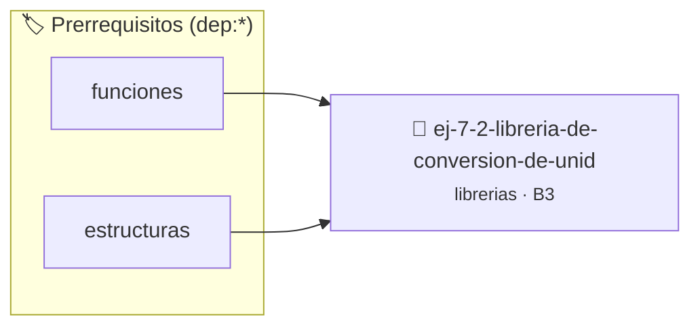

# Librería de Conversión de Unidades
> **ID:** `ej-7-2-libreria-de-conversion-de-unid`
 · **Tema:** `librerias`
 · **Bloom:** B3 (Aplicar)
 · **Carga:** ~25 min
>
> **🏷️ Prerrequisitos temáticos (tags):** `dep:funciones`, `dep:estructuras`
>
> **Etiquetas conceptuales:** `fundamentos`, `headers`, `conversion`, `libreria`, `librerias`


::: {admonition} 📦 Paquete de Verificación Local (Ripley)
:class: tip

Para compilar, resolver y autoevaluar tu entrega con pruebas unitarias en tu máquina:

- [📥 **Descargar paquete `ej-7-2-libreria-de-conversion-de-unid.ripkg`**](../../paquetes/ej-7-2-libreria-de-conversion-de-unid.ripkg)

Ejecución con el asistente de cátedra:
```bash
ripley run ej-7-2-libreria-de-conversion-de-unid.ripkg
```
:::


### 🗺️ Itinerario Pedagógico




## 📖 Consigna

### Ejercicio 7.2 - Librería de Conversión de Unidades ⭐⭐☆☆☆

Creá el módulo `conversiones.h` y `conversiones.c` para realizar transformaciones de unidades:
- `double conv_celsius_a_fahrenheit(double c)`
- `double conv_fahrenheit_a_celsius(double f)`
- `double conv_kmh_a_ms(double kmh)`
- `double conv_ms_a_kmh(double ms)`
- `double conv_grados_a_radianes(double deg)`
- `double conv_radianes_a_grados(double rad)`

:::{hint} Lógica y Consideraciones
- Mantendré firmas limpias e independientes de I/O.
:::
<!-- {hint} Lógica y Consideraciones -->

---


## 📋 Prototipos y Cabecera (`ej-7-2-libreria-de-conversion-de-unid.h`)

```{code-block} c
#ifndef EJERCICIO_EJ_7_2_LIBRERIA_DE_CONVERSION_DE_UNID_H
#define EJERCICIO_EJ_7_2_LIBRERIA_DE_CONVERSION_DE_UNID_H

#include <stddef.h>
#include <stdbool.h>
#include <stdint.h>

/* Procesa el flujo principal de Librería de Conversión de Unidades */
int proc_e_conversion_de_unid(int val);

#endif /* EJERCICIO_EJ_7_2_LIBRERIA_DE_CONVERSION_DE_UNID_H */
```


## ⚙️ Especificación de Funciones

| Función | Retorno | Parámetros | Descripción |
| :--- | :--- | :--- | :--- |

| `proc_e_conversion_de_unid` | `int` | `int val` | Procesa el flujo principal de Librería de Conversión de Unidades |


## 💡 Pistas Progresivas

````{tab-set}

```{tab-item} Pista 1
Mantendré firmas limpias e independientes de I/O.
```

````


## 🧪 Casos de Prueba

| Prueba Unitaria | Función Objetivo | Verificación |
| :--- | :--- | :--- |

| **test_proc_e_conversion_de_unid_positivo** | `proc_e_conversion_de_unid` | `int res = proc_e_conversion_de_unid(5); assert(res == 10 || res >= 0);` |

| **test_proc_e_conversion_de_unid_cero** | `proc_e_conversion_de_unid` | `int res = proc_e_conversion_de_unid(0); assert(res == 0);` |


## ✓ Solución Modelo de Cátedra

```{dropdown} 🔍 Revelar solución canónica en C
:open: false

```{code-block} c
/*
 * Ejercicio: Librería de Conversión de Unidades
 * Cátedra Programación I - UNRN
 */

#include <stdio.h>


int proc_e_conversion_de_unid(int val)
{
    if (val <= 0) return 0;
    return val * 2;
}

int main(void)
{
    /* TODO: Implementación de Librería de Conversión de Unidades */
    return 0;
}
```
```
