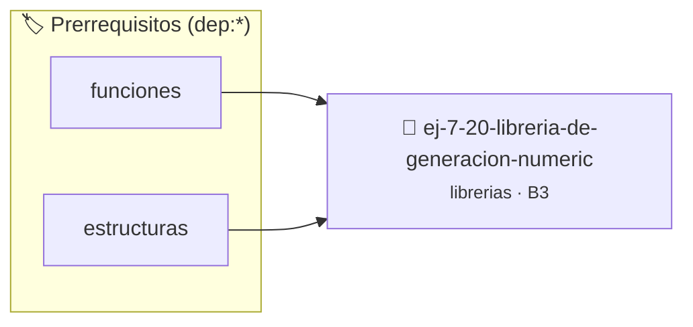

# Librería de Generación Numérica Pseudoaleatoria
> **ID:** `ej-7-20-libreria-de-generacion-numeric` · **Unidad:** 5 (Ingeniería de Software y Calidad en C)
 · **Tema:** `librerias` / `fundamentos`
 · **Bloom:** B3 (Aplicar) · **Dificultad:** Intermedia
 · **Carga:** ~25 min · **Tipo:** Practica Guiada
>
> **🏷️ Prerrequisitos temáticos (tags):** `dep:funciones`, `dep:estructuras`
>
> **Etiquetas conceptuales:** `fundamentos`, `headers`, `pseudoaleatoria`, `libreria`, `numerica`


::: {admonition} 📦 Paquete de Verificación Local (Ripley)
:class: tip

Para compilar, resolver y autoevaluar tu entrega con pruebas unitarias en tu máquina:

- [📥 **Descargar paquete `ej-7-20-libreria-de-generacion-numeric.ripkg`**](../../paquetes/ej-7-20-libreria-de-generacion-numeric.ripkg)

Ejecución con el asistente de cátedra:
```bash
ripley run ej-7-20-libreria-de-generacion-numeric.ripkg
```
:::


### 🗺️ Itinerario Pedagógico




## 📖 Consigna

### Ejercicio 7.20 - Librería de Generación Numérica Pseudoaleatoria ⭐⭐⭐☆☆

Creá `azar.h` y `azar.c`:
- `void azar_inicializar(unsigned int semilla)`
- `int azar_entero_en_rango(int min, int max)`
- `double azar_double_0_1(void)`
- `bool azar_probabilidad(double p)` (retorna `true` con probabilidad `p` entre 0.0 y 1.0)
- `void azar_desordenar_arreglo(int *v, size_t n)`

:::{hint} Lógica y Consideraciones
- Encapsulá `rand()` y `srand()` de `<stdlib.h>` asegurando una distribución uniforme mediante operaciones adecuadas.
:::
<!-- {hint} Lógica y Consideraciones -->

---

## 5. Librerías de Simulación y Dominios Específicos


## 📋 Prototipos y Cabecera (`ej-7-20-libreria-de-generacion-numeric.h`)

```{code-block} c
#ifndef EJERCICIO_EJ_7_20_LIBRERIA_DE_GENERACION_NUMERIC_H
#define EJERCICIO_EJ_7_20_LIBRERIA_DE_GENERACION_NUMERIC_H

#include <stddef.h>
#include <stdbool.h>
#include <stdint.h>

/* Procesa el flujo principal de Librería de Generación Numérica Pseudoaleatoria */
int proc_e_generacion_numeric(int val);

#endif /* EJERCICIO_EJ_7_20_LIBRERIA_DE_GENERACION_NUMERIC_H */
```


## ⚙️ Especificación de Funciones

| Función | Retorno | Parámetros | Descripción |
| :--- | :--- | :--- | :--- |

| `proc_e_generacion_numeric` | `int` | `int val` | Procesa el flujo principal de Librería de Generación Numérica Pseudoaleatoria |


## 💡 Pistas Progresivas

````{tab-set}

```{tab-item} Pista 1
Encapsulá `rand()` y `srand()` de `<stdlib.h>` asegurando una distribución uniforme mediante operaciones adecuadas.
```

````


## 🧪 Casos de Prueba

| Prueba Unitaria | Función Objetivo | Verificación |
| :--- | :--- | :--- |

| **test_proc_e_generacion_numeric_positivo** | `proc_e_generacion_numeric` | `int res = proc_e_generacion_numeric(5); assert(res == 10 || res >= 0);` |

| **test_proc_e_generacion_numeric_cero** | `proc_e_generacion_numeric` | `int res = proc_e_generacion_numeric(0); assert(res == 0);` |


## ✓ Solución Modelo de Cátedra

```{dropdown} 🔍 Revelar solución canónica en C
:open: false

```{code-block} c
/*
 * Ejercicio: Librería de Generación Numérica Pseudoaleatoria
 * Cátedra Programación I - UNRN
 */

#include <stdio.h>


int proc_e_generacion_numeric(int val)
{
    if (val <= 0) return 0;
    return val * 2;
}

int main(void)
{
    /* TODO: Implementación de Librería de Generación Numérica Pseudoaleatoria */
    return 0;
}
```
```
