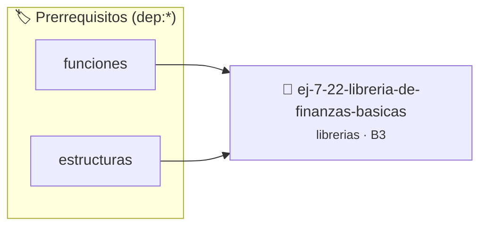

# Librería de Finanzas Básicas
> **ID:** `ej-7-22-libreria-de-finanzas-basicas`
 · **Tema:** `librerias`
 · **Bloom:** B3 (Aplicar)
 · **Carga:** ~25 min
>
> **🏷️ Prerrequisitos temáticos (tags):** `dep:funciones`, `dep:estructuras`
>
> **Etiquetas conceptuales:** `basicas`, `finanzas`, `fundamentos`, `headers`, `libreria`


::: {admonition} 📦 Paquete de Verificación Local (Ripley)
:class: tip

Para compilar, resolver y autoevaluar tu entrega con pruebas unitarias en tu máquina:

- [📥 **Descargar paquete `ej-7-22-libreria-de-finanzas-basicas.ripkg`**](../../paquetes/ej-7-22-libreria-de-finanzas-basicas.ripkg)

Ejecución con el asistente de cátedra:
```bash
ripley run ej-7-22-libreria-de-finanzas-basicas.ripkg
```
:::


### 🗺️ Itinerario Pedagógico




## 📖 Consigna

### Ejercicio 7.22 - Librería de Finanzas Básicas ⭐⭐☆☆☆

Creá `finanzas.h` y `finanzas.c`:
- `double fin_interes_simple(double capital, double tasa, double tiempo)`
- `double fin_interes_compuesto(double capital, double tasa, int periodos)`
- `double fin_cuota_prestamo(double capital, double tasa_mensual, int meses)`
- `double fin_valor_futuro_anualidad(double cuota, double tasa, int periodos)`

:::{hint} Lógica y Consideraciones
- Usá `pow()` de `<math.h>` para los cálculos con exponencial.
:::
<!-- {hint} Lógica y Consideraciones -->

---


## 📋 Prototipos y Cabecera (`ej-7-22-libreria-de-finanzas-basicas.h`)

```{code-block} c
#ifndef EJERCICIO_EJ_7_22_LIBRERIA_DE_FINANZAS_BASICAS_H
#define EJERCICIO_EJ_7_22_LIBRERIA_DE_FINANZAS_BASICAS_H

#include <stddef.h>
#include <stdbool.h>
#include <stdint.h>

/* Procesa el flujo principal de Librería de Finanzas Básicas */
int proc__de_finanzas_basicas(int val);

#endif /* EJERCICIO_EJ_7_22_LIBRERIA_DE_FINANZAS_BASICAS_H */
```


## ⚙️ Especificación de Funciones

| Función | Retorno | Parámetros | Descripción |
| :--- | :--- | :--- | :--- |

| `proc__de_finanzas_basicas` | `int` | `int val` | Procesa el flujo principal de Librería de Finanzas Básicas |


## 💡 Pistas Progresivas

````{tab-set}

```{tab-item} Pista 1
Usá `pow()` de `<math.h>` para los cálculos con exponencial.
```

````


## 🧪 Casos de Prueba

| Prueba Unitaria | Función Objetivo | Verificación |
| :--- | :--- | :--- |

| **test_proc__de_finanzas_basicas_positivo** | `proc__de_finanzas_basicas` | `int res = proc__de_finanzas_basicas(5); assert(res == 10 || res >= 0);` |

| **test_proc__de_finanzas_basicas_cero** | `proc__de_finanzas_basicas` | `int res = proc__de_finanzas_basicas(0); assert(res == 0);` |


## ✓ Solución Modelo de Cátedra

```{dropdown} 🔍 Revelar solución canónica en C
:open: false

```{code-block} c
/*
 * Ejercicio: Librería de Finanzas Básicas
 * Cátedra Programación I - UNRN
 */

#include <stdio.h>


int proc__de_finanzas_basicas(int val)
{
    if (val <= 0) return 0;
    return val * 2;
}

int main(void)
{
    /* TODO: Implementación de Librería de Finanzas Básicas */
    return 0;
}
```
```
