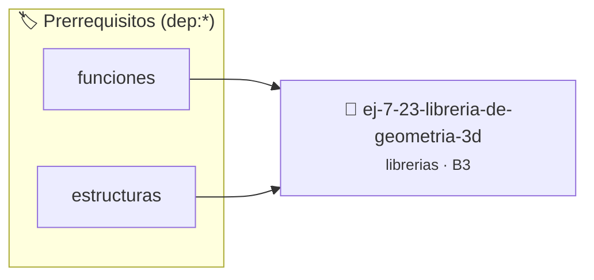

# Librería de Geometría 3D
> **ID:** `ej-7-23-libreria-de-geometria-3d`
 · **Tema:** `librerias`
 · **Bloom:** B3 (Aplicar)
 · **Carga:** ~25 min
>
> **🏷️ Prerrequisitos temáticos (tags):** `dep:funciones`, `dep:estructuras`
>
> **Etiquetas conceptuales:** `geometria`, `fundamentos`, `headers`, `libreria`, `librerias`


::: {admonition} 📦 Paquete de Verificación Local (Ripley)
:class: tip

Para compilar, resolver y autoevaluar tu entrega con pruebas unitarias en tu máquina:

- [📥 **Descargar paquete `ej-7-23-libreria-de-geometria-3d.ripkg`**](../../paquetes/ej-7-23-libreria-de-geometria-3d.ripkg)

Ejecución con el asistente de cátedra:
```bash
ripley run ej-7-23-libreria-de-geometria-3d.ripkg
```
:::


### 🗺️ Itinerario Pedagógico




## 📖 Consigna

### Ejercicio 7.23 - Librería de Geometría 3D ⭐⭐⭐☆☆

Diseñá `geometria3d.h` y `geometria3d.c`:
- `double geo3d_volumen_esfera(double radio)`
- `double geo3d_area_esfera(double radio)`
- `double geo3d_volumen_cilindro(double radio, double altura)`
- `double geo3d_volumen_cono(double radio, double altura)`
- `double geo3d_distancia_puntos(double x1, double y1, double z1, double x2, double y2, double z2)`

:::{hint} Lógica y Consideraciones
- Verificá que el radio y la altura sean mayores a 0.
:::
<!-- {hint} Lógica y Consideraciones -->

---


## 📋 Prototipos y Cabecera (`ej-7-23-libreria-de-geometria-3d.h`)

```{code-block} c
#ifndef EJERCICIO_EJ_7_23_LIBRERIA_DE_GEOMETRIA_3D_H
#define EJERCICIO_EJ_7_23_LIBRERIA_DE_GEOMETRIA_3D_H

#include <stddef.h>
#include <stdbool.h>
#include <stdint.h>

/* Procesa el flujo principal de Librería de Geometría 3D */
int proc_eria_de_geometria_3d(int val);

#endif /* EJERCICIO_EJ_7_23_LIBRERIA_DE_GEOMETRIA_3D_H */
```


## ⚙️ Especificación de Funciones

| Función | Retorno | Parámetros | Descripción |
| :--- | :--- | :--- | :--- |

| `proc_eria_de_geometria_3d` | `int` | `int val` | Procesa el flujo principal de Librería de Geometría 3D |


## 💡 Pistas Progresivas

````{tab-set}

```{tab-item} Pista 1
Verificá que el radio y la altura sean mayores a 0.
```

````


## 🧪 Casos de Prueba

| Prueba Unitaria | Función Objetivo | Verificación |
| :--- | :--- | :--- |

| **test_proc_eria_de_geometria_3d_positivo** | `proc_eria_de_geometria_3d` | `int res = proc_eria_de_geometria_3d(5); assert(res == 10 || res >= 0);` |

| **test_proc_eria_de_geometria_3d_cero** | `proc_eria_de_geometria_3d` | `int res = proc_eria_de_geometria_3d(0); assert(res == 0);` |


## ✓ Solución Modelo de Cátedra

```{dropdown} 🔍 Revelar solución canónica en C
:open: false

```{code-block} c
/*
 * Ejercicio: Librería de Geometría 3D
 * Cátedra Programación I - UNRN
 */

#include <stdio.h>


int proc_eria_de_geometria_3d(int val)
{
    if (val <= 0) return 0;
    return val * 2;
}

int main(void)
{
    /* TODO: Implementación de Librería de Geometría 3D */
    return 0;
}
```
```
