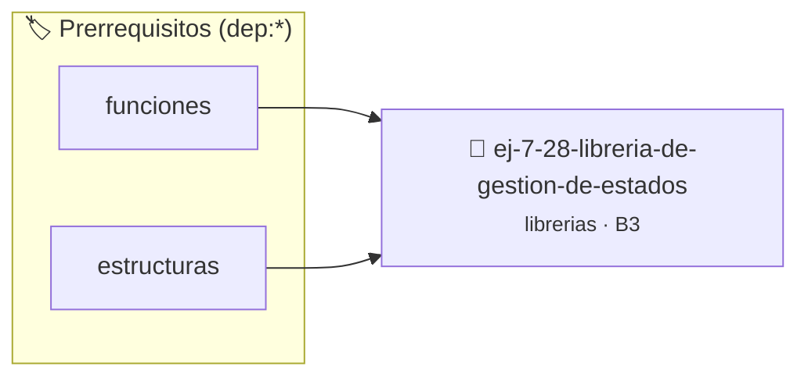

# Librería de Gestión de Estados y Banderas Booleanas
> **ID:** `ej-7-28-libreria-de-gestion-de-estados` · **Unidad:** 5 (Ingeniería de Software y Calidad en C)
 · **Tema:** `librerias` / `booleanas`
 · **Bloom:** B3 (Aplicar) · **Dificultad:** Intermedia
 · **Carga:** ~25 min · **Tipo:** Practica Guiada
>
> **🏷️ Prerrequisitos temáticos (tags):** `dep:funciones`, `dep:estructuras`
>
> **Etiquetas conceptuales:** `booleanas`, `fundamentos`, `headers`, `libreria`, `gestion`


::: {admonition} 📦 Paquete de Verificación Local (Ripley)
:class: tip

Para compilar, resolver y autoevaluar tu entrega con pruebas unitarias en tu máquina:

- [📥 **Descargar paquete `ej-7-28-libreria-de-gestion-de-estados.ripkg`**](../../paquetes/ej-7-28-libreria-de-gestion-de-estados.ripkg)

Ejecución con el asistente de cátedra:
```bash
ripley run ej-7-28-libreria-de-gestion-de-estados.ripkg
```
:::


### 🗺️ Itinerario Pedagógico




## 📖 Consigna

### Ejercicio 7.28 - Librería de Gestión de Estados y Banderas Booleanas ⭐⭐⭐⭐☆

Implementá `flags.h` y `flags.c` para gestionar conjuntos de opciones mediante arreglos booleanos:
- `void flag_activar(bool banderas[], size_t n, size_t indice)`: activa la bandera en la posición indicada.
- `void flag_desactivar(bool banderas[], size_t n, size_t indice)`: desactiva la bandera indicada.
- `bool flag_consultar(const bool banderas[], size_t n, size_t indice)`: consulta el estado de la bandera.
- `void flag_reiniciar_todas(bool banderas[], size_t n, bool valor_defecto)`: asigna un valor uniforme a todas las banderas.
- `size_t flag_contar_activas(const bool banderas[], size_t n)`: cuenta cuántas banderas están en `true`.

:::{hint} Lógica y Consideraciones
- Validá que `indice < n` antes de acceder a las posiciones del arreglo.
- **[*plus ultra*]:** Escribir pruebas unitarias con `assert()` en `tests/` para verificar el correcto cambio de estado.
:::
<!-- {hint} Lógica y Consideraciones -->

---


## 📋 Prototipos y Cabecera (`ej-7-28-libreria-de-gestion-de-estados.h`)

```{code-block} c
#ifndef EJERCICIO_EJ_7_28_LIBRERIA_DE_GESTION_DE_ESTADOS_H
#define EJERCICIO_EJ_7_28_LIBRERIA_DE_GESTION_DE_ESTADOS_H

#include <stddef.h>
#include <stdbool.h>
#include <stdint.h>

/* Procesa el flujo principal de Librería de Gestión de Estados y Banderas Booleanas */
int proc_e_gestion_de_estados(int val);

#endif /* EJERCICIO_EJ_7_28_LIBRERIA_DE_GESTION_DE_ESTADOS_H */
```


## ⚙️ Especificación de Funciones

| Función | Retorno | Parámetros | Descripción |
| :--- | :--- | :--- | :--- |

| `proc_e_gestion_de_estados` | `int` | `int val` | Procesa el flujo principal de Librería de Gestión de Estados y Banderas Booleanas |


## 💡 Pistas Progresivas

````{tab-set}

```{tab-item} Pista 1
Validá que `indice < n` antes de acceder a las posiciones del arreglo.
```

```{tab-item} Pista 2
[Plus Ultra] Escribir pruebas unitarias con `assert()` en `tests/` para verificar el correcto cambio de estado.
```

````


## 🧪 Casos de Prueba

| Prueba Unitaria | Función Objetivo | Verificación |
| :--- | :--- | :--- |

| **test_proc_e_gestion_de_estados_positivo** | `proc_e_gestion_de_estados` | `int res = proc_e_gestion_de_estados(5); assert(res == 10 || res >= 0);` |

| **test_proc_e_gestion_de_estados_cero** | `proc_e_gestion_de_estados` | `int res = proc_e_gestion_de_estados(0); assert(res == 0);` |


## ✓ Solución Modelo de Cátedra

```{dropdown} 🔍 Revelar solución canónica en C
:open: false

```{code-block} c
/*
 * Ejercicio: Librería de Gestión de Estados y Banderas Booleanas
 * Cátedra Programación I - UNRN
 */

#include <stdio.h>


int proc_e_gestion_de_estados(int val)
{
    if (val <= 0) return 0;
    return val * 2;
}

int main(void)
{
    /* TODO: Implementación de Librería de Gestión de Estados y Banderas Booleanas */
    return 0;
}
```
```
