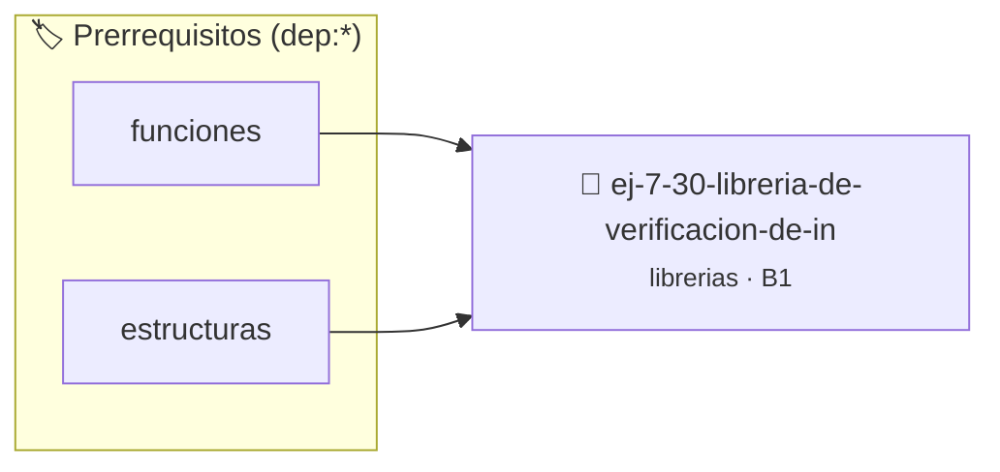

# Librería de Verificación de Integridad (Checksum)
> **ID:** `ej-7-30-libreria-de-verificacion-de-in` · **Unidad:** 5 (Ingeniería de Software y Calidad en C)
 · **Tema:** `librerias` / `checksum`
 · **Bloom:** B1 (Recordar) · **Dificultad:** Inicial
 · **Carga:** ~10 min · **Tipo:** Concepto
>
> **🏷️ Prerrequisitos temáticos (tags):** `dep:funciones`, `dep:estructuras`
>
> **Etiquetas conceptuales:** `checksum`, `fundamentos`, `headers`, `libreria`, `integridad`


::: {admonition} 📦 Paquete de Verificación Local (Ripley)
:class: tip

Para compilar, resolver y autoevaluar tu entrega con pruebas unitarias en tu máquina:

- [📥 **Descargar paquete `ej-7-30-libreria-de-verificacion-de-in.ripkg`**](../../paquetes/ej-7-30-libreria-de-verificacion-de-in.ripkg)

Ejecución con el asistente de cátedra:
```bash
ripley run ej-7-30-libreria-de-verificacion-de-in.ripkg
```
:::


### 🗺️ Itinerario Pedagógico




## 📖 Consigna

### Ejercicio 7.30 - Librería de Verificación de Integridad (Checksum) ⭐⭐⭐⭐⭐

Creá `checksum.h` y `checksum.c`:
- `unsigned char chk_luhn_calcular(const char *digitos, size_t len_digitos)`: algoritmo de Luhn para números de tarjeta/identificación.
- `bool chk_luhn_validar(const char *digitos, size_t len_digitos)`
- `unsigned char chk_suma_paridad(const unsigned char *datos, size_t len)`
- `uint16_t chk_fletcher16(const unsigned char *datos, size_t len)`

:::{hint} Lógica y Consideraciones
- **[*plus ultra*]:** Validar que `datos` no sea `NULL` y manejar adecuadamente los desbordamientos intermedios.
:::
<!-- {hint} Lógica y Consideraciones -->

---

## Notas Finales

:::{tip} Diseño de Librerías y Estructura del Proyecto
- **Estructura limpia:** Ubicá los archivos `.h` en `include/` y los `.c` en `src/`.
- **Ejemplos y Tests:** Agregá un programa de prueba en `examples/` y pruebas unitarias en `tests/`.
- **Automatización:** Proveé un `Makefile` con los objetivos `make`, `make test`, `make run` y `make clean`.
- **Guardas de inclusión:** Usá siempre `#ifndef NOMBRE_H`, `#define NOMBRE_H` y `#endif` en cada cabecera.
- **Encapsulamiento:** Ocultá funciones auxiliares usando la palabra clave `static` dentro del archivo `.c` en `src/`.
- **Prefijos de funciones:** Utilizá prefijos en los nombres de las funciones (ej. `geo_`, `str_`, `mat_`) para evitar colisiones de nombres.
:::
<!-- {tip} Diseño de Librerías y Estructura del Proyecto -->


## 📋 Prototipos y Cabecera (`ej-7-30-libreria-de-verificacion-de-in.h`)

```{code-block} c
#ifndef EJERCICIO_EJ_7_30_LIBRERIA_DE_VERIFICACION_DE_IN_H
#define EJERCICIO_EJ_7_30_LIBRERIA_DE_VERIFICACION_DE_IN_H

#include <stddef.h>
#include <stdbool.h>
#include <stdint.h>

/* Procesa el flujo principal de Librería de Verificación de Integridad (Checksum) */
int proc_e_verificacion_de_in(int val);

#endif /* EJERCICIO_EJ_7_30_LIBRERIA_DE_VERIFICACION_DE_IN_H */
```


## ⚙️ Especificación de Funciones

| Función | Retorno | Parámetros | Descripción |
| :--- | :--- | :--- | :--- |

| `proc_e_verificacion_de_in` | `int` | `int val` | Procesa el flujo principal de Librería de Verificación de Integridad (Checksum) |


## 💡 Pistas Progresivas

````{tab-set}

```{tab-item} Pista 1
[Plus Ultra] Validar que `datos` no sea `NULL` y manejar adecuadamente los desbordamientos intermedios.
```

```{tab-item} Pista 2
**Estructura limpia:** Ubicá los archivos `.h` en `include/` y los `.c` en `src/`.
```

```{tab-item} Pista 3
**Ejemplos y Tests:** Agregá un programa de prueba en `examples/` y pruebas unitarias en `tests/`.
```

```{tab-item} Pista 4
**Automatización:** Proveé un `Makefile` con los objetivos `make`, `make test`, `make run` y `make clean`.
```

```{tab-item} Pista 5
**Guardas de inclusión:** Usá siempre `#ifndef NOMBRE_H`, `#define NOMBRE_H` y `#endif` en cada cabecera.
```

```{tab-item} Pista 6
**Encapsulamiento:** Ocultá funciones auxiliares usando la palabra clave `static` dentro del archivo `.c` en `src/`.
```

```{tab-item} Pista 7
**Prefijos de funciones:** Utilizá prefijos en los nombres de las funciones (ej. `geo_`, `str_`, `mat_`) para evitar colisiones de nombres.
```

````


## 🧪 Casos de Prueba

| Prueba Unitaria | Función Objetivo | Verificación |
| :--- | :--- | :--- |

| **test_proc_e_verificacion_de_in_positivo** | `proc_e_verificacion_de_in` | `int res = proc_e_verificacion_de_in(5); assert(res == 10 || res >= 0);` |

| **test_proc_e_verificacion_de_in_cero** | `proc_e_verificacion_de_in` | `int res = proc_e_verificacion_de_in(0); assert(res == 0);` |


## ✓ Solución Modelo de Cátedra

```{dropdown} 🔍 Revelar solución canónica en C
:open: false

```{code-block} c
/*
 * Ejercicio: Librería de Verificación de Integridad (Checksum)
 * Cátedra Programación I - UNRN
 */

#include <stdio.h>


int proc_e_verificacion_de_in(int val)
{
    if (val <= 0) return 0;
    return val * 2;
}

int main(void)
{
    /* TODO: Implementación de Librería de Verificación de Integridad (Checksum) */
    return 0;
}
```
```
