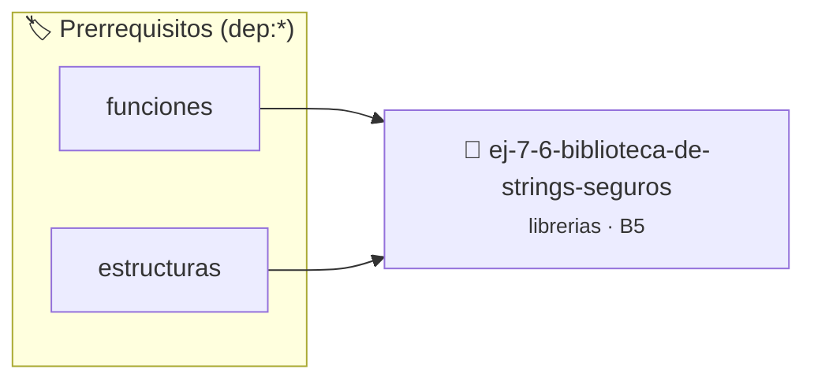

# Biblioteca de Strings seguros
> **ID:** `ej-7-6-biblioteca-de-strings-seguros` · **Unidad:** 5 (Ingeniería de Software y Calidad en C)
 · **Tema:** `librerias` / `procesamiento_texto`
 · **Bloom:** B5 (Evaluar / Crear) · **Dificultad:** Desafio
 · **Carga:** ~45 min · **Tipo:** Desafio
>
> **🏷️ Prerrequisitos temáticos (tags):** `dep:funciones`, `dep:estructuras`
>
> **Etiquetas conceptuales:** `strings`, `fundamentos`, `headers`, `biblioteca`, `librerias`


::: {admonition} 📦 Paquete de Verificación Local (Ripley)
:class: tip

Para compilar, resolver y autoevaluar tu entrega con pruebas unitarias en tu máquina:

- [📥 **Descargar paquete `ej-7-6-biblioteca-de-strings-seguros.ripkg`**](../../paquetes/ej-7-6-biblioteca-de-strings-seguros.ripkg)

Ejecución con el asistente de cátedra:
```bash
ripley run ej-7-6-biblioteca-de-strings-seguros.ripkg
```
:::


### 🗺️ Itinerario Pedagógico




## 📖 Consigna

Reimplementá funciones estándar de `<string.h>` en la librería `seguras.h` y `seguras.c`:
- `int mi_strlen(const char *str, size_t len_str)`
- `void mi_strcpy(char *dest, size_t len_dest, const char *src, size_t len_src)`
- `int mi_strcmp(const char *s1, size_t len_s1, const char *s2, size_t len_s2)`
- `void mi_strcat(char *dest, size_t len_dest, const char *src, size_t len_src)`
- `char *mi_strchr(const char *str, size_t len_str, char c)`

**Orientación:**
- `strlen`: contá hasta `'\0'` o hasta alcanzar `len_str`
- `strcpy`: copiá carácter por carácter respetando los límites de tamaño
- `strcmp`: retorna la diferencia numérica del primer carácter distinto dentro de los límites
- `strcat`: copiá `src` al final de `dest` sin sobrepasar `len_dest`
- `strchr`: retorna puntero a la primera aparición de `c` dentro del límite indicado
- Verificá límites de destino para evitar desbordamientos de búfer.


---

### 📋 Contrato de las Funciones

```c
/*
 * Procesa el flujo principal de Biblioteca de Strings seguros
 * Precondiciones: val representa el parámetro de entrada del flujo.
 * Postcondiciones: Retorna el resultado correspondiente o 0 si val <= 0.
 */
int proc_a_de_strings_seguros(int val);

```

### 🧪 Ejemplos de Ejecución

::::{tab-set}
:::{tab-item} Valor positivo
```text
Entrada: 5
Salida / Retorno: 10
```
:::
:::{tab-item} Valor cero o negativo
```text
Entrada: 0
Salida / Retorno: 0
```
:::
::::

### ⚠️ Precondiciones y Casos Borde

1. **Valores fuera de rango:** Verificar siempre que los datos de entrada cumplan con los rangos admisibles antes de operar.
6. **Casos vacíos o neutros:** Contemplar adecuadamente entradas con longitud cero o valores neutros según corresponda.

### 🎯 Criterios de Aceptación

- [ ] El código compila limpiamente bajo estándar C11 sin warnings con flags estrictos (`-Wall -Wextra -Werror`).
- [ ] Se satisfacen todas las pruebas unitarias y casos de prueba provistos.
- [ ] Las funciones validan exhaustivamente sus precondiciones y gestionan casos borde de forma robusta.

:::{hint} Consideraciones Didácticas
- Diseñar una suite de pruebas unitarias con `assert()` en `tests/` que verifique cadenas vacías y límites exactos de búfer.
- Documentar con etiquetas Doxygen (`@pre`, `@post`) los contratos de seguridad de cada función.
:::


## 📋 Prototipos y Cabecera (`ej-7-6-biblioteca-de-strings-seguros.h`)

```{code-block} c
#ifndef EJERCICIO_EJ_7_6_BIBLIOTECA_DE_STRINGS_SEGUROS_H
#define EJERCICIO_EJ_7_6_BIBLIOTECA_DE_STRINGS_SEGUROS_H

#include <stddef.h>
#include <stdbool.h>
#include <stdint.h>

/* Procesa el flujo principal de Biblioteca de Strings seguros */
int proc_a_de_strings_seguros(int val);

#endif /* EJERCICIO_EJ_7_6_BIBLIOTECA_DE_STRINGS_SEGUROS_H */
```


## ⚙️ Especificación de Funciones

| Función | Retorno | Parámetros | Descripción |
| :--- | :--- | :--- | :--- |

| `proc_a_de_strings_seguros` | `int` | `int val` | Procesa el flujo principal de Biblioteca de Strings seguros |


## 💡 Pistas Progresivas

````{tab-set}

```{tab-item} Pista 1
[Plus Ultra] Diseñar una suite de pruebas unitarias con `assert()` en `tests/` que verifique cadenas vacías y límites exactos de búfer.
```

```{tab-item} Pista 2
[Plus Ultra] Documentar con etiquetas Doxygen (`@pre`, `@post`) los contratos de seguridad de cada función.
```

````


## 🧪 Casos de Prueba

| Prueba Unitaria | Función Objetivo | Verificación |
| :--- | :--- | :--- |

| **test_proc_a_de_strings_seguros_positivo** | `proc_a_de_strings_seguros` | `int res = proc_a_de_strings_seguros(5); assert(res == 10 || res >= 0);` |

| **test_proc_a_de_strings_seguros_cero** | `proc_a_de_strings_seguros` | `int res = proc_a_de_strings_seguros(0); assert(res == 0);` |


## ✓ Solución Modelo de Cátedra

```{dropdown} 🔍 Revelar solución canónica en C
:open: false

```{code-block} c
/*
 * Ejercicio: Biblioteca de Strings seguros
 * Cátedra Programación I - UNRN
 */

#include <stdio.h>


int proc_a_de_strings_seguros(int val)
{
    if (val <= 0) return 0;
    return val * 2;
}

int main(void)
{
    /* TODO: Implementación de Biblioteca de Strings seguros */
    return 0;
}
```
```
