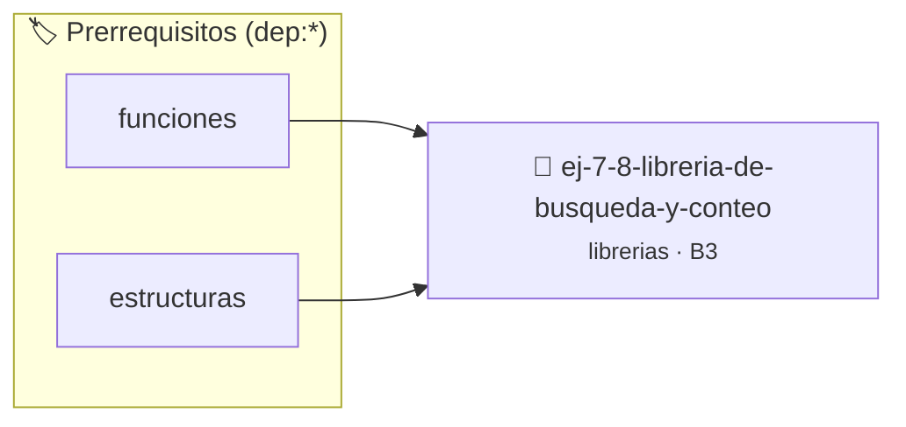

# Librería de Búsqueda y Conteo en Texto
> **ID:** `ej-7-8-libreria-de-busqueda-y-conteo` · **Unidad:** 5 (Ingeniería de Software y Calidad en C)
 · **Tema:** `librerias` / `texto`
 · **Bloom:** B3 (Aplicar) · **Dificultad:** Intermedia
 · **Carga:** ~25 min · **Tipo:** Practica Guiada
>
> **🏷️ Prerrequisitos temáticos (tags):** `dep:funciones`, `dep:estructuras`
>
> **Etiquetas conceptuales:** `texto`, `fundamentos`, `headers`, `busqueda`, `libreria`


::: {admonition} 📦 Paquete de Verificación Local (Ripley)
:class: tip

Para compilar, resolver y autoevaluar tu entrega con pruebas unitarias en tu máquina:

- [📥 **Descargar paquete `ej-7-8-libreria-de-busqueda-y-conteo.ripkg`**](../../paquetes/ej-7-8-libreria-de-busqueda-y-conteo.ripkg)

Ejecución con el asistente de cátedra:
```bash
ripley run ej-7-8-libreria-de-busqueda-y-conteo.ripkg
```
:::


### 🗺️ Itinerario Pedagógico




## 📖 Consigna

### Ejercicio 7.8 - Librería de Búsqueda y Conteo en Texto ⭐⭐⭐☆☆

Implementá la librería `text_search.h` y `text_search.c`:
- `size_t text_contar_palabras(const char *texto, size_t len_texto)`
- `size_t text_contar_caracter(const char *texto, size_t len_texto, char c)`
- `size_t text_contar_vocales(const char *texto, size_t len_texto)`
- `bool text_es_palindromo(const char *texto, size_t len_texto)`

:::{hint} Lógica y Consideraciones
- Para comprobar palíndromos podés ignorar diferencias entre mayúsculas y minúsculas y caracteres no alfabéticos.
:::
<!-- {hint} Lógica y Consideraciones -->

---


## 📋 Prototipos y Cabecera (`ej-7-8-libreria-de-busqueda-y-conteo.h`)

```{code-block} c
#ifndef EJERCICIO_EJ_7_8_LIBRERIA_DE_BUSQUEDA_Y_CONTEO_H
#define EJERCICIO_EJ_7_8_LIBRERIA_DE_BUSQUEDA_Y_CONTEO_H

#include <stddef.h>
#include <stdbool.h>
#include <stdint.h>

/* Procesa el flujo principal de Librería de Búsqueda y Conteo en Texto */
int proc_de_busqueda_y_conteo(int val);

#endif /* EJERCICIO_EJ_7_8_LIBRERIA_DE_BUSQUEDA_Y_CONTEO_H */
```


## ⚙️ Especificación de Funciones

| Función | Retorno | Parámetros | Descripción |
| :--- | :--- | :--- | :--- |

| `proc_de_busqueda_y_conteo` | `int` | `int val` | Procesa el flujo principal de Librería de Búsqueda y Conteo en Texto |


## 💡 Pistas Progresivas

````{tab-set}

```{tab-item} Pista 1
Para comprobar palíndromos podés ignorar diferencias entre mayúsculas y minúsculas y caracteres no alfabéticos.
```

````


## 🧪 Casos de Prueba

| Prueba Unitaria | Función Objetivo | Verificación |
| :--- | :--- | :--- |

| **test_proc_de_busqueda_y_conteo_positivo** | `proc_de_busqueda_y_conteo` | `int res = proc_de_busqueda_y_conteo(5); assert(res == 10 || res >= 0);` |

| **test_proc_de_busqueda_y_conteo_cero** | `proc_de_busqueda_y_conteo` | `int res = proc_de_busqueda_y_conteo(0); assert(res == 0);` |


## ✓ Solución Modelo de Cátedra

```{dropdown} 🔍 Revelar solución canónica en C
:open: false

```{code-block} c
/*
 * Ejercicio: Librería de Búsqueda y Conteo en Texto
 * Cátedra Programación I - UNRN
 */

#include <stdio.h>


int proc_de_busqueda_y_conteo(int val)
{
    if (val <= 0) return 0;
    return val * 2;
}

int main(void)
{
    /* TODO: Implementación de Librería de Búsqueda y Conteo en Texto */
    return 0;
}
```
```
