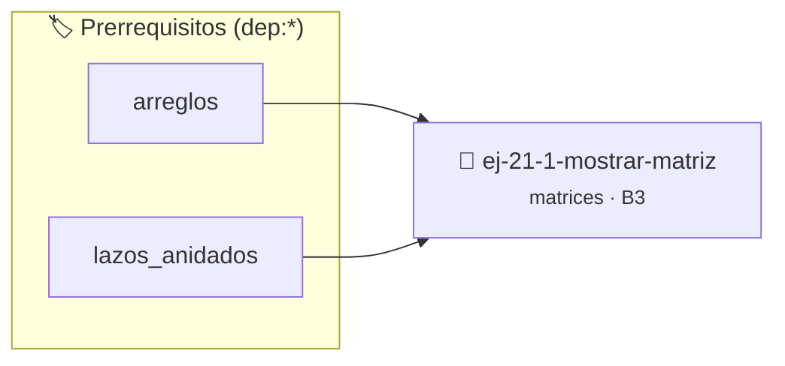

# Mostrar matriz
> **ID:** `ej-21-1-mostrar-matriz` · **Unidad:** 2 (Tipos Compuestos y Direccionamiento)
 · **Tema:** `matrices` / `matrices_2d`
 · **Bloom:** B3 (Aplicar) · **Dificultad:** Intermedia
 · **Carga:** ~25 min · **Tipo:** Practica Guiada
>
> **🏷️ Prerrequisitos temáticos (tags):** `dep:arreglos`, `dep:lazos_anidados`
>
> **Etiquetas conceptuales:** `matrices`, `matriz`, `2d`, `algoritmos`, `mostrar`


::: {admonition} 📦 Paquete de Verificación Local (Ripley)
:class: tip

Para compilar, resolver y autoevaluar tu entrega con pruebas unitarias en tu máquina:

- [📥 **Descargar paquete `ej-21-1-mostrar-matriz.ripkg`**](../../paquetes/ej-21-1-mostrar-matriz.ripkg)

Ejecución con el asistente de cátedra:
```bash
ripley run ej-21-1-mostrar-matriz.ripkg
```
:::


### 🗺️ Itinerario Pedagógico




## 📖 Consigna

### Ejercicio 21.1 - Mostrar matriz ⭐⭐⭐☆☆

#### Descripción
Escribir una función que reciba una matriz (un arreglo 2D), sus dimensiones
(filas y columnas), y la imprima en la consola de una forma clara y ordenada,
fila por fila.

::::{tab-set}

:::{tab-item} Entrada
:sync: tab1
``` text
Una matriz 2x3: 
[[1, 2, 3], [4, 5, 6]]
```
<!-- text -->

:::
<!-- {tab-item} Entrada -->
:::{tab-item} Salida
:sync: tab2
``` text
Matriz (2x3):
[ 1, 2, 3 ]
[ 4, 5, 6 ]
```
<!-- text -->

:::
<!-- {tab-item} Salida -->

::::
<!-- {tab-set} -->

:::{hint} Lógica y Consideraciones

-   **Proceso:** Se necesitan dos lazos `for` anidados para recorrer la matriz.
-   El lazo exterior itera sobre las filas (desde `0` hasta `filas-1`).
-   El lazo interior itera sobre las columnas de la fila actual (desde `0` hasta
    `columnas-1`).
-   Dentro del lazo interior, se imprime cada elemento `matriz[fila][columna]`.
-   Después de que el lazo interior termina (al final de cada fila), se debe
    imprimir un carácter de nueva línea (`\n`) para pasar a la siguiente fila.

:::
<!-- {hint} Lógica y Consideraciones -->

::::{hint} Diagrama
:class: dropdown

:::{mermaid}

flowchart TD
    A["Inicio"] --> B["fila = 0"]
    B --> C{"fila < num_filas?"}
    C -- Sí --> D["Imprimir '['"]
    D --> E["col = 0"]
    E --> F{"col < num_cols?"}
    F -- Sí --> G["Imprimir mat[fila][col]"]
    G --> H["col = col + 1"]
    H --> F
    F -- No --> I["Imprimir ']' y Salto de Línea"]
    I --> J["fila = fila + 1"]
    J --> C
    C -- No --> K["Fin"]

:::
<!-- {mermaid} -->

::::
<!-- {hint} Diagrama -->

:::{hint} Ayuda (Pseudocódigo)
:class: dropdown

```{code-block} pseudocode
:linenos:
PROCEDIMIENTO mostrar_matriz(matriz, filas, columnas)
INICIO
    PARA f DESDE 0 HASTA filas-1 HACER
        ESCRIBIR "[ " SIN SALTO DE LÍNEA
        PARA c DESDE 0 HASTA columnas-1 HACER
            ESCRIBIR matriz[f][c]
            SI c < columnas-1 ENTONCES
                ESCRIBIR ", " SIN SALTO DE LÍNEA
            FIN SI
        FIN PARA
        ESCRIBIR " ]" CON SALTO DE LÍNEA
    FIN PARA
FIN PROCEDIMIENTO

```
<!-- {code-block} pseudocode -->

-   **[*plus ultra*]:** Garantizar la terminación con `\0` y prevenir
    desbordamientos de búfer validando la capacidad máxima.
-   **[*plus ultra*]:** Soportar la lectura de cadenas con espacios y múltiples
    líneas de manera robusta.

:::
<!-- {hint} Ayuda (Pseudocódigo) -->


## 📋 Prototipos y Cabecera (`ej-21-1-mostrar-matriz.h`)

```{code-block} c
#ifndef EJERCICIO_EJ_21_1_MOSTRAR_MATRIZ_H
#define EJERCICIO_EJ_21_1_MOSTRAR_MATRIZ_H

#include <stddef.h>
#include <stdbool.h>
#include <stdint.h>

/* Procesa el flujo principal de Mostrar matriz */
int proc__21_1_mostrar_matriz(int val);

#endif /* EJERCICIO_EJ_21_1_MOSTRAR_MATRIZ_H */
```


## ⚙️ Especificación de Funciones

| Función | Retorno | Parámetros | Descripción |
| :--- | :--- | :--- | :--- |

| `proc__21_1_mostrar_matriz` | `int` | `int val` | Procesa el flujo principal de Mostrar matriz |


## 💡 Pistas Progresivas

````{tab-set}

```{tab-item} Pista 1
**Proceso:** Se necesitan dos lazos `for` anidados para recorrer la matriz.
```

```{tab-item} Pista 2
El lazo exterior itera sobre las filas (desde `0` hasta `filas-1`).
```

```{tab-item} Pista 3
El lazo interior itera sobre las columnas de la fila actual (desde `0` hasta `columnas-1`).
```

```{tab-item} Pista 4
Dentro del lazo interior, se imprime cada elemento `matriz[fila][columna]`.
```

```{tab-item} Pista 5
Después de que el lazo interior termina (al final de cada fila), se debe imprimir un carácter de nueva línea (`\n`) para pasar a la siguiente fila.
```

```{tab-item} Pista 6
[Plus Ultra] Garantizar la terminación con `\0` y prevenir desbordamientos de búfer validando la capacidad máxima.
```

```{tab-item} Pista 7
[Plus Ultra] Soportar la lectura de cadenas con espacios y múltiples líneas de manera robusta.
```

````


## 🧪 Casos de Prueba

| Prueba Unitaria | Función Objetivo | Verificación |
| :--- | :--- | :--- |

| **test_proc__21_1_mostrar_matriz_positivo** | `proc__21_1_mostrar_matriz` | `int res = proc__21_1_mostrar_matriz(5); assert(res == 10 || res >= 0);` |

| **test_proc__21_1_mostrar_matriz_cero** | `proc__21_1_mostrar_matriz` | `int res = proc__21_1_mostrar_matriz(0); assert(res == 0);` |


## ✓ Solución Modelo de Cátedra

```{dropdown} 🔍 Revelar solución canónica en C
:open: false

```{code-block} c
/*
 * Ejercicio: Mostrar matriz
 * Cátedra Programación I - UNRN
 */

#include <stdio.h>


int proc__21_1_mostrar_matriz(int val)
{
    if (val <= 0) return 0;
    return val * 2;
}

int main(void)
{
    /* TODO: Implementación de Mostrar matriz */
    return 0;
}
```
```
