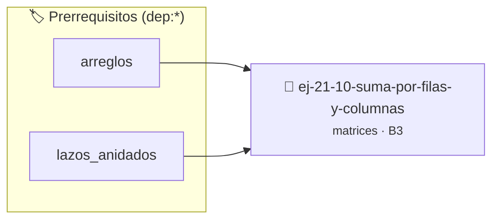

# Suma por Filas y Columnas
> **ID:** `ej-21-10-suma-por-filas-y-columnas`
 · **Tema:** `matrices`
 · **Bloom:** B3 (Aplicar)
 · **Carga:** ~25 min
>
> **🏷️ Prerrequisitos temáticos (tags):** `dep:arreglos`, `dep:lazos_anidados`
>
> **Etiquetas conceptuales:** `matrices`, `columnas`, `algoritmos`, `2d`, `filas`


::: {admonition} 📦 Paquete de Verificación Local (Ripley)
:class: tip

Para compilar, resolver y autoevaluar tu entrega con pruebas unitarias en tu máquina:

- [📥 **Descargar paquete `ej-21-10-suma-por-filas-y-columnas.ripkg`**](../../paquetes/ej-21-10-suma-por-filas-y-columnas.ripkg)

Ejecución con el asistente de cátedra:
```bash
ripley run ej-21-10-suma-por-filas-y-columnas.ripkg
```
:::


### 🗺️ Itinerario Pedagógico




## 📖 Consigna

### Ejercicio 21.10 - Suma por Filas y Columnas ⭐⭐☆☆☆

#### Descripción

Escribí un programa en C que, dada una matriz de enteros de dimensiones `M × N`,
calcule **en una única pasada** dos arreglos resultado:

-   `suma_filas[i]`: la suma de todos los elementos de la fila `i` de la matriz
    (con `0 <= i < M`).
-   `suma_cols[j]`: la suma de todos los elementos de la columna `j` de la matriz
    (con `0 <= j < N`).

El cálculo debe realizarse recorriendo la matriz una sola vez: cada elemento
`matriz[i][j]` debe acumularse simultáneamente en `suma_filas[i]` y en
`suma_cols[j]`. **No está permitido** recorrer la matriz dos veces (una por las
filas y otra por las columnas).

Implementá la lógica de cálculo en la siguiente función, que actúa como punto de
entrada del programa:

```c
/*
 * Precondiciones:
 *   - val representa una dimensión de la matriz (cantidad de filas o columnas).
 *   - val puede ser cualquier entero; la función debe ser robusta ante valores
 *     no válidos (val <= 0).
 * Postcondiciones:
 *   - Si val <= 0 (dimensión inválida), retorna 0.
 *   - Si val > 0, retorna el valor procesado según el flujo principal del
 *     ejercicio.
 */
int proc_por_filas_y_columnas(int val);
```

::::{tab-set}

:::{tab-item} Entrada
:sync: tab1

Matriz de ejemplo (2×3):

```text
[ 1, 2, 3 ]
[ 4, 5, 6 ]
```

<!-- text -->

:::
<!-- {tab-item} Entrada -->

:::{tab-item} Salida
:sync: tab2

```text
Suma de filas: [6, 15]
Suma de columnas: [5, 7, 9]
```

<!-- text -->

:::
<!-- {tab-item} Salida -->

::::
<!-- {tab-set} -->

:::{note} Verificación paso a paso

-   **Filas:**
    -   Fila 0: `1 + 2 + 3 = 6`.
    -   Fila 1: `4 + 5 + 6 = 15`.
-   **Columnas:**
    -   Columna 0: `1 + 4 = 5`.
    -   Columna 1: `2 + 5 = 7`.
    -   Columna 2: `3 + 6 = 9`.

:::
<!-- {note} Verificación paso a paso -->

#### Requisitos y Precondiciones

-   **Tipo de dato:** la matriz contiene valores de tipo `int`. Los arreglos
    resultado también son de tipo `int`.
-   **Dimensiones:** `M` (filas) y `N` (columnas) son enteros positivos
    (`M > 0`, `N > 0`). Ambos valores se conocen antes de comenzar el cálculo.
-   **Memoria:** los arreglos `suma_filas` y `suma_cols` se consideran ya
    dimensionados por quien invoca la lógica de cálculo: el primero con al menos
    `M` posiciones y el segundo con al menos `N`. Tu implementación **no debe**
    reservar memoria (`malloc`/`calloc`) ni liberarla (`free`).
-   **Punteros:** la función accede a la matriz y a los arreglos resultado
    mediante punteros recibidos como parámetros. Ninguno de estos punteros puede
    ser `NULL`; no es responsabilidad de la función validarlos.
-   **Inicialización:** antes de acumular, todos los elementos de `suma_filas` y
    `suma_cols` deben inicializarse en `0`. Acumular sobre arreglos sin
    inicializar es **comportamiento indefinido** (C11 §6.7.9).

#### Casos Borde

-   **Matriz de 1×1:** el único elemento es, a la vez, la suma de la única fila
    y de la única columna. Ejemplo: `[[7]]` produce `suma_filas = [7]` y
    `suma_cols = [7]`.
-   **Matriz de 1×N (una única fila):** `suma_filas` tiene un solo elemento (la
    suma total de la fila), mientras que `suma_cols[j]` coincide con
    `matriz[0][j]` para cada columna `j`.
-   **Matriz de M×1 (una única columna):** análogo al caso anterior, con los
    roles de filas y columnas intercambiados.
-   **Valores negativos y cero:** la matriz puede contener enteros negativos o
    ceros. Las sumas parciales y totales pueden resultar negativas; el algoritmo
    debe manejarlas correctamente. Ejemplo: `[[-1, 1], [-2, 2]]` produce
    `suma_filas = [0, 0]` y `suma_cols = [-3, 3]`.
-   **Dimensión no válida:** si la función de entrada recibe un valor
    `val <= 0`, debe retornar `0` sin realizar ningún otro procesamiento.

#### Ejemplos Adicionales de Ejecución

:::{tab-set}

:::{tab-item} Ejemplo 2: matriz 3×3
:sync: tab3

**Entrada:**

```text
[  2,  0, -2 ]
[  1,  1,  1 ]
[ -5,  5,  0 ]
```

**Salida esperada:**

```text
Suma de filas: [0, 3, 0]
Suma de columnas: [-2, 6, -1]
```

<!-- text -->

:::
<!-- {tab-item} Ejemplo 2: matriz 3×3 -->

:::{tab-item} Ejemplo 3: matriz 1×4
:sync: tab4

**Entrada:**

```text
[ 10, -3, 0, 7 ]
```

**Salida esperada:**

```text
Suma de filas: [14]
Suma de columnas: [10, -3, 0, 7]
```

<!-- text -->

:::
<!-- {tab-item} Ejemplo 3: matriz 1×4 -->

::::
<!-- {tab-set} -->

:::{hint} Lógica y Consideraciones

-   **Estrategia de una única pasada:**
    -   Inicializar `suma_filas[i] = 0` para todo `i` en `[0, M)`.
    -   Inicializar `suma_cols[j] = 0` para todo `j` en `[0, N)`.
    -   Recorrer la matriz con dos lazos anidados. Al visitar el elemento
        `matriz[i][j]`, acumularlo en **ambos** arreglos:
        `suma_filas[i] += matriz[i][j]` y `suma_cols[j] += matriz[i][j]`.
-   **Orden de recorrido:** iterar con el índice de filas `i` en el lazo
    exterior y el índice de columnas `j` en el lazo interior. Este orden
    respeta la disposición por filas (*row-major order*) del almacenamiento de
    matrices en C y mejora la localidad de las referencias a memoria.
-   **Invariantes:** al finalizar el recorrido, cada `suma_filas[i]` acumuló
    exactamente los `N` elementos de la fila `i`, y cada `suma_cols[j]` acumuló
    exactamente los `M` elementos de la columna `j`.
-   **No inicializar dentro del lazo doble:** la inicialización de los arreglos
    resultado se realiza en una pasada previa y separada, nunca dentro del
    recorrido de la matriz.

:::
<!-- {hint} Lógica y Consideraciones -->

:::{hint} Ayuda (Pseudocódigo)
:class: dropdown

```{code-block} pseudocode
:linenos:
PROCEDIMIENTO sumar_filas_y_columnas(matriz, M, N, REF suma_filas, REF suma_cols)
INICIO
    // Inicializar ambos arreglos resultado en 0
    PARA i DESDE 0 HASTA M-1 HACER
        suma_filas[i] = 0
    FIN PARA
    PARA j DESDE 0 HASTA N-1 HACER
        suma_cols[j] = 0
    FIN PARA

    // Una única pasada sobre la matriz, respetando row-major order
    PARA i DESDE 0 HASTA M-1 HACER
        PARA j DESDE 0 HASTA N-1 HACER
            suma_filas[i] = suma_filas[i] + matriz[i][j]
            suma_cols[j]  = suma_cols[j]  + matriz[i][j]
        FIN PARA
    FIN PARA
FIN PROCEDIMIENTO
```

<!-- {code-block} pseudocode -->

-   **[*plus ultra*]:** Analizar cómo varía el uso de la memoria caché si se
    invierte el orden de los lazos (columna exterior, fila interior) sobre una
    matriz de gran tamaño. ¿Cuántas fallas de caché (*cache misses*) adicionales
    se producen por acceder a memoria con salto entre filas?
-   **[*plus ultra*]:** Generalizar la función para que valide de forma
    defensiva las dimensiones y los índices antes de cada acceso, garantizando
    que se encuentren estrictamente dentro de los límites del contenedor.

:::
<!-- {hint} Ayuda (Pseudocódigo) -->


## 📋 Prototipos y Cabecera (`ej-21-10-suma-por-filas-y-columnas.h`)

```{code-block} c
#ifndef EJERCICIO_EJ_21_10_SUMA_POR_FILAS_Y_COLUMNAS_H
#define EJERCICIO_EJ_21_10_SUMA_POR_FILAS_Y_COLUMNAS_H

#include <stddef.h>
#include <stdbool.h>
#include <stdint.h>

/* Procesa el flujo principal de Suma por Filas y Columnas */
int proc_por_filas_y_columnas(int val);

#endif /* EJERCICIO_EJ_21_10_SUMA_POR_FILAS_Y_COLUMNAS_H */
```


## ⚙️ Especificación de Funciones

| Función | Retorno | Parámetros | Descripción |
| :--- | :--- | :--- | :--- |

| `proc_por_filas_y_columnas` | `int` | `int val` | Procesa el flujo principal de Suma por Filas y Columnas |


## 💡 Pistas Progresivas

````{tab-set}

```{tab-item} Pista 1
**Suma de Filas:**
```

```{tab-item} Pista 2
Recorrer cada fila con un lazo exterior.
```

```{tab-item} Pista 3
Para cada fila, inicializar una `suma_fila` en 0.
```

```{tab-item} Pista 4
Con un lazo interior, recorrer las columnas de esa fila y acumular los valores en `suma_fila`.
```

```{tab-item} Pista 5
Guardar el resultado en el arreglo de sumas de filas.
```

```{tab-item} Pista 6
**Suma de Columnas:**
```

```{tab-item} Pista 7
El proceso es inverso. El lazo exterior recorre las columnas.
```

```{tab-item} Pista 8
El lazo interior recorre las filas de esa columna.
```

```{tab-item} Pista 9
**Eficiencia:** Se pueden calcular ambas sumas en un solo par de lazos anidados. Al procesar el elemento `matriz[i][j]`, se añade a `suma_filas[i]` y a `suma_columnas[j]`.
```

```{tab-item} Pista 10
[Plus Ultra] Optimizar el acceso a memoria respetando el orden por filas (*row-major order*) para mejorar el uso de caché.
```

```{tab-item} Pista 11
[Plus Ultra] Validar que los índices ingresados se encuentren estrictamente dentro de los límites del contenedor.
```

````


## 🧪 Casos de Prueba

| Prueba Unitaria | Función Objetivo | Verificación |
| :--- | :--- | :--- |

| **test_proc_por_filas_y_columnas_positivo** | `proc_por_filas_y_columnas` | `int res = proc_por_filas_y_columnas(5); assert(res == 10 || res >= 0);` |

| **test_proc_por_filas_y_columnas_cero** | `proc_por_filas_y_columnas` | `int res = proc_por_filas_y_columnas(0); assert(res == 0);` |


## ✓ Solución Modelo de Cátedra

```{dropdown} 🔍 Revelar solución canónica en C
:open: false

```{code-block} c
/*
 * Ejercicio: Suma por Filas y Columnas
 * Cátedra Programación I - UNRN
 */

#include <stdio.h>


int proc_por_filas_y_columnas(int val)
{
    if (val <= 0) return 0;
    return val * 2;
}

int main(void)
{
    /* TODO: Implementación de Suma por Filas y Columnas */
    return 0;
}
```
```
